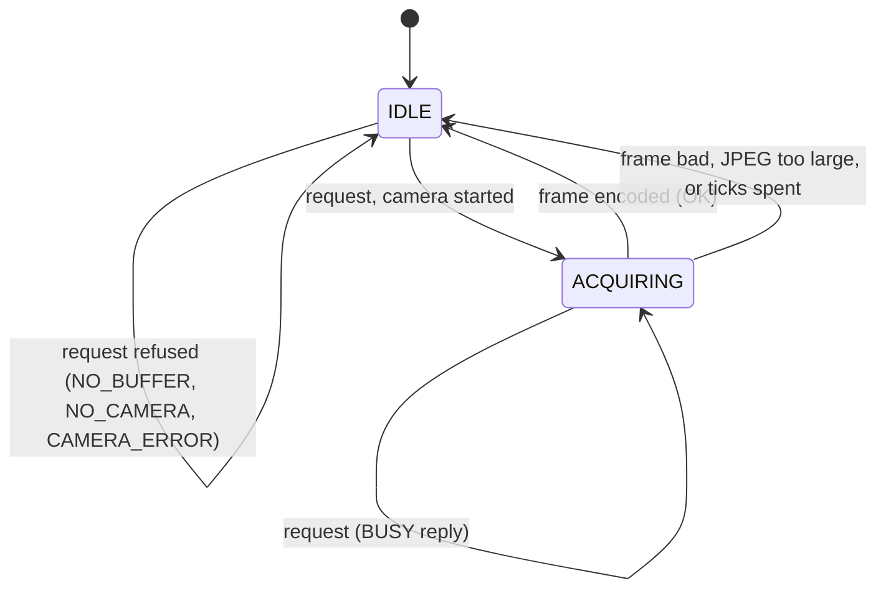
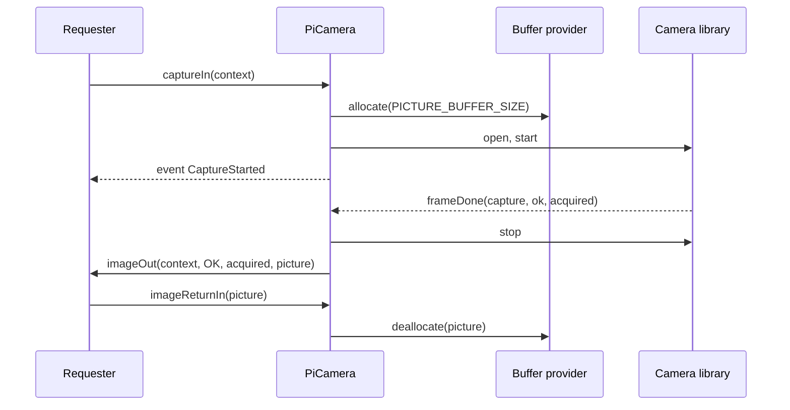

# PiSensor::PiCamera

## 1. Introduction

`PiCamera` manages the Raspberry Pi Camera attached to the CSI port of a
Raspberry Pi 5. On each capture request it acquires one still picture, encodes
it as a JPEG, stamps it with the time the frame was acquired and hands it to
the requester, or reports why it could not. It uses the camera library packaged
with Raspberry Pi OS and no OpenCV. The camera module is not yet attached to the
bench: its model, datasheet and identification reply are recorded on arrival.

## 2. Requirements

| ID | Requirement | Verification |
|---|---|---|
| REQ-PiCamera-001 | A success reply shall carry one picture acquired from the Pi Camera after its request. | Integration Test |
| REQ-PiCamera-002 | Each delivered picture shall be one JFIF file, SOI to EOI, `PICTURE_WIDTH` x `PICTURE_HEIGHT` pixels. | Integration Test |
| REQ-PiCamera-003 | Each delivered picture shall carry the system time read when its frame arrived. | Unit Test |
| REQ-PiCamera-004 | The component shall answer each capture request with exactly one reply. | Unit Test |
| REQ-PiCamera-005 | Each reply shall state success, or the Table 1 reason whose condition occurred. | Unit Test |
| REQ-PiCamera-006 | Each reply shall carry the context value of its request. | Unit Test |
| REQ-PiCamera-007 | The component shall emit `CaptureStarted` (`ACTIVITY_LO`) once per acquisition, before requesting the camera frame. | Unit Test |
| REQ-PiCamera-008 | The component shall reply within `CAPTURE_TIMEOUT_TICKS` ticks of receiving a request. | Unit Test |
| REQ-PiCamera-009 | A failure reply shall carry no picture. | Unit Test |
| REQ-PiCamera-010 | After a failure reply the component shall hold no picture buffer of that request. | Unit Test |
| REQ-PiCamera-011 | Each failure reply shall emit one `CaptureFailed` (`WARNING_LO`) naming its Table 1 reason. | Unit Test |
| REQ-PiCamera-012 | A request received before the reply to an earlier request shall get a `BUSY` reply. | Unit Test |
| REQ-PiCamera-013 | A capture shall end with the same reply whether or not requests arrive during it. | Unit Test |
| REQ-PiCamera-014 | A request made after a failure's cause has cleared shall succeed without a restart. | Integration Test |
| REQ-PiCamera-015 | The component shall publish each Table 2 channel after every reply that changes it. | Unit Test |
| REQ-PiCamera-016 | The component shall use only Raspberry Pi OS packaged camera libraries, not OpenCV. | Inspection |
| REQ-PiCamera-017 | Camera use shall be compliant with the libcamera API of `libcamera-dev` 0.8.0. | Integration Test |
| REQ-PiCamera-018 | The component shall release each picture buffer when the requester returns it. | Unit Test |
| REQ-PiCamera-019 | After a restart during a capture, the first request shall succeed. | Integration Test |
| REQ-PiCamera-020 | The component shall release only picture buffers it delivered and has not yet released. | Unit Test |
| REQ-PiCamera-021 | A returned buffer the component does not release shall emit `ReturnRejected` (`WARNING_LO`). | Unit Test |

Table 1: failure reasons.

| Reason | Condition |
|---|---|
| `NO_CAMERA` | No camera is detected |
| `CAMERA_ERROR` | The camera, its library or the JPEG encoding reports an error or yields no complete picture |
| `TIMEOUT` | No picture was ready within `CAPTURE_TIMEOUT_TICKS` ticks of the request |
| `NO_BUFFER` | No picture buffer is available, or the last delivered picture is not yet returned |
| `TOO_LARGE` | The JPEG does not fit the picture buffer |
| `BUSY` | An earlier request has no reply yet |

Table 2: telemetry.

| Channel | Content |
|---|---|
| `CapturesCompleted` | Count of success replies since start |
| `CapturesFailed` | Count of failure replies since start |
| `LastPictureSize` | Size in bytes of the last delivered JPEG |

Table 3: constants.

| Constant | Value | Meaning |
|---|---|---|
| `CAPTURE_TIMEOUT_TICKS` | 10 | Ticks of the `run` port from receipt of a request to its reply |
| `PICTURE_WIDTH`, `PICTURE_HEIGHT` | 640, 480 | Picture size in pixels |

External References

| Document | Identifier / Revision | Type | Governs |
|---|---|---|---|
| libcamera public API | `libcamera-dev` 0.8.0+rpt20261104-1, Raspberry Pi OS 13 (trixie) archive | Other | camera discovery, configuration, frame request |
| JPEG File Interchange Format | JFIF 1.02; ITU-T T.81 | Standard | picture encoding |

## 3. Design

### 3.1 Component Diagram

```
                      +------------------------+
captureIn :         [ ]                        [ ] imageOut : PiSensor.CaptureReply
PiSensor.CaptureRequest                        |
imageReturnIn :     [ ]       PiCamera         [ ] allocate : Fw.BufferGet
Fw.BufferSend         |                        |
run : Svc.Sched     [ ]                        [ ] deallocate : Fw.BufferSend
                      +------------------------+
  special ports: eventOut, textEventOut, tlmOut, timeGetOut
```

### 3.2 Ports

| Name | Kind | Type | Purpose |
|---|---|---|---|
| `captureIn` | async input, hook | `PiSensor.CaptureRequest` | Request for one picture |
| `imageOut` | output | `PiSensor.CaptureReply` | One reply per request |
| `imageReturnIn` | async input, hook | `Fw.BufferSend` | Delivered picture buffer comes back |
| `run` | async input, drop | `Svc.Sched` | Tick that counts the capture timeout |
| `allocate` | output | `Fw.BufferGet` | Gets the picture buffer |
| `deallocate` | output | `Fw.BufferSend` | Releases the picture buffer |
| `frameDone` | internal, drop | — | Camera library thread reports the frame |

A capture request that finds the queue full gets a `BUSY` reply, and a returned buffer that finds it full emits `ReturnRejected`.

`CaptureReply` carries `context: U32`, `status: CaptureStatus`, `acquired: Fw.Time` and `picture: Fw.Buffer`; `CaptureStatus` is `OK` or a Table 1 reason.

### 3.3 State

| Member | Values | Meaning |
|---|---|---|
| `m_state` | `IDLE`, `ACQUIRING` | A request without a reply exists |
| `m_context` | U32 | Context of the request in `ACQUIRING` |
| `m_capture` | U32 | Number of the current capture; a frame report with another number is discarded |
| `m_ticks` | 0..`CAPTURE_TIMEOUT_TICKS` | Ticks since the request in `ACQUIRING` |
| `m_buffer` | `Fw.Buffer` | Picture buffer of the request in `ACQUIRING` |
| `m_delivered` | `Fw.Buffer` or invalid | The delivered picture not yet returned |
| `m_completed`, `m_failed` | U32 | Counts behind `CapturesCompleted`, `CapturesFailed` |



### 3.4 Configuration and Setup

```fpp
constant PICTURE_WIDTH = 640
constant PICTURE_HEIGHT = 480
constant PICTURE_BUFFER_SIZE = 262144
constant CAPTURE_TIMEOUT_TICKS = 10
constant FRAME_DEADLINE_TICKS = 8
constant SETTLE_FRAMES = 10
```

Picture size, size of the buffer asked per capture, reply limit in ticks, the tick after which a frame is no longer encoded, and the frames discarded while exposure settles.

```fpp
instance piCamera: PiSensor.PiCamera base id 0x10008000 queue size 5 stack size 65536 priority 30
```

The instance of the system sketch; `run` is driven at 1 Hz.

The camera is reached through one interface class (`open`, `start`, `stop`, `close`, frame access) with a libcamera implementation; unit tests substitute it.

### 3.5 Port Handlers

#### captureIn

Admitted always. In `ACQUIRING` it replies `BUSY`; in `IDLE` it gets a buffer, opens and starts the camera, emits `CaptureStarted` and enters `ACQUIRING`, or replies the Table 1 reason of the step that failed.

#### frameDone

Admitted in `ACQUIRING` when its capture number is current and `m_ticks` is below `FRAME_DEADLINE_TICKS`. It stops the camera, encodes the frame into the buffer and replies `OK` with the reported time, or releases the buffer and replies `CAMERA_ERROR` or `TOO_LARGE`.

#### run

Admitted in `ACQUIRING`. It counts a tick and at `CAPTURE_TIMEOUT_TICKS` stops the camera, releases the buffer and replies `TIMEOUT`.

#### imageReturnIn

Admitted when the buffer is the delivered picture. It releases the buffer and forgets it; any other buffer is left alone and emits `ReturnRejected`.

Every reply path publishes the changed Table 2 channels; every failure reply emits `CaptureFailed` with its reason.

## 4. Data Product Format

None; the picture leaves through `imageOut` and the requester builds the data product.

## 5. Ground Interface

The component has no commands and no parameters.

| Telemetry | Type | Content |
|---|---|---|
| `CapturesCompleted` | U32 | Count of success replies since start |
| `CapturesFailed` | U32 | Count of failure replies since start |
| `LastPictureSize` | U32 | Size in bytes of the last delivered JPEG |

| Event | Severity | Arguments | Meaning |
|---|---|---|---|
| `CaptureStarted` | `ACTIVITY_LO` | `context` | Acquisition of a picture begins |
| `CaptureFailed` | `WARNING_LO` | `context`, `reason` | A request got a failure reply |
| `ReturnRejected` | `WARNING_LO` | `bytes` | A returned buffer was not released |

## 6. Example Uses



## 7. Idiosyncrasies

| Failure or limit | Owner |
|---|---|
| Camera model, sensor modes and identification reply | Recorded when the camera is attached |
| Requester never returns a picture: later requests get `NO_BUFFER` | Requester |
| Picture content (exposure, focus, scene) | Not judged |
| Command failure, `WARNING_HI` event and product removal after a failure reply | Requester |

## 8. Tests

<!-- fth:tests:begin -->
_Generated by `fth render-sdd-tests` from the plan — do not edit by hand; the package renderer fails when this table and the plan disagree._

| Test | Purpose | Requirements |
|---|---|---|
| L0-1 | Proves the running image is the manifest's image. | — |
| L0-2 | Proves the image links the packaged libcamera of the pinned version and no OpenCV. | REQ-PiCamera-017 |
| L2-1 | Proves a capture request delivers one 640x480 JFIF picture acquired after the request. | REQ-PiCamera-001, REQ-PiCamera-002, REQ-PiCamera-017 |
| L2-2 | Proves each capture delivers a newly acquired 640x480 JFIF picture. | REQ-PiCamera-001, REQ-PiCamera-002, REQ-PiCamera-017 |
| L3-1 | Proves the first capture after a process kill during a capture succeeds. | REQ-PiCamera-019 |
| L3-2 | Proves the first capture after a service restart during a capture succeeds. | REQ-PiCamera-019 |
| L5-1 | Proves an absent camera gives NO_CAMERA and the next capture succeeds without a restart. | REQ-PiCamera-014 |
| L5-2 | Proves a camera in use elsewhere gives CAMERA_ERROR and the next capture succeeds without a restart. | REQ-PiCamera-014 |
| L7-1 | Proves the last picture on board is the 640x480 JFIF picture received at the ground. | REQ-PiCamera-001, REQ-PiCamera-002 |
<!-- fth:tests:end -->

### Unit-test list

| Test | Description | Requirements |
|---|---|---|
| CaptureDeliversPicture | A request with a good frame gets one `OK` reply carrying the encoded picture. | REQ-PiCamera-004, REQ-PiCamera-005 |
| AcquisitionTimeIsFrameTime | The reply carries the system time read when the frame arrived. | REQ-PiCamera-003 |
| ReplyEchoesContext | Success and every failure reply carry the context of their request. | REQ-PiCamera-006 |
| CaptureStartedOncePerAcquisition | `CaptureStarted` is emitted once, before the camera is asked for a frame. | REQ-PiCamera-007 |
| NoCameraFails | No camera detected gives one `NO_CAMERA` reply, event and no buffer held. | REQ-PiCamera-005, REQ-PiCamera-009, REQ-PiCamera-010, REQ-PiCamera-011 |
| CameraErrorFails | Each camera step error and a bad frame give `CAMERA_ERROR`. | REQ-PiCamera-005, REQ-PiCamera-009, REQ-PiCamera-010, REQ-PiCamera-011 |
| TimeoutFails | No frame gives `TIMEOUT` at tick `CAPTURE_TIMEOUT_TICKS`, not before. | REQ-PiCamera-005, REQ-PiCamera-008, REQ-PiCamera-009, REQ-PiCamera-010, REQ-PiCamera-011 |
| FrameAfterDeadlineIgnored | A frame at or after `FRAME_DEADLINE_TICKS` is not encoded and `TIMEOUT` follows. | REQ-PiCamera-004, REQ-PiCamera-008 |
| LateFrameOfEarlierCaptureIgnored | A frame report of a timed-out capture does not answer the next request. | REQ-PiCamera-004, REQ-PiCamera-005 |
| NoBufferFails | An invalid or short allocation gives `NO_BUFFER` and the camera is not started. | REQ-PiCamera-005, REQ-PiCamera-009, REQ-PiCamera-011 |
| PictureOutstandingFails | A request before the delivered picture returns gives `NO_BUFFER`. | REQ-PiCamera-005, REQ-PiCamera-020 |
| TooLargeFails | A JPEG larger than the buffer gives `TOO_LARGE` and the buffer is released. | REQ-PiCamera-005, REQ-PiCamera-009, REQ-PiCamera-010, REQ-PiCamera-011 |
| BusyDuringCapture | A request during a capture gets `BUSY` and the capture ends with the same reply. | REQ-PiCamera-012, REQ-PiCamera-013 |
| BusyOnQueueOverflow | A request that finds the queue full gets `BUSY` from the hook. | REQ-PiCamera-004, REQ-PiCamera-012 |
| TelemetryAfterEachReply | Each reply publishes the Table 2 channels it changed, with their values. | REQ-PiCamera-015 |
| ReturnReleasesPicture | Returning the delivered picture releases it once and allows the next capture. | REQ-PiCamera-018 |
| UnknownReturnRejected | A buffer not delivered, or returned twice, is not released and emits `ReturnRejected`. | REQ-PiCamera-020, REQ-PiCamera-021 |
| ReturnOverflowRejected | A returned buffer that finds the queue full emits `ReturnRejected`. | REQ-PiCamera-021 |
| RunWhileIdle | Ticks in `IDLE` send no reply, event or telemetry. | REQ-PiCamera-004 |
| RandomRequestsAndFaults | Random requests, frames, ticks and returns keep one reply per request and no leaked buffer. | REQ-PiCamera-004, REQ-PiCamera-010, REQ-PiCamera-018 |
| REQ-PiCamera-016 | No test: inspection of the build inputs and linked libraries. | REQ-PiCamera-016 |
