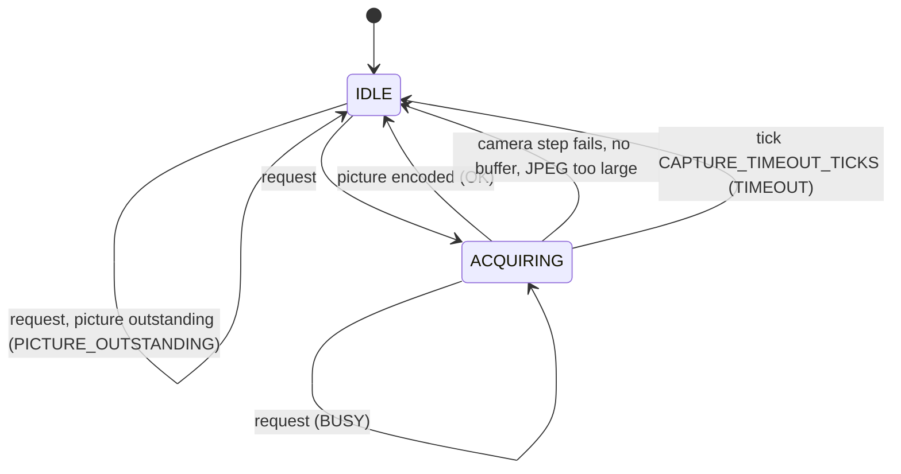
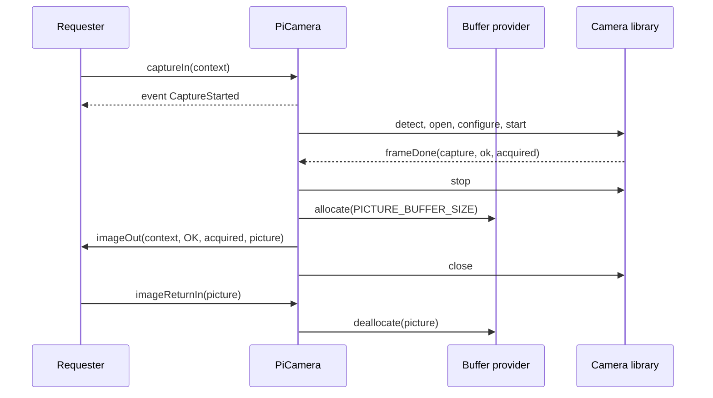

# PiSensor::PiCamera

## 1. Introduction

`PiCamera` manages the Raspberry Pi Camera attached to the CSI port of a
Raspberry Pi 5. On each capture request it acquires one still picture, encodes
it as a JPEG, stamps it with the time the frame was acquired and hands it to
the requester, or reports why it could not. It uses the camera library packaged
with Raspberry Pi OS and no OpenCV. The camera module is not yet attached to the
bench: its model, datasheet and identification reply are recorded on arrival.

Open: camera model, datasheet (title, revision) and identification reply. A camera
that libcamera does not support reopens REQ-PiCamera-001, 002 and 017.

## 2. Requirements

| ID | Requirement | Traces to | Verification |
|---|---|---|---|
| REQ-PiCamera-001 | A success reply shall carry one picture acquired from the Pi Camera after its request. | REQ-PiSensor-004, REQ-PiSensor-005 | Integration Test |
| REQ-PiCamera-002 | Each delivered picture shall be one JFIF file, SOI to EOI, `PICTURE_WIDTH` x `PICTURE_HEIGHT` pixels. | REQ-PiSensor-004 | Integration Test |
| REQ-PiCamera-003 | Each delivered picture shall carry the system time read when its frame arrived. | REQ-PiSensor-006, REQ-PiSensor-007, REQ-PiSensor-008 | Unit Test |
| REQ-PiCamera-004 | The component shall answer each capture request with exactly one reply. | REQ-PiSensor-005 | Unit Test |
| REQ-PiCamera-005 | Each reply shall state success, or the Table 1 reason whose condition occurred. | REQ-PiSensor-005, REQ-PiSensor-028 | Unit Test |
| REQ-PiCamera-006 | Each reply shall carry the context value of its request. | REQ-PiSensor-005 | Unit Test |
| REQ-PiCamera-007 | The component shall emit `CaptureStarted` (`ACTIVITY_LO`) once per acquisition, before requesting the camera frame. | REQ-PiSensor-029 | Unit Test |
| REQ-PiCamera-008 | The component shall reply within `CAPTURE_TIMEOUT_TICKS` ticks of receiving a request. | REQ-PiSensor-010 | Unit Test |
| REQ-PiCamera-009 | A failure reply shall carry no picture. | REQ-PiSensor-028, REQ-PiSensor-029 | Unit Test |
| REQ-PiCamera-010 | After a failure reply the component shall hold no picture buffer of that request. | REQ-PiSensor-029 | Unit Test |
| REQ-PiCamera-011 | Each failure reply shall emit one `CaptureFailed` (`WARNING_LO`) naming its Table 1 reason. | REQ-PiSensor-028 | Unit Test |
| REQ-PiCamera-012 | A request received before the reply to an earlier request shall get a `BUSY` reply. | Proposal | Unit Test |
| REQ-PiCamera-013 | A capture shall end with the same reply whether or not requests arrive during it. | Proposal | Unit Test |
| REQ-PiCamera-014 | A request made after a failure's cause has cleared shall succeed without a restart. | REQ-PiSensor-028 | Integration Test |
| REQ-PiCamera-015 | The component shall publish each Table 2 channel whenever its value changes. | Proposal | Unit Test |
| REQ-PiCamera-016 | The component shall use only Raspberry Pi OS packaged camera and JPEG libraries, not OpenCV. | REQ-PiSensor-040 | Inspection, Integration Test |
| REQ-PiCamera-017 | Camera use shall be compliant with the libcamera API of `libcamera-dev` 0.8.0. | REQ-PiSensor-040 | Integration Test |
| REQ-PiCamera-018 | The component shall release each picture buffer when the requester returns it. | Proposal | Unit Test |
| REQ-PiCamera-019 | After a restart during a capture, the first request shall succeed. | REQ-PiSensor-029 | Integration Test |
| REQ-PiCamera-020 | The component shall release only picture buffers it delivered and has not yet released. | Proposal | Unit Test |
| REQ-PiCamera-021 | A returned buffer the component does not release shall emit `ReturnRejected` (`WARNING_LO`). | Proposal | Unit Test |
| REQ-PiCamera-022 | By its first `run` tick the component shall emit once `CameraFound` (`ACTIVITY_LO`) carrying the libcamera camera id, or `CameraNotFound` (`WARNING_LO`). | Proposal | Unit Test |
| REQ-PiCamera-023 | Each `CaptureFailed` shall carry the Table 4 step of its failure and the failing library call's return code, 0 when none failed. | Proposal | Unit Test |
| REQ-PiCamera-024 | The component shall publish every Table 2 channel once by its first `run` tick. | Proposal | Unit Test |

Every system requirement allocated to this component (REQ-PiSensor-004, 005, 006, 007, 008, 010, 028, 029, 040) is reached by a row. A `Proposal` row derives from no allocated system requirement; it is proposed by the writer and decided at the Approve SDD gate.

Table 1: failure reasons.

| Reason | Condition |
|---|---|
| `NO_CAMERA` | No camera is detected |
| `CAMERA_ERROR` | The camera, its library or the JPEG encoding reports an error or yields no complete picture |
| `TIMEOUT` | No picture was ready within `CAPTURE_TIMEOUT_TICKS` ticks of the request |
| `NO_BUFFER` | No picture buffer is available |
| `PICTURE_OUTSTANDING` | The last delivered picture is not yet returned |
| `TOO_LARGE` | The JPEG does not fit the picture buffer |
| `BUSY` | An earlier request has no reply yet |

`BUSY` and `PICTURE_OUTSTANDING` are decided on receipt, before any other reason.

Table 2: telemetry.

| Channel | Content |
|---|---|
| `CapturesCompleted` | Count of success replies since start |
| `CapturesFailed` | Count of failure replies since start |
| `LastPictureSize` | Size in bytes of the last delivered JPEG, 0 before the first |
| `CameraPresent` | A camera was detected at the last detection |
| `PictureOutstanding` | A delivered picture is not yet returned |

Table 3: constants.

| Constant | Value | Meaning |
|---|---|---|
| `CAPTURE_TIMEOUT_TICKS` | 10 | Ticks of the `run` port from receipt of a request to its reply |
| `PICTURE_WIDTH`, `PICTURE_HEIGHT` | 640, 480 | Picture size in pixels |

Table 4: failure steps.

| Reason | Steps |
|---|---|
| `BUSY` | `RECEIVE` |
| `PICTURE_OUTSTANDING` | `RETURN` |
| `NO_CAMERA` | `DETECT` |
| `CAMERA_ERROR` | `OPEN`, `CONFIGURE`, `START`, `FRAME`, `ENCODE` |
| `NO_BUFFER` | `ALLOCATE` |
| `TOO_LARGE` | `ENCODE` |
| `TIMEOUT` | `TICKS` |

External References

| Document | Identifier / Revision | Type | Governs |
|---|---|---|---|
| libcamera public API | `libcamera-dev` 0.8.0+rpt20261104-1, Raspberry Pi OS 13 (trixie) archive | Other | camera discovery, configuration, frame request |
| libjpeg-turbo API | `libjpeg62-turbo-dev` 1:2.1.5-4, Debian 13 (trixie) main, as shipped by Raspberry Pi OS 13 | Other | JPEG compression calls |
| JPEG File Interchange Format | JFIF 1.02; ITU-T T.81 | Standard | picture encoding |

## 3. Design

### 3.1 Component Diagram

```
                           ┌────────────────────┐
captureIn :               [ ]                  [ ] imageOut : PiSensor.CaptureReply
PiSensor.CaptureRequest    │                    │
imageReturnIn :           [ ]     PiCamera     [ ] allocate : Fw.BufferGet
Fw.BufferSend              │      (active)      │
run : Svc.Sched           [ ]                  [ ] deallocate : Fw.BufferSend
                           │                    │
pingIn : Svc.Ping         [ ]                  [ ] pingOut : Svc.Ping
                           └────────────────────┘
  special ports: eventOut, textEventOut, tlmOut, timeGetOut
```

`PiCamera` is an active component: its thread makes the camera calls, which take seconds.

### 3.2 Ports

| Name | Kind | Type | Purpose |
|---|---|---|---|
| `captureIn` | guarded input | `PiSensor.CaptureRequest` | Request for one picture |
| `imageOut` | output | `PiSensor.CaptureReply` | One reply per request; connects to an async input |
| `imageReturnIn` | guarded input | `Fw.BufferSend` | Delivered picture buffer comes back |
| `run` | guarded input | `Svc.Sched` | 1 Hz tick that counts the capture timeout |
| `allocate` | output | `Fw.BufferGet` | Gets the picture buffer |
| `deallocate` | output | `Fw.BufferSend` | Releases the picture buffer |
| `pingIn`, `pingOut` | async input (drop), output | `Svc.Ping` | Health ping of the component thread |
| `detect` | internal, drop | — | Camera detection at start |
| `acquire` | internal, drop | — | Camera work of one capture |
| `abort` | internal, drop | — | Camera teardown of a capture that timed out |
| `frameDone` | internal, drop | — | Camera library thread reports the frame |

`CaptureStatus`, `CaptureRequest` and `CaptureReply` are in `Components/CapturePorts`, a library of their own, so a requester does not link the camera library.

`CaptureReply` carries `context: U32`, `status: CaptureStatus`, `acquired: Fw.Time` and `picture: Fw.Buffer`; the size of `picture` is the JPEG length in bytes.

Pattern: guarded front, worker thread. Requests, returns and the timeout are decided in the caller's thread under the guard; only camera-library calls run on the component thread, so a stuck library call cannot delay a reply.

Three threads enter the component.

| Thread | Runs | Touches |
|---|---|---|
| Caller of a guarded port | `captureIn`, `imageReturnIn`, `run` | Table of 3.3, under the component guard |
| Component thread | `detect`, `acquire`, `abort`, `frameDone`, `pingIn` | Camera interface, outside the guard; table of 3.3 and the encoder, under the guard |
| Camera library thread | Frame callback of the camera interface | Reads the time, counts settle frames, sends `frameDone`; no member of 3.3 |

### 3.3 State

| Member | Values | Meaning |
|---|---|---|
| `m_state` | `IDLE`, `ACQUIRING` | A request without a reply exists |
| `m_context` | U32 | Context of the request in `ACQUIRING` |
| `m_capture` | U32 | Number of the current capture; compared for equality only |
| `m_ticks` | 0..`CAPTURE_TIMEOUT_TICKS` | Ticks since receipt of the request in `ACQUIRING` |
| `m_delivered` | `Fw.Buffer` or invalid | The delivered picture not yet returned |
| `m_completed`, `m_failed` | U32 | Counts behind `CapturesCompleted`, `CapturesFailed`; wrap to 0 after 4294967295 |
| `m_detected` | bool | `detect` was sent |

At start `m_state` is `IDLE`, `m_delivered` is invalid, the counts are 0 and the camera is closed, whatever an earlier run left.

The camera interface is closed, open or started, and only the component thread changes it. It is left open or started only for the current capture, between its `acquire` and its `frameDone` or `abort`.



### 3.4 Configuration and Setup

```fpp
constant PICTURE_WIDTH = 640
constant PICTURE_HEIGHT = 480
constant PICTURE_BUFFER_SIZE = 262144
constant CAPTURE_TIMEOUT_TICKS = 10
constant SETTLE_FRAMES = 10
```

Picture size, size of the buffer asked per capture, reply limit in ticks, and the frames discarded while exposure settles.

```fpp
instance piCamera: PiSensor.PiCamera base id 0x10008000 queue size 10 stack size 1048576 priority 30
```

The instance of the system sketch with a larger queue and stack; `run` connects to the 1 Hz rate group.

`allocate` and `deallocate` connect to one `Svc.BufferManager` that holds at least one buffer of `PICTURE_BUFFER_SIZE` bytes for this component; the component holds at most one.

The camera is reached through one interface class (`detect`, `open`, `configure`, `start`, `stop`, `close`, frame access) implemented with libcamera; JPEG encoding uses libjpeg-turbo. Both are Raspberry Pi OS packages. Unit tests substitute the interface. The CMake option `PICAMERA_NO_CAMERA` selects an implementation that detects no camera; with the option off, a build that finds no libcamera fails.

### 3.5 Port Handlers

#### captureIn

Admitted always. In `ACQUIRING` it replies `BUSY`; with a picture outstanding it replies `PICTURE_OUTSTANDING`. Otherwise it takes the next capture number, zeroes `m_ticks`, enters `ACQUIRING`, emits `CaptureStarted` and sends `acquire`.

#### acquire

It first closes a camera left open. Admitted further when its capture number is current: it detects, opens, configures and starts the camera outside the guard. A step that fails closes the camera and, when the capture is still current, replies `NO_CAMERA` or `CAMERA_ERROR`.

#### frameDone

The camera interface discards `SETTLE_FRAMES` frames, reports the next one once and keeps its pixels unchanged until `close`.

Admitted when its capture number is current; a report of another capture is discarded and touches nothing.

The handler stops the camera. Under the guard, when its capture number is still current, it gets a buffer, encodes the frame into it and replies `OK` with the reported time, or releases the buffer and replies `CAMERA_ERROR`, `NO_BUFFER` or `TOO_LARGE`. It then closes the camera.

The guard is held from allocation to reply, so a tick cannot end a capture whose buffer is in use. The hold is bounded by the encoding of one `PICTURE_WIDTH` x `PICTURE_HEIGHT` frame; no camera call and no wait happens under the guard, and guarded handlers make no camera call. The guard is held for at most 100 ms, measured on the target in DEVELOPMENT; a measurement above that moves encoding outside the guard behind an `ENCODING` state in which a tick does not end the capture.

#### run

The first tick sends `detect`. In `ACQUIRING` it counts a tick and at `CAPTURE_TIMEOUT_TICKS` replies `TIMEOUT`, enters `IDLE` and sends `abort`, also while the component thread is inside a camera call.

#### abort

It stops and closes the camera when the camera of its capture is still open.

#### detect

It detects the camera, emits `CameraFound` with the library's identification or `CameraNotFound`, and publishes every channel once.

#### imageReturnIn

Admitted when the buffer's data pointer is that of the delivered picture. It releases the buffer and forgets it; any other buffer is left alone and emits `ReturnRejected`.

#### pingIn

It echoes the key on `pingOut`.

Every reply publishes the channels it changed. Every failure reply emits `CaptureFailed` with its reason, its step and the library return code; each reason and step pair of Table 4 has one emission site.

## 4. Data Product Format

None; the picture leaves through `imageOut` and the requester builds the data product.

## 5. Ground Interface

The component has no commands and no parameters.

| Telemetry | Type | Content |
|---|---|---|
| `CapturesCompleted` | U32 | Count of success replies since start |
| `CapturesFailed` | U32 | Count of failure replies since start |
| `LastPictureSize` | U32 | Size in bytes of the last delivered JPEG |
| `CameraPresent` | bool | A camera was detected at the last detection |
| `PictureOutstanding` | bool | A delivered picture is not yet returned |

| Event | Severity | Arguments | Meaning |
|---|---|---|---|
| `CaptureStarted` | `ACTIVITY_LO` | `context` | Acquisition of a picture begins |
| `CaptureFailed` | `WARNING_LO` | `context`, `reason`, `step`, `code` | A request got a failure reply |
| `ReturnRejected` | `WARNING_LO` | `bytes` | A returned buffer was not released |
| `CameraFound` | `ACTIVITY_LO` | `camera` | A camera is detected at start |
| `CameraNotFound` | `WARNING_LO` | — | No camera is detected at start |

## 6. Example Uses



## 7. Idiosyncrasies

| Failure or limit | Owner |
|---|---|
| Camera model, sensor modes and identification reply | Recorded when the camera is attached; `CameraFound` reports it |
| Requester never returns a picture: later requests get `PICTURE_OUTSTANDING` | Requester |
| Component thread stuck in a camera call: requests get `TIMEOUT`, health ping fails | System health |
| Longest camera call expected is under 2 s; the ping limits of `piCamera` are set above it | Topology |
| Constants change by rebuild only | Deployment |
| Guard held during encoding delays the 1 Hz rate group and the requester by the encoding time | Component (bound in 3.5) |
| Picture content (exposure, focus, scene) | Not judged |
| Command failure, `WARNING_HI` event and product removal after a failure reply | Requester |

Differences from the system sketch:

- `imageOut` is `PiSensor.CaptureReply`, so the reply carries status and acquisition time; the requester's input changes with it.
- `captureIn` and `imageReturnIn` are guarded, so refusals and returns need no queue.
- `run` joins the 1 Hz rate group, so the timeout is counted off the component thread.
- `pingIn` and `pingOut` join the health pattern.
- One delivered picture is outstanding at a time.

## 8. Tests

<!-- fth:tests:begin -->
_Generated by `fth render-sdd-tests` from the plan — do not edit by hand; the package renderer fails when this table and the plan disagree._

| Test | Purpose | Requirements |
|---|---|---|
| L0-1 | Proves the running image is the manifest's image. | — |
| L0-2 | Proves the image runs the packaged libcamera of the pinned version and links no OpenCV. | REQ-PiCamera-016, REQ-PiCamera-017 |
| L0-3 | Proves the bench can make the camera unavailable and available without a process restart. | — |
| L0-4 | Proves a capture lasts long enough for the bench to act between CaptureStarted and the reply. | — |
| L0-5 | Proves the bench holder process owns the camera within the settle time the fault test uses. | — |
| L2-1 | Proves a capture request delivers one 640x480 JFIF picture acquired after the request. | REQ-PiCamera-001, REQ-PiCamera-002, REQ-PiCamera-017 |
| L2-2 | Proves each capture delivers a newly acquired 640x480 JFIF picture. | REQ-PiCamera-001, REQ-PiCamera-002, REQ-PiCamera-017 |
| L3-1 | Proves the first capture after a process kill during a capture succeeds. | REQ-PiCamera-019 |
| L3-2 | Proves the first capture after a service restart during a capture succeeds. | REQ-PiCamera-019 |
| L5-1 | Proves an absent camera gives NO_CAMERA and the next capture succeeds without a restart. | REQ-PiCamera-014 |
| L5-2 | Proves a camera in use elsewhere gives CAMERA_ERROR and the next capture succeeds without a restart. | REQ-PiCamera-014 |
| L7-1 | Leaves the final-state record: the last picture on board is the 640x480 JFIF picture received at the ground. | REQ-PiCamera-001, REQ-PiCamera-002 |
<!-- fth:tests:end -->

### Unit-test list

| Test | Description | Requirements |
|---|---|---|
| CaptureDeliversPicture | A request with a good frame gets one `OK` reply carrying the encoded picture. | REQ-PiCamera-004, REQ-PiCamera-005 |
| AcquisitionTimeIsFrameTime | The reply carries the system time read when the frame arrived. | REQ-PiCamera-003 |
| ReplyEchoesContext | Success and every failure reply carry the context of their request. | REQ-PiCamera-006 |
| CaptureStartedOncePerAcquisition | `CaptureStarted` is emitted once, before the camera is asked for a frame. | REQ-PiCamera-007 |
| NoCameraFails | No camera detected gives one `NO_CAMERA` reply, event and no buffer held. | REQ-PiCamera-005, REQ-PiCamera-009, REQ-PiCamera-010, REQ-PiCamera-011 |
| CameraErrorFails | Each camera step error and a bad frame give `CAMERA_ERROR`. | REQ-PiCamera-005, REQ-PiCamera-009, REQ-PiCamera-010, REQ-PiCamera-011 |
| TimeoutFails | No frame gives `TIMEOUT` at tick `CAPTURE_TIMEOUT_TICKS`, not before. | REQ-PiCamera-005, REQ-PiCamera-008, REQ-PiCamera-009, REQ-PiCamera-010, REQ-PiCamera-011 |
| TimeoutDuringCameraCall | A tick at `CAPTURE_TIMEOUT_TICKS` while `acquire` has not run replies `TIMEOUT`; the later camera result sends no reply and closes the camera. | REQ-PiCamera-004, REQ-PiCamera-008, REQ-PiCamera-010 |
| LateFrameOfEarlierCaptureIgnored | A frame report of a timed-out capture does not answer the next request and does not stop its camera. | REQ-PiCamera-004, REQ-PiCamera-005, REQ-PiCamera-013 |
| TimeoutClosesCamera | `TIMEOUT` while waiting for a frame closes the camera before the next capture opens it. | REQ-PiCamera-014 |
| AbortDroppedStillCloses | With `abort` dropped, the next `acquire` closes the camera left open. | REQ-PiCamera-014 |
| NoBufferFails | An invalid or short allocation gives `NO_BUFFER`. | REQ-PiCamera-005, REQ-PiCamera-009, REQ-PiCamera-011 |
| PictureOutstandingFails | A request before the delivered picture returns gives one `PICTURE_OUTSTANDING` reply with an invalid buffer and one `CaptureFailed(reason=PICTURE_OUTSTANDING)`. | REQ-PiCamera-005, REQ-PiCamera-009, REQ-PiCamera-011 |
| TooLargeFails | A JPEG larger than the buffer gives `TOO_LARGE` and the buffer is released. | REQ-PiCamera-005, REQ-PiCamera-009, REQ-PiCamera-010, REQ-PiCamera-011 |
| BusyDuringCapture | A request during a capture gets one `BUSY` reply with an invalid buffer and one `CaptureFailed(reason=BUSY)`, and the capture ends with the same reply. | REQ-PiCamera-005, REQ-PiCamera-009, REQ-PiCamera-011, REQ-PiCamera-012, REQ-PiCamera-013 |
| AcquireDroppedTimesOut | A request whose `acquire` finds the queue full gets `TIMEOUT`. | REQ-PiCamera-004, REQ-PiCamera-008 |
| FailureStepAndCode | Each failure site emits its own step value and the library return code. | REQ-PiCamera-023 |
| CameraReportedAtStart | The first tick gives `CameraFound` with the identification, or `CameraNotFound`, once, and every channel. | REQ-PiCamera-022, REQ-PiCamera-024 |
| CameraClosedAfterEachCapture | Success and each failure leave the camera closed. | REQ-PiCamera-014 |
| PingEchoed | A ping returns its key. | — |
| TelemetryOnChange | Each reply, return and detection publishes the Table 2 channels it changed, with their values. | REQ-PiCamera-015 |
| ReturnReleasesPicture | Returning the delivered picture releases it once and allows the next capture. | REQ-PiCamera-018 |
| UnknownReturnRejected | A buffer not delivered, or returned twice, is not released and emits `ReturnRejected`. | REQ-PiCamera-020, REQ-PiCamera-021 |
| RunWhileIdle | Ticks in `IDLE` after the first send no reply, event or telemetry. | REQ-PiCamera-004 |
| RandomRequestsAndFaults | Random requests, frames, ticks and returns keep one reply per request and no leaked buffer. | REQ-PiCamera-004, REQ-PiCamera-010, REQ-PiCamera-018 |
| REQ-PiCamera-016 | No unit test: inspection of the build inputs; L0-2 judges the linked libraries. | REQ-PiCamera-016 |

Component Development Checklist: [checklist.md](checklist.md)
