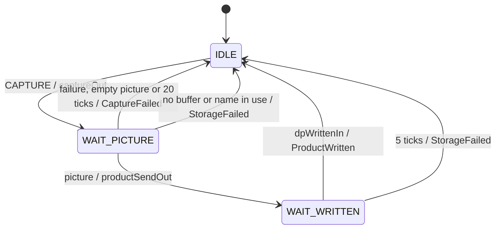
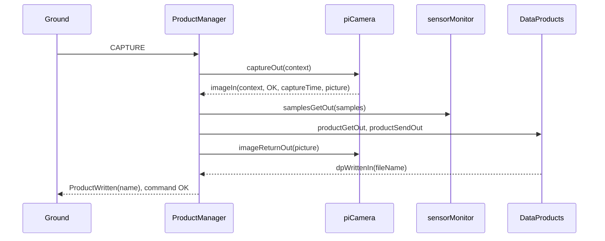
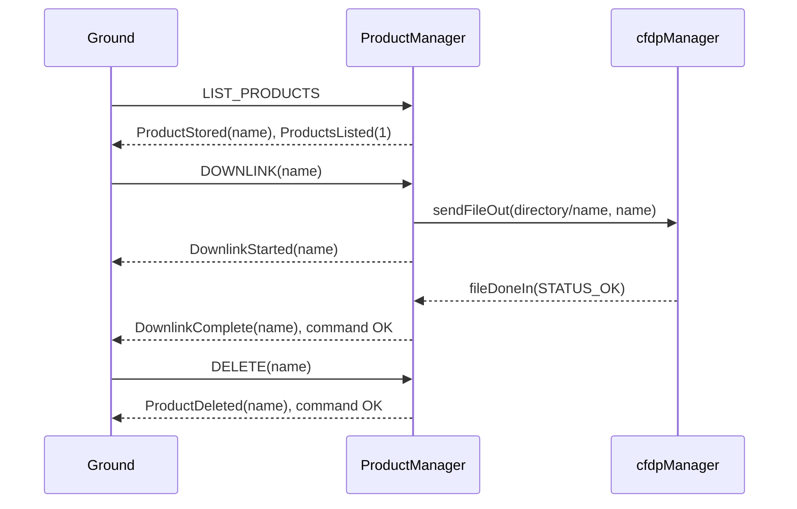

# PiSensor::ProductManager

## 1. Introduction

`ProductManager` runs the capture, downlink, delete and list commands of the PiSensor deployment. On a capture command it asks the camera for one picture, asks the sensor monitor for the latest location, attitude and temperature, and hands them to the storage as one data product; the storage notifies the component when the product file is written.
A stored product is a regular file of the one product directory whose length equals the length its data product header declares; its name is its file name, which the storage derives from the capture time. A partial product is any other regular file of that directory.
The component hands a named product to the CFDP file transfer, removes a named product, and lists the stored products. An activity is a capture, a downlink or a listing; the current capture is the one in progress.

## 2. Requirements

| ID | Requirement | Verification |
|---|---|---|
| REQ-ProductManager-001 | On a `CAPTURE` command, the component shall request one picture from the camera. | Unit Test |
| REQ-ProductManager-002 | On the picture of the capture in progress, the component shall request the latest samples. | Unit Test |
| REQ-ProductManager-003 | Each product shall hold one picture, capture time, location, attitude and temperature record. | Unit Test |
| REQ-ProductManager-004 | The picture record of each product shall equal the delivered picture, byte for byte. | Unit Test |
| REQ-ProductManager-005 | Each metric record shall hold the Table 1 fields as delivered by its source. | Unit Test |
| REQ-ProductManager-006 | Each product file shall comply with the F Prime data product file format. | Unit Test |
| REQ-ProductManager-007 | The capture time record shall equal the acquisition time delivered with the picture. | Unit Test |
| REQ-ProductManager-008 | Each metric record shall carry its sample time and a validity mark. | Unit Test |
| REQ-ProductManager-009 | The component shall mark valid each valid-reported metric sampled within 2 s of capture time. | Unit Test |
| REQ-ProductManager-010 | The component shall mark invalid each metric sampled more than 2 s from capture time. | Unit Test |
| REQ-ProductManager-011 | The component shall mark invalid each metric its source reports invalid. | Unit Test |
| REQ-ProductManager-012 | The component shall return each delivered picture buffer to the camera exactly once. | Unit Test |
| REQ-ProductManager-013 | On the written notification of its product, the component shall complete `CAPTURE` successfully. | Unit Test |
| REQ-ProductManager-014 | On each successful capture, the component shall emit `ACTIVITY_HI` event `ProductWritten` naming the product. | Unit Test |
| REQ-ProductManager-015 | A capture shall leave every stored product unchanged. | Integration Test |
| REQ-ProductManager-016 | The component shall fail `CAPTURE` with `WARNING_HI` event `CaptureFailed` when the camera reports failure. | Unit Test |
| REQ-ProductManager-017 | The component shall fail `CAPTURE` with `CaptureFailed` when the delivered picture is empty. | Unit Test |
| REQ-ProductManager-018 | The component shall fail `CAPTURE` with `CaptureFailed` when no picture arrives within 20 `run` ticks. | Unit Test |
| REQ-ProductManager-019 | The component shall write no product for a picture not of the current capture. | Unit Test |
| REQ-ProductManager-020 | The component shall fail `CAPTURE` with `WARNING_HI` event `StorageFailed` when no product buffer fits. | Unit Test |
| REQ-ProductManager-021 | `CAPTURE` shall fail with `StorageFailed` when no written notification arrives in 5 `run` ticks. | Unit Test |
| REQ-ProductManager-022 | After a failed capture, the component shall remove every partial product. | Unit Test |
| REQ-ProductManager-023 | The component shall remove a product whose written notification is not of the current capture. | Unit Test |
| REQ-ProductManager-024 | At start-up, the component shall remove every partial product. | Unit Test |
| REQ-ProductManager-025 | A `CAPTURE` during a capture shall fail with `WARNING_LO` event `CommandRejected` and not disturb it. | Unit Test |
| REQ-ProductManager-026 | On `DOWNLINK`, the component shall request file transfer of the named product under its name. | Unit Test |
| REQ-ProductManager-027 | The component shall complete `DOWNLINK` successfully when the file transfer reports success. | Unit Test |
| REQ-ProductManager-028 | The component shall fail `DOWNLINK` with `WARNING_HI` event `DownlinkStalled` when the transfer reports failure. | Unit Test |
| REQ-ProductManager-029 | The component shall fail `DOWNLINK` with `WARNING_LO` event `DownlinkRefused` when the transfer refuses the request. | Unit Test |
| REQ-ProductManager-030 | The component shall leave the product file unchanged by a downlink, complete or failed. | Unit Test |
| REQ-ProductManager-031 | A `DOWNLINK` command during a downlink shall fail with `CommandRejected` and not disturb that downlink. | Unit Test |
| REQ-ProductManager-032 | After a `CAPTURE` or `DOWNLINK` completes or fails, the component shall accept the next one. | Unit Test |
| REQ-ProductManager-033 | A `DOWNLINK` or `DELETE` naming no stored product shall fail with `WARNING_LO` event `ProductNotFound`. | Unit Test |
| REQ-ProductManager-034 | On `DELETE`, the component shall remove the named product, then complete the command successfully. | Unit Test |
| REQ-ProductManager-035 | A `DELETE` command naming the product being downlinked shall fail with `CommandRejected`. | Unit Test |
| REQ-ProductManager-036 | On `LIST_PRODUCTS`, the component shall emit `ACTIVITY_LO` event `ProductStored` naming each stored product. | Unit Test |
| REQ-ProductManager-037 | The component shall emit at most 4 `ProductStored` events per `run` tick. | Unit Test |
| REQ-ProductManager-038 | The component shall complete `LIST_PRODUCTS` with `ACTIVITY_HI` event `ProductsListed` counting the `ProductStored` events emitted. | Unit Test |
| REQ-ProductManager-039 | A `LIST_PRODUCTS` command during a listing shall fail with `CommandRejected`. | Unit Test |
| REQ-ProductManager-040 | `DOWNLINK`, `DELETE` and `LIST_PRODUCTS` shall act on every product stored before a restart. | Unit Test |
| REQ-ProductManager-041 | During any activity, a command Table 2 does not reject shall behave as when idle. | Unit Test |
| REQ-ProductManager-042 | The component shall fail a command with `WARNING_HI` event `FileSystemError` on a file system error. | Unit Test |
| REQ-ProductManager-043 | At start-up, the component shall emit `FileSystemError` when the product directory cannot be read. | Unit Test |
| REQ-ProductManager-044 | The component shall return to the camera each picture it cannot queue. | Unit Test |
| REQ-ProductManager-045 | The component shall give a busy response to each command it cannot queue. | Unit Test |
| REQ-ProductManager-046 | `CAPTURE` shall fail with `StorageFailed` when its product name is that of a stored product. | Unit Test |

Table 1: metric records.

| Record | Fields |
|---|---|
| Temperature | temperature (°C) |
| Attitude | roll, pitch (°); gyro rate x, y, z (°/s) |
| Location | latitude, longitude (°); altitude (m) |

Table 2: commands, and the activity during which each is rejected with `CommandRejected`.

| Command | Argument | Rejected during |
|---|---|---|
| `CAPTURE` | none | a capture |
| `DOWNLINK` | product name | a downlink |
| `DELETE` | product name | the downlink of the named product |
| `LIST_PRODUCTS` | none | a listing |

### External References

| Document | Identifier / Revision | Type | Governs |
|---|---|---|---|
| PiSensor SSDD | `docs/ssdd.md` at `ba498d7` | System design | Allocated requirements REQ-PiSensor-004 to -041, decisions D1 to D13 |
| F Prime data product file format | nasa/fprime v4.4.2, `Fw/Dp/docs/sdd.md` | Format | REQ-ProductManager-006 |
| F Prime data product file name | nasa/fprime v4.4.2, `DP_FILENAME_FORMAT` of `config/DpCfg.hpp` | Format | REQ-ProductManager-046 |

## 3. Design

### 3.1. Component Diagram

```
                    +-----------------------------------+
 imageIn : PictureDone []                               [] captureOut : CaptureRequest
 dpWrittenIn : Svc.DpWritten []                         [] imageReturnOut : Fw.BufferSend
 fileDoneIn : Svc.SendFileComplete []  ProductManager   [] samplesGetOut : SamplesGet
 run : Svc.Sched []                      (active)       [] sendFileOut : Svc.SendFileRequest
                    |                                   [] productGetOut : Fw.DpGet
                    |                                   [] productSendOut : Fw.DpSend
                    +-----------------------------------+
   special ports: cmdIn, cmdRegOut, cmdResponseOut, eventOut, textEventOut, timeGetOut
```

### 3.2. Ports

| Name | Kind | Type | Purpose |
|---|---|---|---|
| `captureOut` | output | `CaptureRequest` | Ask the camera for one picture |
| `imageIn` | async input, hook | `PictureDone` | Picture or failure, with acquisition time |
| `imageReturnOut` | output | `Fw.BufferSend` | Return the picture buffer |
| `samplesGetOut` | output | `SamplesGet` | Read the latest sample set |
| `productGetOut` | product get | `Fw.DpGet` | Get a product buffer |
| `productSendOut` | product send | `Fw.DpSend` | Hand the filled product to the storage |
| `dpWrittenIn` | async input | `Svc.DpWritten` | Product file written |
| `sendFileOut` | output | `Svc.SendFileRequest` | Hand a product to the file transfer |
| `fileDoneIn` | async input | `Svc.SendFileComplete` | File transfer ended |
| `run` | async input, drop | `Svc.Sched` | 1 Hz tick for time-outs and listing |

On queue overflow the hooks return the picture buffer to the camera and answer a command with `BUSY`.

### 3.3. State

| Member | Values | Meaning |
|---|---|---|
| `m_capture` | `IDLE`, `WAIT_PICTURE`, `WAIT_WRITTEN` | Capture activity |
| `m_captureContext`, `m_captureTicks` | `U32` | Number of the current capture, matched against `imageIn`; ticks in its state |
| `m_captureName` | file name | Product of the current capture |
| `m_discardName` | file name | Product of a capture that failed in `WAIT_WRITTEN` |
| `m_downlink`, `m_downlinkName` | `IDLE`, `ACTIVE`; file name | Downlink activity and its product |
| `m_listing`, `m_listCount` | `IDLE`, `ACTIVE`; `U32` | Listing activity and its event count |
| `m_scanned` | `bool` | Start-up scan done |



### 3.4. Configuration and Setup

```fpp
constant PICTURE_TIMEOUT_TICKS = 20   # run ticks for the camera to deliver
constant WRITTEN_TIMEOUT_TICKS = 5    # run ticks for the storage to report
constant LIST_EVENTS_PER_TICK = 4     # ProductStored events per tick
constant LIST_ENTRIES_PER_TICK = 64   # directory entries read per tick
constant SCAN_MAX_ENTRIES = 4096      # directory entries of the start-up scan
```

```cpp
productManager.configure(productDirectory);  // the directory Svc.DpWriter writes to
```

`run` is driven at 1 Hz. The product name is formed with `DP_FILENAME_FORMAT` from the container id and the capture time, the rule `Svc.DpWriter` applies.

### 3.5. Behavior

The first handler call in the component thread scans the product directory and removes every partial product.
`CAPTURE` removes the file of `m_discardName`, increments `m_captureContext` and requests a picture. `imageIn` returns the buffer in every case and acts only on the context of the current capture: it reads the samples, sets each validity mark, fails the capture when the product name is that of a stored product, fills the container with the capture time as its time tag, and sends it. `dpWrittenIn` completes the capture when the file name is `m_captureName` and removes the named file otherwise.
`DOWNLINK` and `DELETE` act on a stored product other than `m_captureName`. `DOWNLINK` calls `sendFileOut` with the product as source and its name as destination; `fileDoneIn` ends the downlink and is ignored outside one. `LIST_PRODUCTS` opens the directory and `run` reports its stored products. Section 6 holds the timing diagrams.

## 4. Data Product Format

| Container | Id | Record | Id | Type | Count |
|---|---|---|---|---|---|
| `Capture` | 0 | `CaptureTime` | 0 | `Fw.TimeValue` | 1 |
| | | `Temperature` | 1 | `TemperatureSample` | 1 |
| | | `Attitude` | 2 | `AttitudeSample` | 1 |
| | | `Location` | 3 | `LocationSample` | 1 |
| | | `Picture` | 4 | `U8` array, JPEG bytes as delivered | picture size |

| Struct | Field | Type | Value |
|---|---|---|---|
| all three | `valid` | `bool` | Validity mark |
| all three | `sampleTime` | `Fw.TimeValue` | Sample time |
| `TemperatureSample` | `temperature` | `F32` | °C |
| `AttitudeSample` | `roll`, `pitch` | `F32` | ° |
| `AttitudeSample` | `gyroRate` | `[3] F32` | °/s, x y z |
| `LocationSample` | `latitude`, `longitude` | `F64` | ° |
| `LocationSample` | `altitude` | `F32` | m |

## 5. Ground Interface

| Command | Argument | Effect |
|---|---|---|
| `CAPTURE` | none | Capture one picture and store one product |
| `DOWNLINK` | `name` | Send the named product by CFDP |
| `DELETE` | `name` | Remove the named product |
| `LIST_PRODUCTS` | none | Report the stored products |

| Event | Severity | Arguments | Meaning |
|---|---|---|---|
| `ProductWritten` | activity high | name, size | A capture ended with its product stored |
| `CaptureFailed` | warning high | reason | The camera gave no usable picture |
| `StorageFailed` | warning high | reason | The product could not be stored |
| `CommandRejected` | warning low | reason | Command refused during an activity (Table 2) |
| `DownlinkStarted` | activity high | name | The file transfer accepted the product |
| `DownlinkComplete` | activity high | name | The file transfer delivered the product |
| `DownlinkStalled` | warning high | name | The file transfer ended without delivery |
| `DownlinkRefused` | warning low | name, status | The file transfer refused the request |
| `ProductNotFound` | warning low | name | The name is not that of a stored product |
| `ProductDeleted` | activity high | name | The named product was removed |
| `ProductStored` | activity low | name, size | One stored product of a listing |
| `ProductsListed` | activity high | count | A listing ended |
| `ProductDiscarded` | warning low | name, reason | A file was removed without a `DELETE` |
| `FileSystemError` | warning high | operation, status | The file system reported an error |

The component has no parameters and no telemetry channels.

## 6. Example Uses

A capture, then a listing, downlink and delete of its product.





## 7. Idiosyncrasies

| Out of scope | Owner |
|---|---|
| Detecting 60 s without transfer progress and ending the transfer | `cfdpManager` |
| Checking product content before a downlink | none: a product is sent as stored |
| Bounding the number of stored products | operator, with `DELETE` |
| Reporting a product file that fails to open or write | `Svc.DpWriter` events |
| Delivering the picture within 1 s of its acquisition time | `piCamera` |
