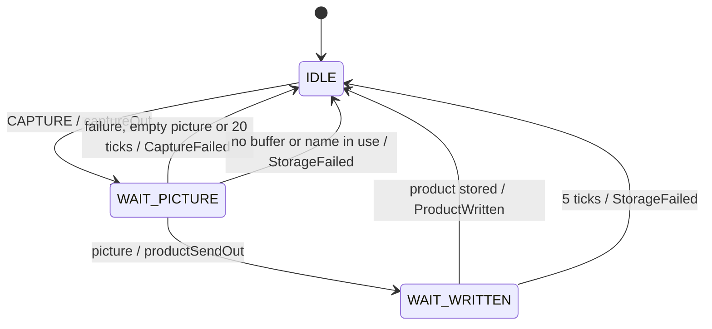
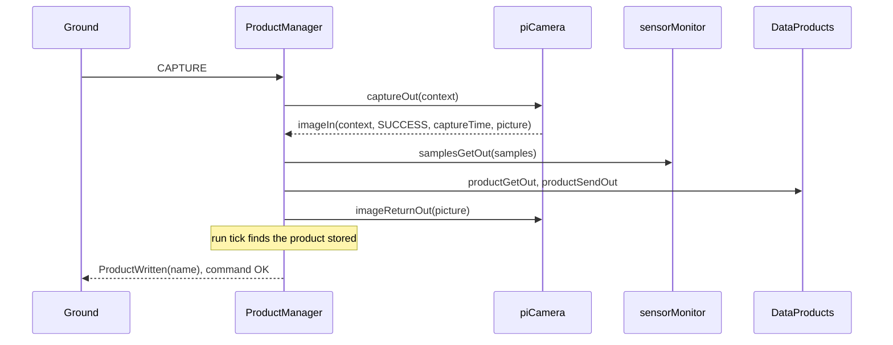
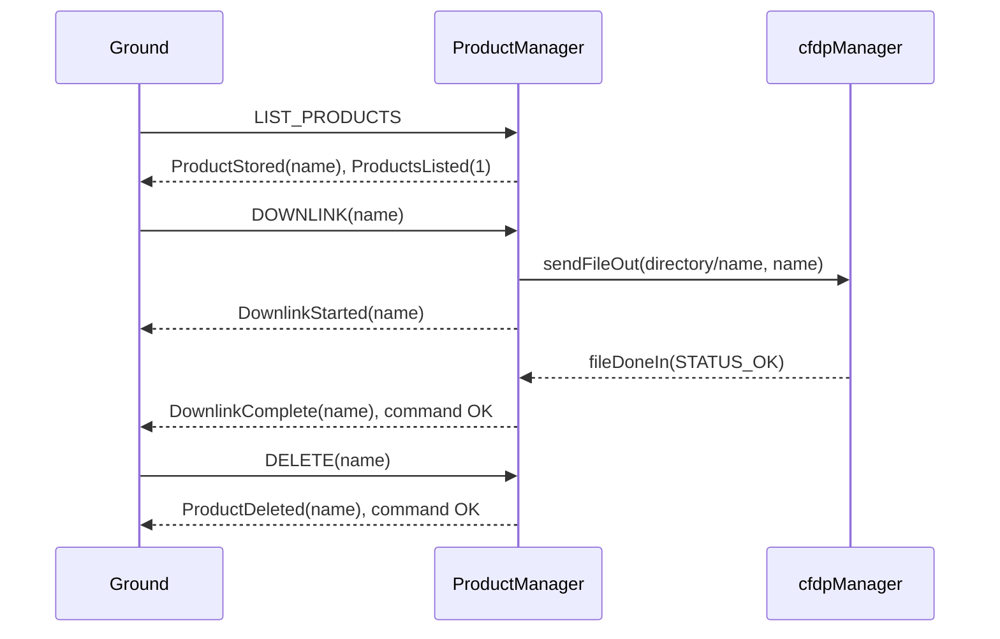

# PiSensor::ProductManager

## 1. Introduction

`ProductManager` runs the capture, downlink, delete and list commands of the PiSensor deployment. On a capture command it asks the camera for one picture, asks the sensor monitor for the latest location, attitude and temperature, and hands them to the storage as one data product; the capture ends when the product file is stored.
A product file is a regular file of the one product directory whose name has the form the storage gives the products of this component; the name carries the capture time. A stored product is a product file whose length equals the length its data product header declares; a partial product is a product file shorter than a data product header or whose length differs from the declared one. A product file the operating system cannot open or read is neither (a command naming it fails under row 042, not row 033), and files of other names are not touched. The component hands a named product to the CFDP file transfer, removes a named product, and lists the stored products. An activity is a capture, a downlink or a listing; the current capture is the one in progress.

## 2. Requirements

| ID | Requirement | Verification |
|---|---|---|
| REQ-ProductManager-001 | On a `CAPTURE` command, the component shall request one picture from the camera. | Unit Test |
| REQ-ProductManager-002 | On the picture of the capture in progress, the component shall request the latest samples. | Unit Test |
| REQ-ProductManager-003 | Each product shall hold one picture, capture time, location, attitude and temperature record. | Unit Test |
| REQ-ProductManager-004 | The picture record of each product shall equal the delivered picture, byte for byte. | Unit Test |
| REQ-ProductManager-005 | Each metric record shall hold the Table 1 fields as delivered by its source. | Unit Test |
| REQ-ProductManager-006 | Each product file shall comply with the F Prime data product file format. | Unit Test |
| REQ-ProductManager-007 | The capture time record shall equal the acquisition time delivered with the picture. | Unit Test |
| REQ-ProductManager-008 | Each metric record shall carry its sample time and a validity mark. | Unit Test |
| REQ-ProductManager-009 | The component shall mark valid each valid-reported metric sampled within 2 s of capture time. | Unit Test |
| REQ-ProductManager-010 | The component shall mark invalid each metric sampled more than 2 s from capture time. | Unit Test |
| REQ-ProductManager-011 | The component shall mark invalid each metric its source reports invalid. | Unit Test |
| REQ-ProductManager-012 | The component shall return each delivered picture buffer to the camera exactly once. | Unit Test |
| REQ-ProductManager-013 | When its product is stored, the component shall complete `CAPTURE` successfully. | Unit Test |
| REQ-ProductManager-014 | On each successful capture, the component shall emit `ACTIVITY_HI` event `ProductWritten` naming the product. | Unit Test |
| REQ-ProductManager-015 | A capture shall leave every stored product unchanged. | Integration Test |
| REQ-ProductManager-016 | The component shall fail `CAPTURE` with `WARNING_HI` event `CaptureFailed` when the camera reports failure. | Unit Test |
| REQ-ProductManager-017 | The component shall fail `CAPTURE` with `CaptureFailed` when the delivered picture is empty. | Unit Test |
| REQ-ProductManager-018 | The component shall fail `CAPTURE` with `CaptureFailed` when no picture arrives within 20 `run` ticks. | Unit Test |
| REQ-ProductManager-019 | The component shall write no product for a picture not of the current capture. | Unit Test |
| REQ-ProductManager-020 | The component shall fail `CAPTURE` with `WARNING_HI` event `StorageFailed` when no product buffer fits. | Unit Test |
| REQ-ProductManager-021 | `CAPTURE` shall fail with `StorageFailed` when its product is not stored in 5 `run` ticks. | Unit Test |
| REQ-ProductManager-022 | After a failed capture, the component shall remove every partial product. | Unit Test |
| REQ-ProductManager-023 | After a row 021 failure, that capture's file appearing within 5 ticks shall be removed. | Unit Test |
| REQ-ProductManager-024 | At start-up, the component shall remove every partial product. | Unit Test |
| REQ-ProductManager-025 | A `CAPTURE` during a capture shall fail with `WARNING_LO` event `CommandRejected` and not disturb it. | Unit Test |
| REQ-ProductManager-026 | On `DOWNLINK`, the component shall request file transfer of the named product under its name. | Unit Test |
| REQ-ProductManager-027 | The component shall complete `DOWNLINK` successfully when the file transfer reports success. | Unit Test |
| REQ-ProductManager-028 | The component shall fail `DOWNLINK` with `WARNING_HI` event `DownlinkStalled` when the transfer reports failure. | Unit Test |
| REQ-ProductManager-029 | The component shall fail `DOWNLINK` with `WARNING_LO` event `DownlinkRefused` when the transfer refuses the request. | Unit Test |
| REQ-ProductManager-030 | The component shall leave the product file unchanged by a downlink, complete or failed. | Unit Test |
| REQ-ProductManager-031 | A `DOWNLINK` command during a downlink shall fail with `CommandRejected` and not disturb that downlink. | Unit Test |
| REQ-ProductManager-032 | After a `CAPTURE` or `DOWNLINK` completes or fails, the component shall accept the next one. | Unit Test |
| REQ-ProductManager-033 | A `DOWNLINK` or `DELETE` naming no stored product shall fail with `WARNING_LO` event `ProductNotFound`. | Unit Test |
| REQ-ProductManager-034 | On `DELETE`, the component shall remove the named product, then complete the command successfully. | Unit Test |
| REQ-ProductManager-035 | A `DELETE` command naming the product being downlinked shall fail with `CommandRejected`. | Unit Test |
| REQ-ProductManager-036 | On `LIST_PRODUCTS`, the component shall emit `ACTIVITY_LO` event `ProductStored` naming each stored product. | Unit Test |
| REQ-ProductManager-037 | The component shall emit at most 4 `ProductStored` events per `run` tick. | Unit Test |
| REQ-ProductManager-038 | The component shall complete `LIST_PRODUCTS` with `ACTIVITY_HI` event `ProductsListed` counting the `ProductStored` events emitted. | Unit Test |
| REQ-ProductManager-039 | A `LIST_PRODUCTS` command during a listing shall fail with `CommandRejected`. | Unit Test |
| REQ-ProductManager-040 | `DOWNLINK`, `DELETE` and `LIST_PRODUCTS` shall act on every product stored before a restart. | Unit Test |
| REQ-ProductManager-041 | During any activity, a command Table 2 does not reject shall behave as when idle. | Unit Test |
| REQ-ProductManager-042 | A command shall fail with `WARNING_HI` `FileSystemError` on a directory or named-product error. | Unit Test |
| REQ-ProductManager-043 | The component shall emit `FileSystemError` on each other file system error. | Unit Test |
| REQ-ProductManager-044 | The component shall return to the camera each picture it cannot queue. | Unit Test |
| REQ-ProductManager-045 | The component shall give a busy response to each command it cannot queue. | Unit Test |
| REQ-ProductManager-046 | `CAPTURE` shall fail with `StorageFailed` when its product name is that of a stored product. | Unit Test |
| REQ-ProductManager-047 | The component shall report in telemetry, on change, whether each activity is in progress. | Unit Test |
| REQ-ProductManager-048 | After each start-up scan, the component shall emit `ACTIVITY_HI` `ScanComplete` counting stored and removed products. | Unit Test |
| REQ-ProductManager-049 | A transfer report that cannot be queued shall end `DOWNLINK` as a queued one does. | Unit Test |

Table 1: metric records.

| Record | Fields |
|---|---|
| Temperature | temperature (°C) |
| Attitude | roll, pitch (°); gyro rate x, y, z (°/s) |
| Location | latitude, longitude (°); altitude (m) |

Table 2: commands, and the activity during which each is rejected with `CommandRejected`.

| Command | Argument | Rejected during |
|---|---|---|
| `CAPTURE` | none | a capture |
| `DOWNLINK` | product name | a downlink |
| `DELETE` | product name | the downlink of the named product |
| `LIST_PRODUCTS` | none | a listing |

### External References

| Document | Identifier / Revision | Type | Governs |
|---|---|---|---|
| PiSensor SSDD | `docs/ssdd.md` at `383a9ce` | System design | Allocated requirements REQ-PiSensor-004 to -041, decisions D1 to D13 |
| F Prime data product file format | nasa/fprime v4.4.2, `Fw/Dp/docs/sdd.md` | Format | REQ-ProductManager-006 |
| F Prime data product file name | nasa/fprime v4.4.2, `DP_FILENAME_FORMAT` of `config/DpCfg.hpp` | Format | REQ-ProductManager-046 |
| JPL Design Principles | DP10, External Release V4, rule 4.4.6.4 | Standard | REQ-ProductManager-047 |

## 3. Design

### 3.1. Component Diagram

```
                                   ┌──────────────────┐
              imageIn : PictureDone □                  □ captureOut : CaptureRequest
  fileDoneIn : Svc.SendFileComplete □  ProductManager  □ imageReturnOut : Fw.BufferSend
                    run : Svc.Sched □     (active)     □ samplesGetOut : SamplesGet
                                    │                  □ sendFileOut : Svc.SendFileRequest
                                    │                  □ productGetOut : Fw.DpGet
                                    │                  □ productSendOut : Fw.DpSend
                                    └──────────────────┘
   special ports: cmdIn, cmdRegOut, cmdResponseOut, eventOut, textEventOut, tlmOut, timeGetOut
```

### 3.2. Ports

| Name | Kind | Type | Purpose |
|---|---|---|---|
| `captureOut` | output | `CaptureRequest` | Ask the camera for one picture |
| `imageIn` | async input, hook | `PictureDone` | Picture or failure, with acquisition time |
| `imageReturnOut` | output | `Fw.BufferSend` | Return the picture buffer |
| `samplesGetOut` | output | `SamplesGet` | Read the latest sample set |
| `productGetOut` | product get | `Fw.DpGet` | Get a product buffer |
| `productSendOut` | product send | `Fw.DpSend` | Hand the filled product to the storage |
| `sendFileOut` | output | `Svc.SendFileRequest` | Hand a product to the file transfer |
| `fileDoneIn` | async input, hook | `Svc.SendFileComplete` | File transfer ended |
| `run` | async input, drop | `Svc.Sched` | 1 Hz tick: time-outs, stored check, listing |

The component is event-driven; `samplesGetOut`, `productGetOut` and `sendFileOut` are synchronous calls from its thread. On queue overflow the hooks, which run in the caller's thread, return the picture buffer to the camera and answer a command with `BUSY`; the `fileDoneIn` hook stores the status in a member guarded by a mutex, and the next `run` tick ends the downlink with it. The mutex is held only to copy the status, with no port call under it; each tick empties the member and drops its content outside a downlink, and `DOWNLINK` clears it before calling `sendFileOut`.

### 3.3. State

| Member | Values | Meaning |
|---|---|---|
| `m_capture` | `IDLE`, `WAIT_PICTURE`, `WAIT_WRITTEN` | Capture activity |
| `m_captureContext`, `m_captureTicks` | `U32` | Number of the current capture, compared for equality with `imageIn`, wraps at 2^32; ticks in its state |
| `m_captureName` | file name | Product of the current capture; empty in `IDLE` |
| `m_discardName`, `m_discardTicks` | file name; `U32` | File of the last capture failed in `WAIT_WRITTEN`; ticks left to remove it if it appears |
| `m_downlink`, `m_downlinkName`, `m_fileDoneLost` | `IDLE`, `ACTIVE`; file name; status under a mutex | Downlink activity, its product, a transfer report the queue could not take |
| `m_listing`, `m_listCount` | `IDLE`, `ACTIVE`; `U32` | Listing activity and its event count |
| `m_scanned` | `bool` | Start-up scan done |



### 3.4. Configuration and Setup

```fpp
constant PICTURE_TIMEOUT_TICKS = 20   # run ticks for the camera to deliver
constant WRITTEN_TIMEOUT_TICKS = 5    # run ticks for the storage to store the product
constant DISCARD_RECHECK_TICKS = 5    # run ticks a failed capture's file is removed if it appears
constant LIST_EVENTS_PER_TICK = 4     # ProductStored events per tick
constant LIST_ENTRIES_PER_TICK = 64   # directory entries read per tick
constant SCAN_MAX_ENTRIES = 4096      # directory entries of the start-up scan
```

```cpp
productManager.configure(productDirectory);  // the directory Svc.DpWriter writes to
```

`run` is driven at 1 Hz; time-outs count dispatched ticks, so a dropped tick lengthens them by 1 s. The product name is formed with `DP_FILENAME_FORMAT` from the container id and the capture time, the rule `Svc.DpWriter` applies; a clock that steps back can repeat a name, and that capture fails with `StorageFailed(NAME_IN_USE)`.
Preconditions on the deployment: `productDirectory` is at most 59 characters (`configure` asserts it) and only `Svc.DpWriter` writes product files to it; `cfdpManager` parameters `FileInDefaultKeep = KEEP` and `FileInDefaultClass = CLASS_2`; the product buffer pool holds the largest picture of `piCamera` plus 200 bytes; the queue holds at least 20 messages. The start-up scan is one handler call of at most `SCAN_MAX_ENTRIES` entries; commands sent during it wait in the queue or get `BUSY`.

### 3.5. Behavior

The first message dispatched runs the start-up scan, one pass of at most `SCAN_MAX_ENTRIES` entries: it removes every partial product and always ends with `ScanComplete`, whose `truncated` tells a scan cut short or failed. Header lengths are read with `Fw::DpContainer`; a product file that cannot be opened or read is left in place and reported with `FileSystemError(FILE_READ)` naming it, a `DOWNLINK` or `DELETE` naming it fails with that event, and a scan, listing or `WAIT_WRITTEN` check goes on.
`CAPTURE` increments `m_captureContext` and requests a picture. `imageIn` returns the buffer in every case and acts only on the context of the current capture: it reads the samples, sets each validity mark from the absolute time difference, fails the capture when the product name is that of a stored product, fills the container with the capture time as its time tag, and sends it. In `WAIT_WRITTEN` each tick tests whether `m_captureName` is a stored product and completes the capture on it; until then the file is `Svc.DpWriter`'s. At 5 ticks the capture fails and its file is removed, at once if present and during `DISCARD_RECHECK_TICKS` ticks if it appears; a missing file is not an error, and the re-check ends before a later capture can fail the same way: on a tick it runs before the `WAIT_WRITTEN` time-out.
`DOWNLINK` and `DELETE` act on a stored product; the file of a capture in `WAIT_WRITTEN` or under re-check is not one, and a command naming it fails with `ProductNotFound`. `DOWNLINK` calls `sendFileOut` with the product as source and its name as destination; `fileDoneIn` ends the downlink and is ignored outside one. No time-out runs on a downlink: a transfer that does not end is ended from the ground with `cfdpManager.CancelTransaction`. `LIST_PRODUCTS` opens the directory and `run` reports its stored products. Section 6 holds the timing diagrams.

## 4. Data Product Format

| Container | Id | Default priority |
|---|---|---|
| `Capture` | 0 | 10 |

| Record | Id | Type | Count |
|---|---|---|---|
| `CaptureTime` | 0 | `Fw.TimeValue` | 1 |
| `Temperature` | 1 | `TemperatureSample` | 1 |
| `Attitude` | 2 | `AttitudeSample` | 1 |
| `Location` | 3 | `LocationSample` | 1 |
| `Picture` | 4 | `U8` array, JPEG bytes as delivered | picture size |

| Struct | Field | Type | Value |
|---|---|---|---|
| all three | `valid` | `bool` | Validity mark |
| all three | `sampleTime` | `Fw.TimeValue` | Sample time |
| `TemperatureSample` | `temperature` | `F32` | °C |
| `AttitudeSample` | `roll`, `pitch` | `F32` | ° |
| `AttitudeSample` | `gyroRate` | `[3] F32` | °/s, x y z |
| `LocationSample` | `latitude`, `longitude` | `F64` | ° |
| `LocationSample` | `altitude` | `F32` | m |

## 5. Ground Interface

| Command | Argument | Effect |
|---|---|---|
| `CAPTURE` | none | Capture one picture and store one product |
| `DOWNLINK` | `name` | Send the named product by CFDP |
| `DELETE` | `name` | Remove the named product |
| `LIST_PRODUCTS` | none | Report the stored products |

| Event | Severity | Arguments | Meaning |
|---|---|---|---|
| `ProductWritten` | activity high | name, size | A capture ended with its product stored |
| `CaptureFailed` | warning high | reason | The camera gave no usable picture |
| `StorageFailed` | warning high | reason | The product could not be stored |
| `CommandRejected` | warning low | reason | Command refused during an activity (Table 2) |
| `DownlinkStarted` | activity high | name | The file transfer accepted the product |
| `DownlinkComplete` | activity high | name | The file transfer delivered the product |
| `DownlinkStalled` | warning high | name | The file transfer ended without delivery |
| `DownlinkRefused` | warning low | name, status | The file transfer refused the request |
| `ProductNotFound` | warning low | name | The name is not that of a stored product |
| `ProductDeleted` | activity high | name | The named product was removed |
| `ProductStored` | activity low | name, size | One stored product of a listing |
| `ProductsListed` | activity high | count | A listing ended |
| `ProductDiscarded` | warning low | name, reason | A file was removed without a `DELETE` |
| `FileSystemError` | warning high | operation, name, status | The file system reported an error |
| `ScanComplete` | activity high | stored, removed, truncated | The start-up scan ended |

| Channel | Type | Update | Meaning |
|---|---|---|---|
| `CaptureActivity` | `CaptureState` | on change | Capture state |
| `DownlinkActivity` | `Activity` | on change | Downlink in progress |
| `ListingActivity` | `Activity` | on change | Listing in progress |

The three channels are written once when the start-up scan ends and then on each change. The component has no parameters.

## 6. Example Uses

A capture, then a listing, downlink and delete of its product.





## 7. Idiosyncrasies

| Out of scope | Owner |
|---|---|
| Detecting 60 s without transfer progress and ending the transfer | `cfdpManager` |
| Checking product content before a downlink | none: a product is sent as stored |
| Bounding the number of stored products | operator, with `DELETE` |
| Reporting a product file that fails to open or write | `Svc.DpWriter` events |
| Delivering the picture within 1 s of its acquisition time | `piCamera` |
| Changing the time-outs in flight | none: rebuild (REQ-ProductManager-018, -021) |
| Files of the product directory not named as product files | left untouched and unlisted |

## 8. Tests

<!-- fth:tests:begin -->
_Generated by `fth render-sdd-tests` from the plan — do not edit by hand; the package renderer fails when this table and the plan disagree._

| Test | Purpose | Requirements |
|---|---|---|
| L0-1 | Proves the running image is the manifest's prototype image and the marker round-trips. | — |
| L2-1 | Proves a successful capture emits ProductWritten naming the one new product file. | REQ-ProductManager-014 |
| L2-2 | Proves a second capture names a new product and leaves the first unchanged. | REQ-ProductManager-014, REQ-ProductManager-015 |
| L2-3 | Proves captures and a delete of another product leave a stored product unchanged. | REQ-ProductManager-015, REQ-ProductManager-034 |
| L2-4 | Proves DELETE removes the named product and no other, before its command response. | REQ-ProductManager-034 |
| L5-1 | Proves a CAPTURE during a capture is rejected and the first capture stores its product. | REQ-ProductManager-025 |
| L5-2 | Proves a rejected CAPTURE does not disturb the capture in progress or the next one. | REQ-ProductManager-025 |
| L5-3 | Proves a DOWNLINK during a downlink is rejected and the first transfer delivers its product. | REQ-ProductManager-031 |
| L5-4 | Proves a DOWNLINK naming the product in transfer is rejected without a second transfer. | REQ-ProductManager-031 |
| L5-5 | Proves a DELETE of the product in transfer is rejected and the product is delivered and kept. | REQ-ProductManager-035 |
| L5-6 | Proves a DELETE rejected during the downlink succeeds once the transfer has ended. | REQ-ProductManager-035, REQ-ProductManager-034 |
| L6-1 | Proves a DOWNLINK naming no stored product is rejected and nothing is sent. | REQ-ProductManager-033 |
| L6-2 | Proves a DELETE naming no stored product is rejected and removes nothing. | REQ-ProductManager-033 |
| L6-3 | Proves a DELETE whose name is a path to a stored product is rejected and removes nothing. | REQ-ProductManager-033 |
| L7-1 | Leaves one known product on board for the independent final-state check. | REQ-ProductManager-014 |
<!-- fth:tests:end -->

### Unit-test list

| Test | Description | Requirements |
|---|---|---|
| CaptureNominal | A capture requests one picture, reads samples, sends one product and completes. | REQ-ProductManager-001, REQ-ProductManager-002, REQ-ProductManager-003, REQ-ProductManager-013, REQ-ProductManager-014 |
| ProductContent | The product holds the picture byte for byte and every record of Table 1. | REQ-ProductManager-003, REQ-ProductManager-004, REQ-ProductManager-005, REQ-ProductManager-006 |
| CaptureTime | The capture time record and container time tag equal the delivered acquisition time. | REQ-ProductManager-007 |
| ValidityMarks | Each record carries its sample time; valid sources within 2 s are marked valid. | REQ-ProductManager-008, REQ-ProductManager-009 |
| StaleMetric | A sample over 2 s before or after capture time is marked invalid. | REQ-ProductManager-010 |
| SourceInvalid | A metric its source reports invalid is marked invalid, the others unaffected. | REQ-ProductManager-011 |
| BufferReturned | Every delivered picture buffer is returned once, in success and in every failure. | REQ-ProductManager-012 |
| CameraFailure | A failure status fails the capture with CaptureFailed and writes no product. | REQ-ProductManager-016, REQ-ProductManager-019 |
| EmptyPicture | An empty picture fails the capture with CaptureFailed. | REQ-ProductManager-017 |
| PictureTimeout | No picture in 20 ticks fails the capture; 19 ticks do not. | REQ-ProductManager-018 |
| LatePicture | A picture of an earlier capture or outside a capture writes no product. | REQ-ProductManager-019, REQ-ProductManager-012 |
| NoProductBuffer | A refused product buffer fails the capture with StorageFailed. | REQ-ProductManager-020 |
| StoreTimeout | A product not stored in 5 ticks fails the capture and removes its file. | REQ-ProductManager-021, REQ-ProductManager-022 |
| LateFile | The file of a capture failed by row 021 appearing within 5 ticks is removed. | REQ-ProductManager-023 |
| NameInUse | A capture whose product name is a stored product fails and leaves it unchanged. | REQ-ProductManager-046, REQ-ProductManager-015 |
| StartupScan | The start-up scan removes partial products, an empty one too, and keeps other files. | REQ-ProductManager-024, REQ-ProductManager-040, REQ-ProductManager-048 |
| Telemetry | Each activity channel is written after the scan and on each change. | REQ-ProductManager-047 |
| StartupScanError | An unreadable directory or a failed remove at start-up emits FileSystemError and ScanComplete. | REQ-ProductManager-043, REQ-ProductManager-048 |
| UnreadableProduct | A product file that cannot be read is kept; commands naming it fail with FileSystemError. | REQ-ProductManager-042, REQ-ProductManager-043 |
| FileDoneOverflow | A transfer report that cannot be queued completes or fails DOWNLINK at the next tick. | REQ-ProductManager-049 |
| CaptureBusy | A CAPTURE during a capture is rejected and the first capture completes. | REQ-ProductManager-025 |
| DownlinkNominal | DOWNLINK requests transfer of the named product under its name; success completes it. | REQ-ProductManager-026, REQ-ProductManager-027, REQ-ProductManager-030 |
| DownlinkFailure | A failure report fails DOWNLINK with DownlinkStalled and leaves the file unchanged. | REQ-ProductManager-028, REQ-ProductManager-030 |
| DownlinkRefused | A refused transfer request fails DOWNLINK with DownlinkRefused. | REQ-ProductManager-029 |
| DownlinkBusy | A DOWNLINK during a downlink is rejected and the first downlink completes. | REQ-ProductManager-031 |
| NextAccepted | After each ended capture or downlink, failed or not, the next one is accepted. | REQ-ProductManager-032 |
| ProductNotFound | A missing, partial, directory, path or in-capture name fails DOWNLINK and DELETE. | REQ-ProductManager-033 |
| DeleteNominal | DELETE removes the named product, emits ProductDeleted and completes. | REQ-ProductManager-034 |
| DeleteInDownlink | DELETE of the product in transfer is rejected; another product is deleted. | REQ-ProductManager-035, REQ-ProductManager-041 |
| ListProducts | A listing names each stored product, 4 per tick, then gives the count. | REQ-ProductManager-036, REQ-ProductManager-037, REQ-ProductManager-038 |
| ListBusy | A LIST_PRODUCTS during a listing is rejected. | REQ-ProductManager-039 |
| CommandsDuringActivity | Commands Table 2 does not reject behave as when idle during each activity. | REQ-ProductManager-041 |
| FileSystemErrors | A failed remove or directory read fails the command with FileSystemError. | REQ-ProductManager-042 |
| QueueOverflow | A picture that cannot be queued is returned; a command gets a busy response. | REQ-ProductManager-044, REQ-ProductManager-045 |
| StrayFileDone | A transfer report outside a downlink changes nothing. | REQ-ProductManager-027 |
