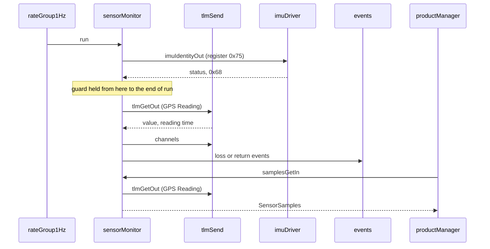

# PiSensor::SensorMonitor

## Introduction

`SensorMonitor` turns the latest BMP280, MPU6050 and GPS readings into the sensor telemetry of the PiSensor system: temperature, roll and pitch, gyro rates and location, with a validity flag for temperature, attitude and location. It decides validity from the age and range of each reading, from the identity register of the MPU6050 and from the GPS quality indicator of the GGA sentences that pass through it. It reports a sensor that is lost and a sensor that returns, and it hands the product manager every metric with validity and reading time for a data product. Attitude is roll and pitch plus raw gyro rates; yaw is not reported. The identity register is read as the MPU-6000 and MPU-6050 Register Map and Descriptions, RM-MPU-6000A-00 Rev. 4.2, defines it: the bench MPU6050 on I2C bus 1, address 0x68, returns 0x68 from register 0x75. The GPS receiver is not identified on the bench yet; its identification reopens REQ-SensorMonitor-009, -022 and the GPS row of Table 2.

## Requirements

| ID | Requirement | Verification |
|---|---|---|
| REQ-SensorMonitor-001 | On each schedule call, the component shall publish every Table 1 and Table 2 channel. (REQ-PiSensor-001, REQ-PiSensor-002, REQ-PiSensor-003, REQ-PiSensor-022, REQ-PiSensor-024) | Unit Test |
| REQ-SensorMonitor-002 | Each value channel shall carry its Table 1 value, computed from the latest source reading. (REQ-PiSensor-001, REQ-PiSensor-002, REQ-PiSensor-003) | Unit Test |
| REQ-SensorMonitor-003 | Valid roll and pitch shall be within 0.1 degrees of their Table 1 formulas. (REQ-PiSensor-002) | Unit Test |
| REQ-SensorMonitor-004 | A value shall be zero, with reading time zero, until its source's first reading. (proposal) | Unit Test |
| REQ-SensorMonitor-005 | A metric shall be reported invalid while its reading is over 2 s old. (REQ-PiSensor-008, REQ-PiSensor-022) | Unit Test |
| REQ-SensorMonitor-006 | A metric shall be reported invalid while its reading time is after the current time. (proposal) | Unit Test |
| REQ-SensorMonitor-007 | A metric shall be reported invalid until its source delivers a first reading. (REQ-PiSensor-022) | Unit Test |
| REQ-SensorMonitor-008 | A metric shall be reported invalid while its reading is outside its Table 1 limits. (proposal) | Unit Test |
| REQ-SensorMonitor-009 | Location shall be reported invalid unless the newest GGA sentence carries quality indicator 1–8. (REQ-PiSensor-009, REQ-PiSensor-024) | Unit Test |
| REQ-SensorMonitor-010 | The component shall read the MPU6050 identity register on each schedule call. (REQ-PiSensor-043) | Unit Test |
| REQ-SensorMonitor-011 | Attitude shall be reported invalid unless the latest identity read returned the identity value. (REQ-PiSensor-043, REQ-PiSensor-022, REQ-PiSensor-020) | Unit Test |
| REQ-SensorMonitor-012 | A metric shall be reported valid while no condition of REQ-SensorMonitor-005 to -011 holds. (REQ-PiSensor-023) | Unit Test |
| REQ-SensorMonitor-013 | A sensor shall become lost at a schedule call where its Table 2 condition holds. (REQ-PiSensor-019, REQ-PiSensor-020, REQ-PiSensor-021, REQ-PiSensor-043) | Unit Test |
| REQ-SensorMonitor-014 | A sensor's Table 2 loss event shall be emitted once, when it becomes lost. (REQ-PiSensor-019, REQ-PiSensor-020, REQ-PiSensor-021) | Unit Test |
| REQ-SensorMonitor-015 | A lost sensor shall return at a schedule call where its Table 2 condition clears. (REQ-PiSensor-023) | Unit Test |
| REQ-SensorMonitor-016 | A sensor's Table 2 return event shall be emitted once, when it returns. (proposal) | Unit Test |
| REQ-SensorMonitor-017 | The component shall pass each received GPS sentence on once, in order, unchanged. (REQ-PiSensor-003) | Unit Test |
| REQ-SensorMonitor-018 | A request shall return each latest Table 1 value with validity and reading time. (REQ-PiSensor-005, REQ-PiSensor-007) | Unit Test |
| REQ-SensorMonitor-019 | Returned validity shall follow REQ-SensorMonitor-005 to -012 with reading age taken at the request time. (REQ-PiSensor-007, REQ-PiSensor-008, REQ-PiSensor-009) | Unit Test |
| REQ-SensorMonitor-020 | Schedule calls, readings, GPS sentences and sample requests shall be handled one at a time. (proposal) | Inspection |
| REQ-SensorMonitor-021 | The MPU6050 identity read shall be compliant with RM-MPU-6000A-00 Rev. 4.2. (REQ-PiSensor-043) | Unit Test |
| REQ-SensorMonitor-022 | The GGA quality indicator read shall be compliant with NMEA 0183 Version 4.11. (REQ-PiSensor-024) | Unit Test |

Each row ends with the system requirements it derives from; `(proposal)` marks a row that derives from none. Table 1 — metrics. A reading is the value set a sensor's manager component last delivered, with its reading time: the time the component received it (BMP280, MPU6050) or the manager published it (GPS). A reading time of another time base than the current time counts as after it. Age is the current time minus the reading time.

| Metric | Validity and reason channel | Source reading | Value channel | Unit | Value | Limits (a value that is not a finite number is outside) |
|---|---|---|---|---|---|---|
| Temperature | `TemperatureValid`, `TemperatureInvalidReason` | BMP280 (degC) | `Temperature` | degC | temperature | -40 to 85 |
| Attitude | `AttitudeValid`, `AttitudeInvalidReason` | MPU6050 (acceleration a_x, a_y, a_z in g; rotation rate in deg/s) | `Roll` | deg | atan2(a_y, a_z), in degrees | acceleration not (0, 0, 0), each axis -16 to 16 |
| | | | `Pitch` | deg | atan2(-a_x, sqrt(a_y^2 + a_z^2)), in degrees | as `Roll` |
| | | | `GyroX`, `GyroY`, `GyroZ` | deg/s | rotation rate x, y, z, unchanged | -2000 to 2000 |
| Location | `FixValid`, `FixInvalidReason` | GPS (deg, m) | `Latitude` | deg | latitude | -90 to 90 |
| | | | `Longitude` | deg | longitude | -180 to 180 |
| | | | `Altitude` | m | altitude | -1000 to 100000 |

Table 2 — sensors.

| Sensor | Loss condition | Loss event (`WARNING_HI`) | Return event (`ACTIVITY_HI`) | Channels |
|---|---|---|---|---|
| BMP280 | the last N schedule calls saw no new BMP280 reading | `Bmp280Lost` | `Bmp280Returned` | `Bmp280State` (present, lost) |
| MPU6050 | the last N schedule calls saw no new MPU6050 reading; or the last M identity reads each failed or returned another value than the identity value | `Mpu6050Lost` | `Mpu6050Returned` | `Mpu6050State` |
| GPS | the last N schedule calls saw no GPS sentence | `GpsSilent` | `GpsReturned` | `GpsState`, `GpsQuality` (newest GGA quality indicator, 0xFF when none) |
| Constants | N = 5 and M = 3, counted from start-up; identity value 0x68; a new reading is one delivered since the schedule call before | | | |

| Document | Identifier / Revision | Type | Governs |
|---|---|---|---|
| MPU-6000 and MPU-6050 Register Map and Descriptions | RM-MPU-6000A-00 Rev. 4.2 | Datasheet | identity register address and value |
| NMEA 0183 Standard for Interfacing Marine Electronic Devices | Version 4.11 | Standard | GGA sentence, GPS quality indicator field |

## Design

### Component Diagram

```text
                          +--------------------------------+
        run : Svc.Sched  [] PiSensor.SensorMonitor         [] tlmGetOut : Fw.TlmGet
 bmpDataIn :             []                                [] imuIdentityOut : Drv.I2cWriteRead
  Bmp280.Bmp280DataOut    |                                [] gpsSentenceOut : Svc.ComDataWithContext
 imuDataIn :             []                                 |
  MpuImu.ImuDataOut       |                                 |
 gpsSentenceIn :         []                                 |
  Svc.ComDataWithContext  |                                 |
 samplesGetIn :          []                                 |
  PiSensor.SamplesGet     +--------------------------------+
        special ports: eventOut, textEventOut, tlmOut, timeGetOut
```

### Ports

| Name | Kind | Type | Purpose |
|---|---|---|---|
| `run` | sync input | `Svc.Sched` | 1 Hz evaluation and telemetry |
| `bmpDataIn` | guarded input | `Bmp280.Bmp280DataOut` | BMP280 reading from `bmpManager.bmpDataPush` |
| `imuDataIn` | guarded input | `MpuImu.ImuDataOut` | MPU6050 reading from `imuManager.imuDataPush` |
| `gpsSentenceIn` | guarded input | `Svc.ComDataWithContext` | GPS sentence from the frame accumulator |
| `samplesGetIn` | guarded input | `PiSensor.SamplesGet` | sample request from the product manager |
| `tlmGetOut` | output | `Fw.TlmGet` | latest GPS manager reading with reading time |
| `imuIdentityOut` | output | `Drv.I2cWriteRead` | MPU6050 identity register read |
| `gpsSentenceOut` | output | `Svc.ComDataWithContext` | GPS sentence passed on |

The component is a cyclic passive component with a pass-through tap: four inputs are guarded because the 10 Hz rate group, the GPS receive thread and the product manager call them (REQ-SensorMonitor-020), the tap state is read by `run` and `samplesGetIn`, and the request returns by reference. `run` is `sync`: it reads the identity register before it takes the same guard for the evaluation, so the component guard is never held across a bus transaction; `run` has one caller, `rateGroup1Hz`. The identity read holds the IMU bus driver guard, so `imuManager` in the 10 Hz rate group can wait for one identity read. A guarded call waits for at most one evaluation or one GPS sentence pass-through. Lock order: `sensorMonitor` guard, then `gpsManager` guard, then `NmeaGps.bufferManager` guard, `tlmSend` guard; no component called from a handler may call a `sensorMonitor` input.

### State

| Member | Values | Meaning |
|---|---|---|
| `m_configured` | false, true | `configure` was called; `run` and `samplesGetIn` assert before it, the other inputs work |
| `m_gpsReadingId`, `m_mpuAddress` | channel id, I2C address | set by `configure` |
| `m_bmp`, `m_imu` | reading, reading time, new flag | latest pushed reading; zero value and zero time before the first |
| `m_missedCalls[3]` | 0 to `SENSOR_LOSS_CALLS` | schedule calls in a row without a new reading (BMP280, MPU6050) or sentence (GPS); saturates |
| `m_identityFails` | 0 to `MPU6050_IDENTITY_FAIL_CALLS` | identity reads in a row that failed; saturates |
| `m_identityStatus`, `m_identityValue` | `Drv.I2cStatus`, `U8` | result of the latest identity read |
| `m_lost[3]` | false, true | sensor is lost; every member above and below is written only under the guard, the `configure` members only before any thread starts |
| `m_sentenceSeen` | false, true | a GPS sentence arrived since the schedule call before |
| `m_fixQuality` | 0 to 8, 0xFF | quality indicator of the newest GGA sentence; 0xFF before any and when the field is not one digit 0 to 8 |

### Configuration and Setup

```fpp
constant SENSOR_LOSS_CALLS = 5             # Table 2 N
constant MPU6050_IDENTITY_FAIL_CALLS = 3   # Table 2 M
constant SENSOR_STALE_SECONDS = 2          # REQ-SensorMonitor-005
constant MPU6050_IDENTITY_REGISTER = 0x75
constant MPU6050_IDENTITY_VALUE = 0x68
```

```cpp
// once, before the rate groups start: the GPS manager's Reading channel id and the
// address also given to imuManager.configure
sensorMonitor.configure(NmeaGps::gpsManager.getIdBase() + GPS_READING_CHANNEL_OFFSET, mpuAddress);
```

```fpp
instance sensorMonitor: PiSensor.SensorMonitor base id 0x10009000
```

The Table 1 limits are constants in `SensorMonitor.hpp`; `GPS_READING_CHANNEL_OFFSET` (0 at the pinned catalog commit) is a constant of the topology definitions, because the generated channel id of the inherited manager is not public. `bmpManager` and `imuManager` run in `rateGroup10Hz` and push a reading on every good read, `sensorMonitor` runs in `rateGroup1Hz`, and the GPS manager publishes on the GPS receive thread, so a GPS reading is up to one GGA period old at a schedule call.

### Port Handlers

- **`run`**: admitted once configured. It reads the identity register once into local variables, then takes the guard, releases it on every exit path, and under it stores the identity result, takes one time for the call, fetches the GPS reading, updates each sensor's loss state with its events, and writes every channel with that time.
- **`bmpDataIn`, `imuDataIn`**: admitted on every call. Each stores the reading with the current time and sets its new flag.
- **`gpsSentenceIn`**: admitted for every buffer. It sets `m_sentenceSeen`, stores the quality indicator when the sentence is a GGA sentence (bounded scan, buffer not written), and sends the same buffer and context on `gpsSentenceOut`.
- **`samplesGetIn`**: admitted once configured. It fetches the GPS reading and fills `SensorSamples` with the latest values, reading times and validity taken at the request time, with `m_fixQuality` and the latest identity result as they stand.

Validity is tested in the order of `InvalidReason` (identity and fix first, because the GPS manager publishes no reading without a fix) and the first condition that holds is the reason; age is computed only after the reading time is found comparable and not later than the current time. A GPS reading that `tlmGetOut` returns empty, or that does not deserialize into `NmeaGps.GpsData`, is no reading. `Mpu6050Lost` carries the latest identity result for either reason, `reason` is `IDENTITY` when both conditions hold, and a change of cause while lost emits no event. The identity read lasts at most the kernel I2C adapter time-out (`Drv.LinuxI2cDriver` sets none), which is a failed read; its value is measured in development against a limit of 500 ms, half the 1 Hz period.

## Data Product Format

The component writes no data product; `SensorSamples` is the record the product manager stores.

| Field | Type | Value |
|---|---|---|
| `temperature`, `temperatureValid`, `temperatureTime` | `F32`, `Validity`, `Fw.TimeValue` | degC |
| `roll`, `pitch`, `gyro`, `attitudeValid`, `attitudeTime` | `F32`, `F32`, `FprimeSensors.GeometricVector3`, `Validity`, `Fw.TimeValue` | deg, deg, deg/s |
| `latitude`, `longitude`, `altitude`, `fixValid`, `locationTime` | `F64`, `F64`, `F64`, `Validity`, `Fw.TimeValue` | deg, deg, m |

## Ground Interface

The component has no commands and no parameters.

| Telemetry | Type | Meaning |
|---|---|---|
| `TemperatureInvalidReason`, `AttitudeInvalidReason`, `FixInvalidReason` | `InvalidReason` | first invalidity condition that holds, `NONE` when valid |
| `Bmp280State`, `Mpu6050State`, `GpsState` | `SensorState` | present or lost |
| `GpsQuality` | `U8` | newest GGA quality indicator, 0xFF when none |
| `Temperature` | `F32` | BMP280 temperature, degC |
| `TemperatureValid`, `AttitudeValid`, `FixValid` | `Validity` | validity of temperature, attitude, location |
| `Roll`, `Pitch` | `F32` | deg |
| `GyroX`, `GyroY`, `GyroZ` | `F32` | deg/s |
| `Latitude`, `Longitude`, `Altitude` | `F64` | deg, deg, m |

| Event | Severity | Arguments | Meaning |
|---|---|---|---|
| `Bmp280Lost` | `WARNING_HI` | none | BMP280 became lost |
| `Mpu6050Lost` | `WARNING_HI` | `reason`, `status`, `identity` | MPU6050 became lost: no reading, or identity read |
| `GpsSilent` | `WARNING_HI` | none | GPS became lost |
| `Bmp280Returned`, `Mpu6050Returned`, `GpsReturned` | `ACTIVITY_HI` | none | the sensor returned |

## Example Uses



## Idiosyncrasies

| Failure | Owner |
|---|---|
| BMP280 or MPU6050 bus read failure report | `Bmp280.BmpManager`, `MpuImu.ImuManager` |
| NMEA checksum failure | `NmeaGps.frameAccumulator` |
| Telemetry downlink rate | `CdhCore`, `ComCcsds` |
| Product stale check against the capture time | `productManager` |
| GPS `Reading` channel absent from the telemetry store: reported as location invalid, `NO_READING` | `CdhCore.tlmSend` configuration |
| Layout of `NmeaGps.GpsData`, `Bmp280.Bmp280Data`, `MpuImu.ImuData` and the channel offset of the GPS `Reading` | catalog types at the pinned commit |

## Tests

<!-- fth:tests:begin -->
_Generated by `fth render-sdd-tests` from the plan — do not edit by hand; the package renderer fails when this table and the plan disagree._

| Test | Purpose | Requirements |
|---|---|---|
| L0-1 | Proves the running image is the manifest's prototype image and contains the component. | REQ-SensorMonitor-001 |
| L2-1 | Proves every Table 1 and Table 2 channel is published each second and reads valid. | REQ-SensorMonitor-001, REQ-SensorMonitor-002, REQ-SensorMonitor-012 |
| L2-2 | Proves roll or pitch steps with a bench tilt and matches the reported acceleration. | REQ-SensorMonitor-001, REQ-SensorMonitor-002, REQ-SensorMonitor-012 |
| L5-1 | Proves a stopped BMP280 is reported lost once, reads invalid, and returns valid. | REQ-SensorMonitor-005, REQ-SensorMonitor-013, REQ-SensorMonitor-014, REQ-SensorMonitor-015, REQ-SensorMonitor-016, REQ-SensorMonitor-012 |
| L5-2 | Proves a stopped MPU6050 is reported lost once by its identity read, and returns valid. | REQ-SensorMonitor-005, REQ-SensorMonitor-010, REQ-SensorMonitor-011, REQ-SensorMonitor-013, REQ-SensorMonitor-014, REQ-SensorMonitor-015, REQ-SensorMonitor-016, REQ-SensorMonitor-021, REQ-SensorMonitor-012 |
| L5-3 | Proves a silent GPS is reported once, reads invalid, and returns valid. | REQ-SensorMonitor-005, REQ-SensorMonitor-013, REQ-SensorMonitor-014, REQ-SensorMonitor-015, REQ-SensorMonitor-016, REQ-SensorMonitor-012 |
| L5-4 | Proves each loss and each return of one sensor gives exactly one event. | REQ-SensorMonitor-005, REQ-SensorMonitor-010, REQ-SensorMonitor-011, REQ-SensorMonitor-013, REQ-SensorMonitor-014, REQ-SensorMonitor-015, REQ-SensorMonitor-016, REQ-SensorMonitor-021, REQ-SensorMonitor-012 |
| L5-5 | Proves no-fix GGA sentences read location invalid with reason NO_FIX and raise no silence event. | REQ-SensorMonitor-009, REQ-SensorMonitor-022, REQ-SensorMonitor-012 |
| L5-6 | Proves quality 2 and 8 read location valid and an empty indicator reads it invalid. | REQ-SensorMonitor-009, REQ-SensorMonitor-022 |
| L7-1 | Leaves every sensor present and valid, with the location equal to the bench script. | REQ-SensorMonitor-002, REQ-SensorMonitor-012 |
<!-- fth:tests:end -->

| Unit test | Description | Requirements |
|---|---|---|
| UT-01 ChannelsEveryCall | Each schedule call writes every Table 1 and Table 2 channel once, one time tag. | REQ-SensorMonitor-001 |
| UT-02 ValuesFromReadings | Channels equal the pushed BMP280, MPU6050 values and the GPS reading of the configured id. | REQ-SensorMonitor-002 |
| UT-03 RollPitch | Roll and pitch match the formulas within 0.1 degrees over the four quadrants. | REQ-SensorMonitor-003 |
| UT-04 BeforeFirstReading | Before any reading, values and reading times are zero and metrics invalid, NO_READING. | REQ-SensorMonitor-004, REQ-SensorMonitor-007 |
| UT-05 StaleBoundary | A reading aged exactly 2 s is valid; one microsecond older is invalid, STALE. | REQ-SensorMonitor-005, REQ-SensorMonitor-012 |
| UT-06 FutureTime | A reading time after the current time, or of another time base, reads invalid, FUTURE_TIME. | REQ-SensorMonitor-006 |
| UT-07 Limits | Each Table 1 limit, both edges, and non-finite values read invalid, OUT_OF_LIMITS. | REQ-SensorMonitor-008 |
| UT-08 ZeroAcceleration | Acceleration (0, 0, 0) reads attitude invalid, OUT_OF_LIMITS. | REQ-SensorMonitor-008 |
| UT-09 GgaQuality | Quality 0, 1 to 8, 9, a letter, empty and missing field set validity. | REQ-SensorMonitor-009, REQ-SensorMonitor-022 |
| UT-09b GgaTalkers | GGA sentences of talkers GP, GN, GL and GA are all read. | REQ-SensorMonitor-022 |
| UT-10 NonGgaSentence | A non-GGA sentence leaves the stored quality indicator and validity unchanged. | REQ-SensorMonitor-009, REQ-SensorMonitor-022 |
| UT-11 MalformedSentence | Empty, zero-size and unterminated buffers are scanned within bounds and passed on. | REQ-SensorMonitor-017, REQ-SensorMonitor-022 |
| UT-12 IdentityRead | Each schedule call makes one write-read of register 0x75 at the configured address. | REQ-SensorMonitor-010, REQ-SensorMonitor-021 |
| UT-13 IdentityWrongValue | A wrong identity value reads attitude invalid, IDENTITY, from the first call. | REQ-SensorMonitor-011, REQ-SensorMonitor-021 |
| UT-14 IdentityBusError | Each failing `Drv.I2cStatus` of the identity read reads attitude invalid, IDENTITY. | REQ-SensorMonitor-011 |
| UT-15 IdentityPersistence | `Mpu6050Lost` comes at the third failed identity read in a row; a good read resets. | REQ-SensorMonitor-013, REQ-SensorMonitor-014 |
| UT-16 ReasonOrder | With several conditions holding, the reason channel reports the first in enum order. | REQ-SensorMonitor-012 |
| UT-16b CounterReset | Four missed calls, a reading, four missed calls give no loss event, each sensor. | REQ-SensorMonitor-013 |
| UT-16c Saturation | Over 300 calls without readings the counters stay at their limits; one loss event each. | REQ-SensorMonitor-013, REQ-SensorMonitor-014 |
| UT-17 LossBmp280 | `Bmp280Lost` comes once, on the fifth call without a new reading, also from start-up. | REQ-SensorMonitor-013, REQ-SensorMonitor-014 |
| UT-18 LossMpu6050 | `Mpu6050Lost` comes once for no reading, with reason, status and identity arguments. | REQ-SensorMonitor-013, REQ-SensorMonitor-014 |
| UT-19 LossGps | `GpsSilent` comes once, on the fifth call without a sentence; no-fix sentences prevent it. | REQ-SensorMonitor-013, REQ-SensorMonitor-014 |
| UT-20 Return | Each return event comes once; the MPU6050 returns only when both conditions clear. | REQ-SensorMonitor-015, REQ-SensorMonitor-016 |
| UT-21 LossTwice | A second loss after a return gives a second loss event and return event. | REQ-SensorMonitor-014, REQ-SensorMonitor-016 |
| UT-22 BothMpuConditions | Both MPU6050 conditions give one event, reason IDENTITY; a cause change gives none. | REQ-SensorMonitor-013, REQ-SensorMonitor-014 |
| UT-23 SentencePassThrough | Each sentence leaves once, in order, same buffer and context. | REQ-SensorMonitor-017 |
| UT-24 SamplesGet | A request returns every value, validity and reading time of the latest readings. | REQ-SensorMonitor-018 |
| UT-25 SamplesAgeAtRequest | A request ages readings at the request time, not at the last schedule call. | REQ-SensorMonitor-019 |
| UT-26 SamplesIdentityAndFix | A request applies the latest identity result and quality indicator. | REQ-SensorMonitor-019 |
| UT-26b SamplesOtherConditions | A request reports no-reading, future-time and out-of-limits metrics invalid. | REQ-SensorMonitor-019 |
| UT-27 GpsReadingAbsent | An empty or undeserializable GPS reading from `tlmGetOut` reads location invalid, NO_READING. | REQ-SensorMonitor-007 |
| UT-28 BeforeConfigure | `run` and `samplesGetIn` assert before `configure`; sentences and readings are accepted. | Design: State, `m_configured` |
| Inspection | Four guarded inputs and the guard taken in `run` serialize all state access. | REQ-SensorMonitor-020 |
