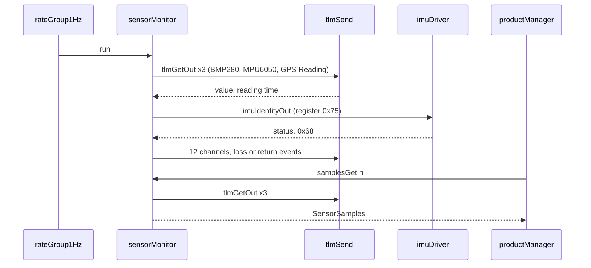

# PiSensor::SensorMonitor

## 1. Introduction

`SensorMonitor` turns the latest BMP280, MPU6050 and GPS readings into the sensor telemetry of the PiSensor system: temperature, roll and pitch, gyro rates and location, with a validity flag for temperature, attitude and location. It decides validity from the age and range of each reading, from the identity register of the MPU6050 and from the GPS quality indicator of the GGA sentences that pass through it. It reports a sensor that is lost and a sensor that returns, and it hands the product manager every metric with validity and reading time for a data product. Attitude is roll and pitch plus raw gyro rates; yaw is not reported. The identity register is read as the MPU-6000 and MPU-6050 Register Map and Descriptions, RM-MPU-6000A-00 Rev. 4.2, defines it: the bench MPU6050 on I2C bus 1, address 0x68, returns 0x68 from register 0x75. The GPS receiver is not identified on the bench yet; its identification reopens REQ-SensorMonitor-009, -022 and the GPS row of Table 2.

## 2. Requirements

| ID | Requirement | Verification |
|---|---|---|
| REQ-SensorMonitor-001 | On each schedule call, the component shall publish every Table 1 channel. | Unit Test |
| REQ-SensorMonitor-002 | Each value channel shall carry its Table 1 value, computed from the latest source reading. | Unit Test |
| REQ-SensorMonitor-003 | Valid roll and pitch shall be within 0.1 degrees of their Table 1 formulas. | Unit Test |
| REQ-SensorMonitor-004 | A value shall be zero, with reading time zero, until its source's first reading. | Unit Test |
| REQ-SensorMonitor-005 | A metric shall be reported invalid while its reading is over 2 s old. | Unit Test |
| REQ-SensorMonitor-006 | A metric shall be reported invalid while its reading time is after the current time. | Unit Test |
| REQ-SensorMonitor-007 | A metric shall be reported invalid until its source delivers a first reading. | Unit Test |
| REQ-SensorMonitor-008 | A metric shall be reported invalid while its reading is outside its Table 1 limits. | Unit Test |
| REQ-SensorMonitor-009 | Location shall be reported invalid unless the newest GGA sentence carries quality indicator 1–8. | Unit Test |
| REQ-SensorMonitor-010 | The component shall read the MPU6050 identity register on each schedule call. | Unit Test |
| REQ-SensorMonitor-011 | Attitude shall be reported invalid unless the latest identity read returned the identity value. | Unit Test |
| REQ-SensorMonitor-012 | A metric shall be reported valid while no condition of REQ-SensorMonitor-005 to -011 holds. | Unit Test |
| REQ-SensorMonitor-013 | A sensor shall become lost at a schedule call where its Table 2 condition holds. | Unit Test |
| REQ-SensorMonitor-014 | A sensor's Table 2 loss event shall be emitted once, when it becomes lost. | Unit Test |
| REQ-SensorMonitor-015 | A lost sensor shall return at a schedule call where its Table 2 condition clears. | Unit Test |
| REQ-SensorMonitor-016 | A sensor's Table 2 return event shall be emitted once, when it returns. | Unit Test |
| REQ-SensorMonitor-017 | The component shall pass each received GPS sentence on once, in order, unchanged. | Unit Test |
| REQ-SensorMonitor-018 | A request shall return each latest Table 1 value with validity and reading time. | Unit Test |
| REQ-SensorMonitor-019 | Returned validity shall follow REQ-SensorMonitor-005 to -012 with reading age taken at the request time. | Unit Test |
| REQ-SensorMonitor-020 | Schedule calls, GPS sentences and sample requests shall be handled one at a time. | Inspection |
| REQ-SensorMonitor-021 | The MPU6050 identity read shall be compliant with RM-MPU-6000A-00 Rev. 4.2. | Unit Test |
| REQ-SensorMonitor-022 | The GGA quality indicator read shall be compliant with NMEA 0183 Version 4.11. | Unit Test |

Table 1 — metrics. A reading is the value set a sensor's manager component last published, with the time it published it (the reading time); age is the current time minus the reading time.

| Metric | Validity channel | Source reading | Value channel | Unit | Value | Limits (a value that is not a finite number is outside) |
|---|---|---|---|---|---|---|
| Temperature | `TemperatureValid` | BMP280 (degC) | `Temperature` | degC | temperature | -40 to 85 |
| Attitude | `AttitudeValid` | MPU6050 (acceleration a_x, a_y, a_z in g; rotation rate in deg/s) | `Roll` | deg | atan2(a_y, a_z), in degrees | acceleration not (0, 0, 0), each axis -16 to 16 |
| | | | `Pitch` | deg | atan2(-a_x, sqrt(a_y^2 + a_z^2)), in degrees | as `Roll` |
| | | | `GyroX`, `GyroY`, `GyroZ` | deg/s | rotation rate x, y, z, unchanged | -2000 to 2000 |
| Location | `FixValid` | GPS (deg, m) | `Latitude` | deg | latitude | -90 to 90 |
| | | | `Longitude` | deg | longitude | -180 to 180 |
| | | | `Altitude` | m | altitude | -1000 to 100000 |

Table 2 — sensors.

| Sensor | Loss condition | Loss event (`WARNING_HI`) | Return event (`ACTIVITY_HI`) |
|---|---|---|---|
| BMP280 | the last N schedule calls saw no new BMP280 reading | `Bmp280Lost` | `Bmp280Returned` |
| MPU6050 | the last N schedule calls saw no new MPU6050 reading; or the latest identity read failed or returned another value than the identity value | `Mpu6050Lost` | `Mpu6050Returned` |
| GPS | the last N schedule calls saw no GPS sentence | `GpsSilent` | `GpsReturned` |
| Constants | N = 5, counted from start-up; identity value 0x68; a new reading has another reading time than at the schedule call before, and any reading is new on the first schedule call | | |

| Document | Identifier / Revision | Type | Governs |
|---|---|---|---|
| MPU-6000 and MPU-6050 Register Map and Descriptions | RM-MPU-6000A-00 Rev. 4.2 | Datasheet | identity register address and value |
| NMEA 0183 Standard for Interfacing Marine Electronic Devices | Version 4.11 | Standard | GGA sentence, GPS quality indicator field |

## 3. Design

### Component Diagram

```text
                          +--------------------------------+
        run : Svc.Sched  [] PiSensor.SensorMonitor         [] tlmGetOut : Fw.TlmGet
 gpsSentenceIn :         []                                [] imuIdentityOut : Drv.I2cWriteRead
  Svc.ComDataWithContext  |                                [] gpsSentenceOut : Svc.ComDataWithContext
 samplesGetIn :          []                                 |
  PiSensor.SamplesGet     +--------------------------------+
        special ports: eventOut, textEventOut, tlmOut, timeGetOut
```

### Ports

| Name | Kind | Type | Purpose |
|---|---|---|---|
| `run` | guarded input | `Svc.Sched` | 1 Hz evaluation and telemetry |
| `gpsSentenceIn` | guarded input | `Svc.ComDataWithContext` | GPS sentence from the frame accumulator |
| `samplesGetIn` | guarded input | `PiSensor.SamplesGet` | sample request from the product manager |
| `tlmGetOut` | output | `Fw.TlmGet` | latest manager readings with reading time |
| `imuIdentityOut` | output | `Drv.I2cWriteRead` | MPU6050 identity register read |
| `gpsSentenceOut` | output | `Svc.ComDataWithContext` | GPS sentence passed on |

The three inputs are guarded because the rate group, the GPS receive thread and the product manager call them from three threads (REQ-SensorMonitor-020).

### State

| Member | Values | Meaning |
|---|---|---|
| `m_readingIds[3]` | channel ids | `Reading` channel of the BMP280, MPU6050 and GPS manager, set by `configure` |
| `m_lastReadingTime[2]` | `Fw::Time` | reading time of the BMP280 and MPU6050 reading at the schedule call before |
| `m_missedCalls[3]` | 0 to `SENSOR_LOSS_CALLS` | schedule calls in a row without a new reading (BMP280, MPU6050) or sentence (GPS); saturates |
| `m_lost[3]` | false, true | sensor is lost |
| `m_sentenceSeen` | false, true | a GPS sentence arrived since the schedule call before |
| `m_fixQuality` | 0 to 8, `NO_QUALITY` | quality indicator of the newest GGA sentence; `NO_QUALITY` before any and when the field is not one digit 0 to 8 |
| `m_identityOk` | false, true | latest identity read returned `MPU6050_IDENTITY_VALUE` |

### Configuration and Setup

```fpp
constant SENSOR_LOSS_CALLS = 5          # Table 2 N
constant SENSOR_STALE_SECONDS = 2       # REQ-SensorMonitor-005
constant MPU6050_ADDRESS = 0x68
constant MPU6050_IDENTITY_REGISTER = 0x75
constant MPU6050_IDENTITY_VALUE = 0x68
```

```cpp
// after the instances are initialised: the Reading channel of each manager
sensorMonitor.configure(bmpManagerReadingId, imuManagerReadingId, gpsManagerReadingId);
```

```fpp
instance sensorMonitor: PiSensor.SensorMonitor base id 0x10009000
```

The Table 1 limits are constants in `SensorMonitor.hpp`. The component is called by the 1 Hz rate group after the three managers.

### Port Handlers

- **`run`**: admitted on every call. It fetches the three readings, reads the identity register, updates the loss state of each sensor with its events, and writes the twelve channels.
- **`gpsSentenceIn`**: admitted for every buffer. It sets `m_sentenceSeen`, stores the quality indicator when the sentence is a GGA sentence, and sends the same buffer and context on `gpsSentenceOut`.
- **`samplesGetIn`**: admitted on every call. It fetches the three readings and fills `SensorSamples` with values, reading times and validity taken at the request time, with `m_fixQuality` and `m_identityOk` as they stand.

A reading that `tlmGetOut` returns with an empty value, or that does not deserialize into its manager's type, is no reading; a reading time that cannot be compared with the current time makes the metric invalid.

## 4. Data Product Format

The component writes no data product; `SensorSamples` is the record the product manager stores.

| Field | Type | Value |
|---|---|---|
| `temperature`, `temperatureValid`, `temperatureTime` | `F32`, `Validity`, `Fw.TimeValue` | degC |
| `roll`, `pitch`, `gyro`, `attitudeValid`, `attitudeTime` | `F32`, `F32`, `FprimeSensors.GeometricVector3`, `Validity`, `Fw.TimeValue` | deg, deg, deg/s |
| `latitude`, `longitude`, `altitude`, `fixValid`, `locationTime` | `F64`, `F64`, `F64`, `Validity`, `Fw.TimeValue` | deg, deg, m |

## 5. Ground Interface

The component has no commands and no parameters.

| Telemetry | Type | Meaning |
|---|---|---|
| `Temperature` | `F32` | BMP280 temperature, degC |
| `TemperatureValid`, `AttitudeValid`, `FixValid` | `Validity` | validity of temperature, attitude, location |
| `Roll`, `Pitch` | `F32` | deg |
| `GyroX`, `GyroY`, `GyroZ` | `F32` | deg/s |
| `Latitude`, `Longitude`, `Altitude` | `F64` | deg, deg, m |

| Event | Severity | Arguments | Meaning |
|---|---|---|---|
| `Bmp280Lost` | `WARNING_HI` | none | BMP280 became lost |
| `Mpu6050Lost` | `WARNING_HI` | `reason`, `status`, `identity` | MPU6050 became lost: no reading, or identity read |
| `GpsSilent` | `WARNING_HI` | none | GPS became lost |
| `Bmp280Returned`, `Mpu6050Returned`, `GpsReturned` | `ACTIVITY_HI` | none | the sensor returned |

## 6. Example Uses



## 7. Idiosyncrasies

| Failure | Owner |
|---|---|
| BMP280 or MPU6050 bus read failure report | `Bmp280.BmpManager`, `MpuImu.ImuManager` |
| NMEA checksum failure | `NmeaGps.frameAccumulator` |
| Telemetry downlink rate | `CdhCore`, `ComCcsds` |
| Product stale check against the capture time | `productManager` |
