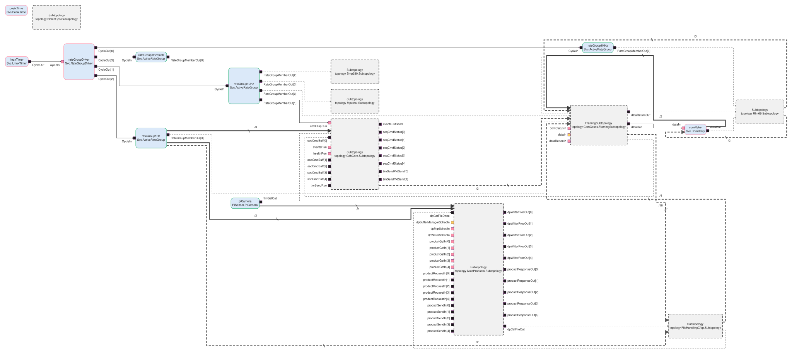

Subtopology <code>Bmp280.Subtopology</code>

> 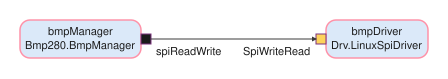
>

Subtopology <code>CdhCore.Subtopology</code>

> 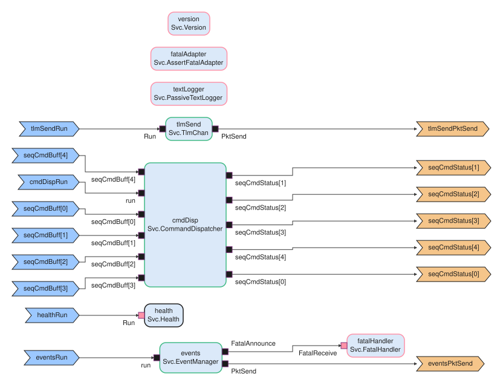
>

Subtopology <code>ComCcsds.FramingSubtopology</code>

> 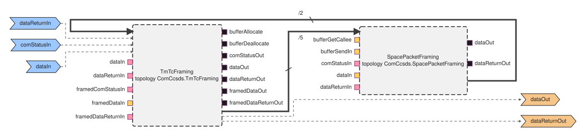
>
> 

> 
Subtopology <code>ComCcsds.SpacePacketFraming</code>

>
> > 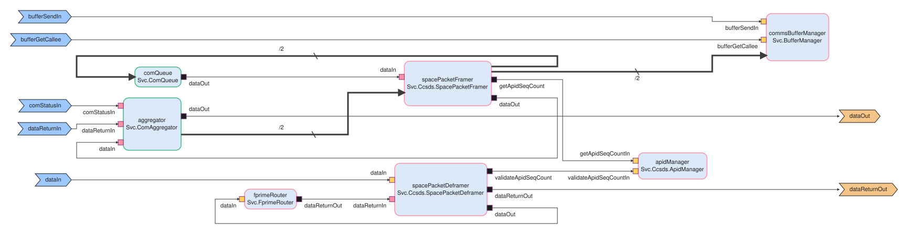
> >
> 

>
> 

> 
Subtopology <code>ComCcsds.TmTcFraming</code>

>
> > 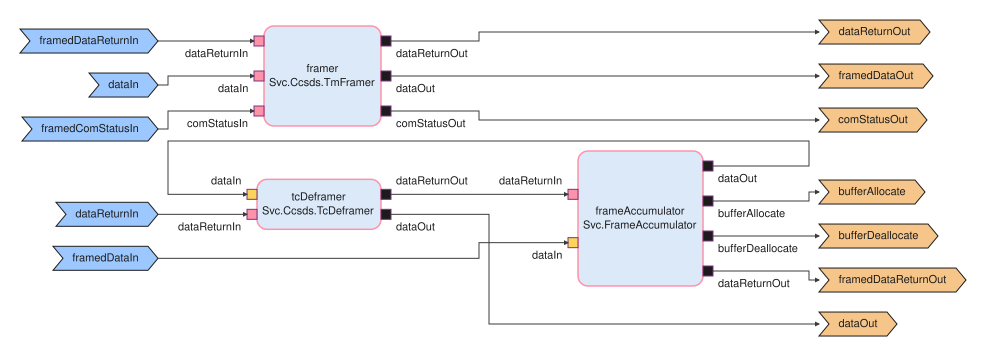
> >
> 

>

Subtopology <code>DataProducts.Subtopology</code>

> 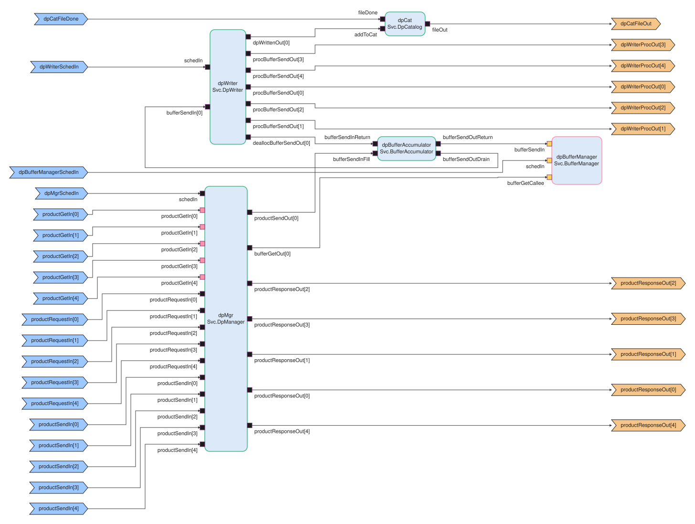
>

Subtopology <code>FileHandlingCfdp.Subtopology</code>

> 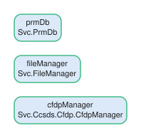
>

Subtopology <code>MpuImu.Subtopology</code>

> 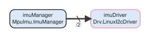
>

Subtopology <code>NmeaGps.Subtopology</code>

> 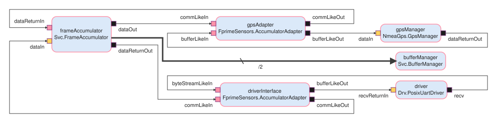
>

Subtopology <code>Rfm69.Subtopology</code>

> 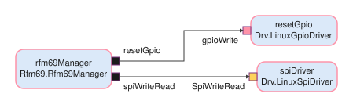
>

_Solid box: component instance (green outline active, pink passive). Dashed box: imported topology. Chevron: port declared by this topology. Thick line with `/N`: N parallel connections. Dashed line: connection that reaches inside an imported topology. Connections generated by connection patterns (command, events, telemetry, text events, time, health, parameters) are not drawn._
