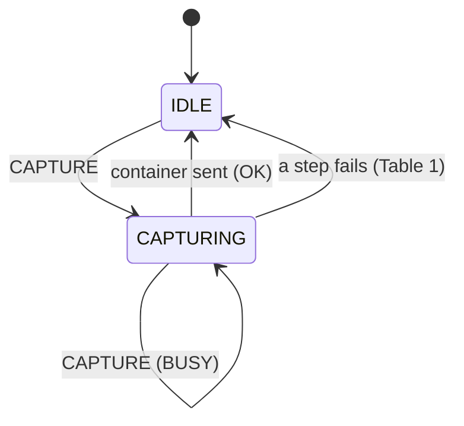
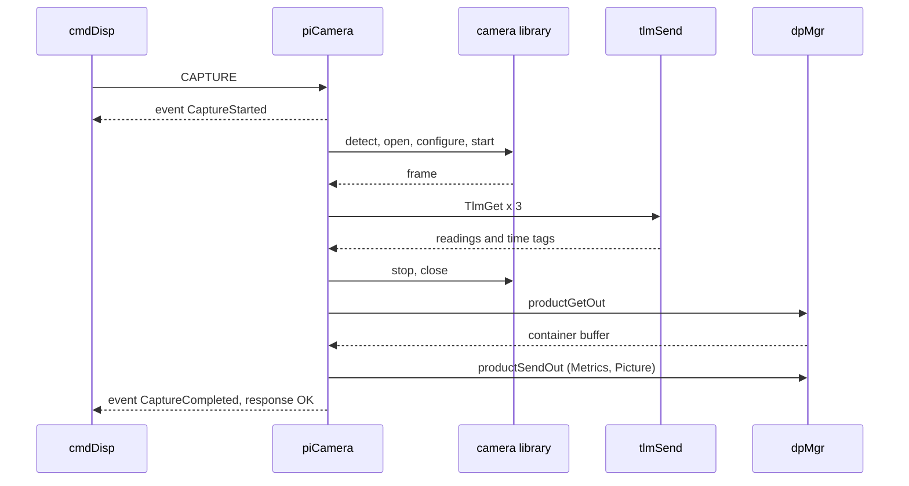

# PiSensor::PiCamera

## 1. Introduction

`PiCamera` manages the Raspberry Pi Camera attached to the CSI port of a
Raspberry Pi 5. On a capture command it acquires one picture, encodes it as a
JPEG, reads the latest temperature, acceleration and location readings with
their sample times from the telemetry store, derives roll and pitch from the
acceleration, and writes the picture and the metrics as one data product
container. Storage and downlink of the container belong to the data product
components it hands the container to.

Open: camera model, datasheet (title, revision) and the identification the
camera library reports. The camera is not yet attached to the bench. A camera
that libcamera does not support reopens REQ-PiCamera-001, 002 and 003.

## 2. Requirements

| ID | Requirement | Traces to | Verification |
|---|---|---|---|
| REQ-PiCamera-001 | For each accepted `CAPTURE` command the component shall acquire one picture from the Pi Camera after it receives the command. | REQ-PiSensor-004 | Integration Test |
| REQ-PiCamera-002 | Each stored picture shall be one JFIF file, SOI to EOI, `PICTURE_WIDTH` x `PICTURE_HEIGHT` pixels. | REQ-PiSensor-004 | Integration Test |
| REQ-PiCamera-003 | The component shall use only Raspberry Pi OS packaged camera and JPEG libraries, not OpenCV. | REQ-PiSensor-004 | Inspection |
| REQ-PiCamera-004 | Each successful capture shall send exactly one `Capture` container holding one `Picture` record and one `Metrics` record. | REQ-PiSensor-005 | Unit Test |
| REQ-PiCamera-005 | The `Metrics` record shall hold the latitude, longitude and temperature of the latest Table 3 readings, unchanged. | REQ-PiSensor-005 | Unit Test |
| REQ-PiCamera-006 | The `Metrics` record shall hold roll = atan2(ay, az) and pitch = atan2(-ax, sqrt(ay² + az²)) in degrees, within 0.01°, with ax, ay, az the x, y, z of the latest `MpuImu.ImuData.acceleration`. | REQ-PiSensor-005 | Unit Test |
| REQ-PiCamera-007 | The capture time shall be the system time read when the frame arrives from the camera, stored in the `Metrics` record and as the container time tag. | REQ-PiSensor-006 | Unit Test |
| REQ-PiCamera-008 | The `Metrics` record shall hold, for location, attitude and temperature, the time tag the telemetry store returns with the reading. | REQ-PiSensor-006 | Unit Test |
| REQ-PiCamera-009 | Each accepted `CAPTURE` command shall get its response within `CAPTURE_MAX_MS` of its receipt. | REQ-PiSensor-007 | Integration Test |
| REQ-PiCamera-010 | A capture shall fail with `SENSOR_STALE` when a sample time differs from the capture time by more than `METRIC_MAX_AGE_MS` or has another time base. | REQ-PiSensor-014 | Unit Test |
| REQ-PiCamera-011 | A capture shall fail with `SENSOR_NO_DATA` when the telemetry store returns no value for a Table 3 channel or a value that does not decode. | REQ-PiSensor-014 | Unit Test |
| REQ-PiCamera-012 | A capture shall fail with `METRIC_INVALID` when a reading holds a non-finite value, a latitude outside ±90, a longitude outside ±180 or an acceleration of magnitude 0. | REQ-PiSensor-005 | Unit Test |
| REQ-PiCamera-013 | A failed capture shall send no container. | REQ-PiSensor-005, REQ-PiSensor-014 | Unit Test |
| REQ-PiCamera-014 | Each `CAPTURE` command shall get exactly one command response: `OK` after the container is sent, `EXECUTION_ERROR` on failure. | Component | Unit Test |
| REQ-PiCamera-015 | Each failed `CAPTURE` command shall emit one `CaptureFailed` (`WARNING_HI`) with the Table 1 reason and step of the failure and a code: the failing library call's return code, the sample age in ms for `SENSOR_STALE` limited to the I32 range (0 for another time base), 0 otherwise. | Component | Unit Test |
| REQ-PiCamera-016 | A capture shall fail with `NO_CAMERA` when the camera library lists no camera, and with `CAMERA_ERROR` when a camera or JPEG library call fails or the frame is reported in error or incomplete. | Component | Integration Test, Unit Test |
| REQ-PiCamera-017 | A capture shall fail with `TOO_LARGE` when the JPEG exceeds `PICTURE_MAX_SIZE` bytes, and with `NO_CONTAINER` when no container buffer is obtained. | Component | Unit Test |
| REQ-PiCamera-018 | A `CAPTURE` command received before an earlier capture ended shall fail with `BUSY` and shall not change the earlier capture's result. | Component | Unit Test |
| REQ-PiCamera-019 | After a failed capture, the next capture shall succeed without a restart once the cause is gone. | Component | Integration Test, Unit Test |
| REQ-PiCamera-020 | Each accepted `CAPTURE` command shall emit one `CaptureStarted` (`ACTIVITY_LO`) before acquisition. | Component | Unit Test |
| REQ-PiCamera-021 | The component shall publish each Table 2 channel once at start and whenever its value changes. | Component | Unit Test |
| REQ-PiCamera-022 | The component shall answer each health ping from its thread with the key it received. | Component | Unit Test |
| REQ-PiCamera-023 | The component shall ask the camera for a frame with a limit of `FRAME_TIMEOUT_MS` and fail a capture whose wait is reported timed out with `TIMEOUT`. | REQ-PiSensor-007 | Unit Test |
| REQ-PiCamera-024 | After a restart during a capture, the first `CAPTURE` command shall succeed. | Component | Integration Test |
| REQ-PiCamera-025 | Each successful capture shall emit one `CaptureCompleted` (`ACTIVITY_HI`) with the JPEG size. | Component | Unit Test |

`Traces to` names the system requirement a row derives from. `Component` marks
fault, warning and reporting behaviour the system design assigns to this
component without a system requirement.

Table 1: failure reasons and steps. `BUSY` is decided on receipt of the command, before any other reason; the others are decided in the order of the steps: `DETECT`, `OPEN`, `CONFIGURE`, `START`, `FRAME`, `TEMPERATURE`, `ATTITUDE`, `LOCATION`, `ENCODE`, `CONTAINER`.

| Reason | Meaning | Steps |
|---|---|---|
| `BUSY` | An earlier capture has not ended | `RECEIVE` |
| `NO_CAMERA` | The camera library lists no camera | `DETECT` |
| `CAMERA_ERROR` | A camera or JPEG library call failed, or the frame is reported in error or incomplete | `OPEN`, `CONFIGURE`, `START`, `FRAME`, `ENCODE` |
| `TIMEOUT` | No frame within `FRAME_TIMEOUT_MS` | `FRAME` |
| `SENSOR_NO_DATA` | No usable reading in the telemetry store | `TEMPERATURE`, `ATTITUDE`, `LOCATION` |
| `SENSOR_STALE` | Sample time too far from the capture time | `TEMPERATURE`, `ATTITUDE`, `LOCATION` |
| `METRIC_INVALID` | A reading holds a value outside its range | `TEMPERATURE`, `ATTITUDE`, `LOCATION` |
| `TOO_LARGE` | JPEG larger than `PICTURE_MAX_SIZE` | `ENCODE` |
| `NO_CONTAINER` | No container buffer obtained | `CONTAINER` |

Table 2: telemetry.

| Channel | Content |
|---|---|
| `CapturesCompleted` | Captures that sent a container since start |
| `CapturesFailed` | `CAPTURE` commands that failed since start |
| `LastPictureSize` | Size in bytes of the last stored JPEG |

Each channel is 0 at start.

Table 3: readings taken from the telemetry store.

| Metric | Source | Type | Fields used |
|---|---|---|---|
| Temperature | `Bmp280.bmpManager.Reading` | `Bmp280.Bmp280Data` | `temperature` (°C) |
| Attitude | `MpuImu.imuManager.Reading` | `MpuImu.ImuData` | `acceleration` x, y, z |
| Location | `NmeaGps.gpsManager.Reading` | `NmeaGps.GpsData` | `latitude`, `longitude` (degrees) |

Table 4: constants.

| Constant | Value | Unit |
|---|---|---|
| `PICTURE_WIDTH`, `PICTURE_HEIGHT` | 640, 480 | pixels |
| `PICTURE_MAX_SIZE` | 262144 | bytes |
| `FRAME_TIMEOUT_MS` | 10000 | ms |
| `CAPTURE_MAX_MS` | 15000 | ms |
| `METRIC_MAX_AGE_MS` | 2000 | ms |

External References

| Document | Identifier / Revision | Type | Governs |
|---|---|---|---|
| libcamera public API | `libcamera-dev` 0.8.0+rpt20261104-1, Raspberry Pi OS 13 (trixie) archive | Other | camera discovery, configuration, frame request |
| libjpeg-turbo API | `libjpeg62-turbo-dev` 1:2.1.5-4, Debian 13 (trixie) main, as shipped by Raspberry Pi OS 13 | Other | JPEG compression calls |
| JPEG File Interchange Format | JFIF 1.02; ITU-T T.81 | Standard | picture encoding |
| F Prime data products | `nasa/fprime` `devel@83221ba`, `Fw/Dp`, `Svc/DpManager`, `Svc/DpWriter` | Other | container format, buffer and send ports |
| F Prime telemetry store | `nasa/fprime` `devel@83221ba`, `Svc/TlmChan` port `TlmGet` | Other | latest channel value and time tag |
| Sensor reading types | `fprime-community/fprime-sensors@e5d83d1`, `Bmp280`, `MpuImu`, `NmeaGps` `Types.fpp` | Other | layout and units of the Table 3 readings |

## 3. Design

### 3.1 Component Diagram

```
                           ┌────────────────────┐
cmdIn : Fw.Cmd            [ ]                  [ ] tlmGetOut : Fw.TlmGet
                           │      PiCamera      │
pingIn : Svc.Ping         [ ]     (active)     [ ] productGetOut : Fw.DpGet
                           │                    │
                           │                   [ ] productSendOut : Fw.DpSend
                           │                    │
                           │                   [ ] pingOut : Svc.Ping
                           └────────────────────┘
  special ports: cmdRegOut, cmdResponseOut, eventOut, textEventOut, tlmOut, timeGetOut
```

`PiCamera` is an active component: its thread makes the camera calls, which take seconds.

### 3.2 Ports

| Name | Kind | Type | Purpose |
|---|---|---|---|
| `cmdIn` | command recv | `Fw.Cmd` | `CAPTURE`, a guarded command |
| `tlmGetOut` | output | `Fw.TlmGet` | Latest value and time tag of a Table 3 channel |
| `productGetOut` | product get | `Fw.DpGet` | Gets the container buffer, synchronously |
| `productSendOut` | product send | `Fw.DpSend` | Sends the filled container |
| `pingIn`, `pingOut` | async input (drop), output | `Svc.Ping` | Health ping of the component thread |
| `acquire` | internal | `opCode`, `cmdSeq` | Work of one capture, on the component thread; carries the command it answers |

Three threads enter the component.

| Thread | Runs | Touches |
|---|---|---|
| Command dispatcher | `CAPTURE` handler | `m_busy`, `m_failed`, under the component guard; emits its events, telemetry, response and `acquire` under the guard |
| Component thread | `acquire`, `pingIn` | Everything else; `m_busy`, `m_completed`, `m_failed` under the guard |
| Camera library thread | Frame callback inside the camera interface | The interface's frame slot and wake-up, under the interface's own lock; no component member, no port |

### 3.3 State

| Member | Values | Meaning |
|---|---|---|
| `m_busy` | bool | A capture is accepted and has not ended |
| `m_jpeg` | `PICTURE_MAX_SIZE` bytes | Encoded picture until it is copied into the container |
| `m_completed`, `m_failed` | U32 | Counts behind `CapturesCompleted`, `CapturesFailed`; wrap to 0 after 4294967295 |
| `m_channels` | 3 channel identifiers | Table 3 channels, set by `configure` |

At start `m_busy` is false, the counts are 0 and the camera is closed. Nothing is kept across a restart (REQ-PiCamera-024).

The camera is closed outside `acquire`: every capture opens it and closes it again, on success and on failure.



### 3.4 Configuration and Setup

```fpp
constant PICTURE_WIDTH = 640
constant PICTURE_HEIGHT = 480
constant PICTURE_MAX_SIZE = 262144
constant FRAME_TIMEOUT_MS = 10000
constant CAPTURE_MAX_MS = 15000
constant SETTLE_FRAMES = 10
constant JPEG_QUALITY = 90
constant METRIC_MAX_AGE_MS = 2000
```

Picture size, largest JPEG, longest wait for the frame, longest time from command to response, frames discarded while exposure settles, the libjpeg quality setting, and the largest difference between a sample time and the capture time.

```fpp
instance piCamera: PiSensor.PiCamera base id 0x10008000 queue size 5 stack size 1048576 priority 30
```

`configure(temperatureChannel, attitudeChannel, locationChannel)` is called once before the component thread starts, with the identifiers of the Table 3 channels in the topology.

The component thread publishes the three Table 2 channels with value 0 when it starts, after the ports are connected.

| Port | Connects to |
|---|---|
| `tlmGetOut` | `CdhCore.tlmSend.TlmGet` |
| `productGetOut` | `DataProducts.Subtopology.productGetIn` |
| `productSendOut` | `DataProducts.Subtopology.productSendIn` |
| `pingIn`, `pingOut` | `CdhCore.$health`, ping entry `piCamera` with warning at 20 and fatal at 30 unanswered 1 Hz cycles |

The buffers of `DataProducts.Subtopology` hold at least one `Capture` container: `PICTURE_MAX_SIZE` bytes plus the `Metrics` record and the container overhead (`DataProductsConfig.BuffMgr.dpBufferStoreSize`).

The ping is not answered during a capture; its limits lie above `CAPTURE_MAX_MS`, the bound of REQ-PiCamera-009 on the steps of 3.5.

The camera is asked for `PICTURE_WIDTH` x `PICTURE_HEIGHT` frames in a format libjpeg-turbo compresses without conversion (YUV420), encoded at `JPEG_QUALITY` (REQ-PiCamera-002).

The camera is reached through one interface class (`detect`, `open`, `configure`, `start`, `waitFrame`, `stop`, `close`) implemented with libcamera; JPEG encoding uses libjpeg-turbo. Both are Raspberry Pi OS packages. `stop` returns only after no frame callback can run; a frame that arrives after the wait timed out is discarded. Unit tests substitute the interface. The CMake option `PICAMERA_NO_CAMERA` selects an implementation that detects no camera; with the option off, a build that finds no libcamera fails.

### 3.5 Handlers

#### CAPTURE

Under the guard: when `m_busy` is set it emits `CaptureFailed(BUSY, RECEIVE, 0)`, counts the failure, publishes `CapturesFailed` and responds `EXECUTION_ERROR`. Otherwise it sets `m_busy`, emits `CaptureStarted` and sends `acquire` with the opcode and sequence number of the command.

#### acquire

It runs the steps below in order. The first step that fails closes the camera, emits `CaptureFailed` with its Table 1 reason and step, ends the capture and responds `EXECUTION_ERROR`; no later step runs.

Ending a capture is one guarded section: count the success or failure, publish the changed channels, clear `m_busy`. The command response follows it, with the opcode and sequence number `acquire` carried, so a `CAPTURE` sent on receipt of the response is accepted and cannot change the response of the ended capture.

1. Detect, open, configure and start the camera (`DETECT`, `OPEN`, `CONFIGURE`, `START`).
2. Wait for the frame, at most `FRAME_TIMEOUT_MS` (`FRAME`). The camera interface discards `SETTLE_FRAMES` frames and hands over the next one; a frame reported in error or shorter than a full frame fails the step. The wait is measured on a monotonic clock, not on system time.
3. Read the system time: the capture time.
4. Read the three Table 3 channels through `tlmGetOut` and check each one in the order `TEMPERATURE`, `ATTITUDE`, `LOCATION`: a value is present and decodes, its time tag is within `METRIC_MAX_AGE_MS` of the capture time, its fields are in range. Compute roll and pitch.
5. Encode the frame as a JPEG into `m_jpeg` (`ENCODE`), then stop and close the camera.
6. Get a `Capture` container buffer for the two records through `productGetOut` (`CONTAINER`).
7. Write the `Metrics` record and the `Picture` record, set the container time tag to the capture time and send the container through `productSendOut`.
8. Emit `CaptureCompleted`, end the capture and respond `OK`.

The readings are read after the frame arrives and before encoding, so their age does not include the encoding time.

The component thread holds the guard only to end a capture; the `CAPTURE` handler holds it for its events, telemetry, response and `acquire` send. No camera call, `tlmGetOut` call, product port call or wait happens while the guard is held.

The queue holds at most one `acquire` and the pings; a full queue asserts.

#### pingIn

It echoes the key on `pingOut`.

## 4. Data Product Format

One container per successful capture, no processing. Its time tag is the capture time.

| Container | Default priority | Records |
|---|---|---|
| `Capture` | 10 | `Metrics`, `Picture` |

| Record | Type | Content |
|---|---|---|
| `Metrics` | `CaptureMetrics` | Capture time, metrics and their sample times |
| `Picture` | `U8` array | The JPEG, SOI to EOI; the array size is the JPEG length |

`CaptureMetrics`, in serialization order:

| Field | Type | Unit | Content |
|---|---|---|---|
| `captureTime` | `Fw.TimeValue` | — | Time the frame arrived |
| `latitude` | F64 | degrees, north positive | From `NmeaGps.GpsData` |
| `longitude` | F64 | degrees, east positive | From `NmeaGps.GpsData` |
| `locationTime` | `Fw.TimeValue` | — | Sample time of latitude and longitude |
| `roll` | F32 | degrees | Derived from the acceleration |
| `pitch` | F32 | degrees | Derived from the acceleration |
| `attitudeTime` | `Fw.TimeValue` | — | Sample time of the acceleration |
| `temperature` | F32 | °C | From `Bmp280.Bmp280Data` |
| `temperatureTime` | `Fw.TimeValue` | — | Sample time of the temperature |

## 5. Ground Interface

| Command | Kind | Arguments | Action |
|---|---|---|---|
| `CAPTURE` | guarded | — | Acquire one picture and store it with the latest metrics as one data product |

| Telemetry | Type | Content |
|---|---|---|
| `CapturesCompleted` | U32 | Captures that sent a container since start |
| `CapturesFailed` | U32 | `CAPTURE` commands that failed since start |
| `LastPictureSize` | U32 | Size in bytes of the last stored JPEG |

| Event | Severity | Arguments | Meaning |
|---|---|---|---|
| `CaptureStarted` | `ACTIVITY_LO` | — | A `CAPTURE` command is accepted; acquisition begins |
| `CaptureCompleted` | `ACTIVITY_HI` | `bytes` | The container was sent; `bytes` is the JPEG size |
| `CaptureFailed` | `WARNING_HI` | `reason`, `step`, `code` | A `CAPTURE` command failed; `code` is the library return code, the sample age in ms (capture time minus sample time, limited to the I32 range, 0 for another time base) for `SENSOR_STALE`, else 0 |

The component has no parameters.

## 6. Example Uses



A capture with the GPS receiver silent ends after step 4 with `CaptureFailed(SENSOR_STALE, LOCATION, age)` or, when the receiver never reported, `CaptureFailed(SENSOR_NO_DATA, LOCATION, 0)`, a command response `EXECUTION_ERROR` and no container.

## 7. Idiosyncrasies

- The command response `OK` means the container was handed to the data product components. The file is written later by `dpWriter`, which reports `FileWritten` or a write error with its own events; the component does not learn of a write failure.
- `NmeaGps.GpsData` has no fix flag. Without a fix the receiver's channel is not updated, so a capture fails with `SENSOR_STALE` or `SENSOR_NO_DATA` at `LOCATION`.
- Roll and pitch assume the sensor is at rest; under acceleration they are wrong by the angle between the measured acceleration and gravity. Yaw is not available.
- A `CAPTURE` command is refused with `BUSY` from its acceptance until the earlier capture's response, at most `CAPTURE_MAX_MS`.
- The health ping is not answered during a capture; the ping limits of 3.4 cover the longest capture. A camera library call that does not return blocks the component thread: health then reports the ping and later `CAPTURE` commands get `BUSY`.
- `PICTURE_WIDTH`, `PICTURE_HEIGHT`, `PICTURE_MAX_SIZE`, `FRAME_TIMEOUT_MS`, `CAPTURE_MAX_MS`, `SETTLE_FRAMES`, `JPEG_QUALITY` and `METRIC_MAX_AGE_MS` are compile-time constants; changing one needs a rebuild.
- The picture is held twice during a capture: in `m_jpeg` and in the container.

## 8. Tests

REQ-PiCamera-001, 002 and 009 are verified on the bench by the system tests of the project (`test/int/plan.json`, tests L2-3 to L2-6), which read the picture record of the downlinked product and the times of the command and its response. REQ-PiCamera-016, 019 and 024 need bench captures: with no camera attached, after a failure (camera held by another process, then freed) and after a restart during a capture. REQ-PiCamera-003 is verified by inspection of the build inputs and of the libraries the image links.

Unit tests substitute the camera interface, the telemetry store and the data product ports.

| Unit test | Description | Requirements |
|---|---|---|
| NominalCapture | A capture sends one container with one `Metrics` and one `Picture` record holding the substitute's JPEG, and responds `OK` once. | REQ-PiCamera-004, REQ-PiCamera-014 |
| MetricsCopied | Latitude, longitude and temperature in the record equal the readings in the store. | REQ-PiCamera-005 |
| RollPitch | Roll and pitch equal the formula within 0.01° for accelerations along +x, -x, +y, -y, +z, -z and one oblique vector. | REQ-PiCamera-006 |
| CaptureTime | The capture time in the record and the container time tag equal the time set when the substitute hands over the frame, not the command time. | REQ-PiCamera-007 |
| SampleTimes | The three sample times in the record equal three different time tags in the store. | REQ-PiCamera-008 |
| FrameTimeout | No frame: the wait is asked for `FRAME_TIMEOUT_MS` and the capture fails with `TIMEOUT` at `FRAME`. | REQ-PiCamera-023, REQ-PiCamera-015 |
| StaleReading | For each channel: a time tag `METRIC_MAX_AGE_MS` from the capture time passes, 1 ms more fails with `SENSOR_STALE` and the age as code, earlier and later; another time base fails with code 0; an age beyond the I32 range gives the range limit. | REQ-PiCamera-010, REQ-PiCamera-013 |
| MissingReading | For each channel: invalid status, empty value and a value too short to decode fail with `SENSOR_NO_DATA` at its step. | REQ-PiCamera-011, REQ-PiCamera-013 |
| InvalidMetric | NaN and infinity in each field, latitude ±90 passes and beyond fails, longitude ±180 passes and beyond fails, acceleration (0, 0, 0) fails, with `METRIC_INVALID`. | REQ-PiCamera-012, REQ-PiCamera-013 |
| NoCamera | No camera listed fails with `NO_CAMERA` at `DETECT`. | REQ-PiCamera-016, REQ-PiCamera-015 |
| CameraErrors | A failure at each of `OPEN`, `CONFIGURE`, `START`, `FRAME`, `ENCODE`, and a frame in error or incomplete, fails with `CAMERA_ERROR`, that step and the substitute's return code, and closes the camera. | REQ-PiCamera-016, REQ-PiCamera-015 |
| TooLarge | A JPEG of `PICTURE_MAX_SIZE` bytes passes; one byte more fails with `TOO_LARGE`. | REQ-PiCamera-017 |
| NoContainer | A failed container request fails with `NO_CONTAINER`; nothing is sent. | REQ-PiCamera-017, REQ-PiCamera-013 |
| FailureResponse | Every failure above gives one `EXECUTION_ERROR` response, one `CaptureFailed`, no `CaptureCompleted` and no container. | REQ-PiCamera-013, REQ-PiCamera-014, REQ-PiCamera-015 |
| BusyDuringCapture | A `CAPTURE` during a capture gets `BUSY` at `RECEIVE`, one `EXECUTION_ERROR` and one count in `CapturesFailed`; a `CAPTURE` sent on the earlier response is accepted; the capture in progress ends with the same container as without it. | REQ-PiCamera-018, REQ-PiCamera-014 |
| RecoveryAfterFailure | After each failure reason, a capture with the cause removed succeeds. | REQ-PiCamera-019 |
| Events | An accepted capture emits `CaptureStarted` once before the first camera call; a success emits `CaptureCompleted` with the JPEG size. | REQ-PiCamera-020, REQ-PiCamera-025 |
| TelemetryOnChange | The start of the component thread publishes the three channels as 0; each success and failure publishes the Table 2 channels it changed, with their values. | REQ-PiCamera-021 |
| Ping | A ping is echoed with its key. | REQ-PiCamera-022 |
| RandomSequences | Random sequences of captures, busy commands and injected failures keep one response per command and the counts equal to the responses. | REQ-PiCamera-014, REQ-PiCamera-018, REQ-PiCamera-021 |

Component Development Checklist: [checklist.md](../../Components/PiCamera/docs/checklist.md)
