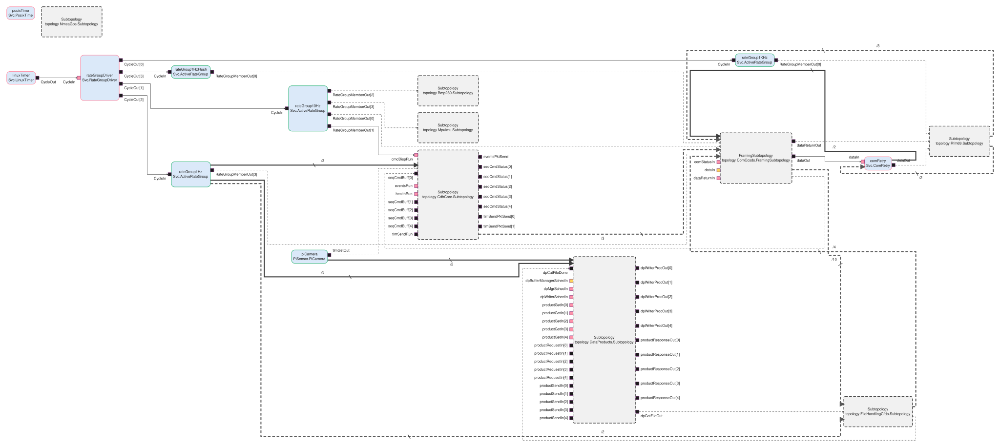
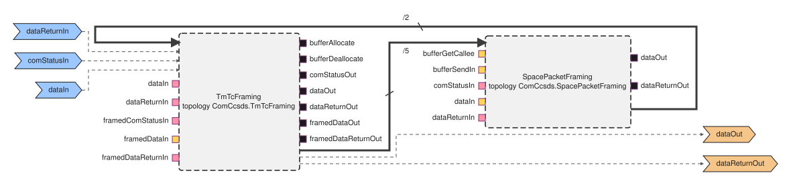
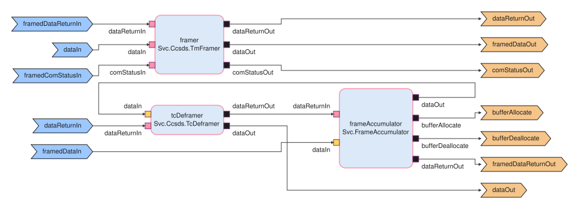
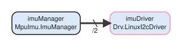
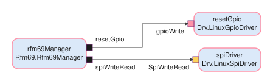

# PiSensor System Software Design Document

## Introduction

PiSensor is an F Prime deployment for a Raspberry Pi 5. The ask, verbatim:

> I would like you to develop a system that runs on a raspberry pi 5, and communicates with the following sensors:
>
> 1. BMP280
> 2. MPU6050
> 3. PI Camera
> 4. Nmea GPS
>
> The system shall have the goal of reading these sensors and combining the key sensor metrics: location, attitude, and temperature + a picture into a single data product for downlinking using CFDP.  The sensors should stream telemetry, and pictures should be captured, correlated, and made into a data product in response to a command.
>
> System communication should go through an RFM69 packet radio.
>
> My expectation is that the PI camera be rewritten using standard PI libraries that are easy to install rather than using the OpenCV camera setup from fprime-examples as that is complex and overkill.
>
> Note: your development testbed is the PI used for soak testing trials attached to your PI workstation.  Be respectful of other users.  A ground system PI w/ RFM69 will be attached to your workstation for ground testing and a camera will be attached to the soak PI after SSDD approval.  Prototype the initial system over TCP.
>
> Since this is an automatic process, please ask questions now and then proceed through SSDD review!

Attitude is roll and pitch plus raw gyro rates; yaw is not reported. The
ground system is fprime-yamcs. Bench parts on the Pi 5: an MPU6050 on I2C bus 1 (address 0x68) and an RFM69
on SPI0 CE1 answer. No BMP280 and no GPS receiver answer on any bus or port
yet; the Pi Camera and the ground Pi with its RFM69 arrive after approval.
The goal is a functional deployment with
respect to the ask, every system requirement proven in system tests on the
complete testbed.

## Requirements

| ID | Requirement | Verification |
|---|---|---|
| REQ-PiSensor-001 | Outside a CFDP downlink, the system shall downlink BMP280 temperature telemetry at least once every 2 s. | Integration Test |
| REQ-PiSensor-002 | Outside a CFDP downlink, the system shall downlink MPU6050 attitude telemetry at least once every 2 s. | Integration Test |
| REQ-PiSensor-003 | Outside a CFDP downlink, the system shall downlink GPS location telemetry at least once every 2 s. | Integration Test |
| REQ-PiSensor-004 | On a capture command, the system shall capture one Pi Camera JPEG of at least 640x480 pixels. | Integration Test |
| REQ-PiSensor-005 | Each successful capture shall produce one data product holding picture, location, attitude and temperature. | Integration Test |
| REQ-PiSensor-006 | Each data product shall carry its capture time, taken when the picture is acquired. | Integration Test |
| REQ-PiSensor-007 | Each metric marked valid shall carry a sample time within 2 s of capture time. | Integration Test |
| REQ-PiSensor-008 | A data product shall mark invalid each metric older than 2 s. | Integration Test |
| REQ-PiSensor-009 | A data product shall mark location invalid when the GPS reports no fix. | Integration Test |
| REQ-PiSensor-010 | The system shall complete a capture command within 30 s of dispatch. | Integration Test |
| REQ-PiSensor-011 | Each successful capture shall emit an `ACTIVITY_HI` event naming its data product. | Integration Test |
| REQ-PiSensor-012 | On a downlink command, the system shall send the named data product by CFDP class 2. | Integration Test |
| REQ-PiSensor-013 | A downlinked data product shall be byte-identical to the on-board data product. | Integration Test |
| REQ-PiSensor-014 | On a delete command, the system shall remove the named data product. | Integration Test |
| REQ-PiSensor-015 | In the flight configuration, commands, telemetry, events and CFDP files shall pass over the RFM69. | Integration Test |
| REQ-PiSensor-016 | In the prototype configuration, commands, telemetry, events and CFDP files shall pass over TCP. | Integration Test |
| REQ-PiSensor-017 | Commands, telemetry, events and CFDP files shall interoperate with the fprime-yamcs ground system. | Integration Test |
| REQ-PiSensor-018 | During a CFDP downlink, Table 1 sensor telemetry shall continue at least once every 10 s. | Integration Test |
| REQ-PiSensor-019 | The system shall emit a `WARNING_HI` event within 10 s of BMP280 read failure. | Integration Test |
| REQ-PiSensor-020 | The system shall emit a `WARNING_HI` event within 10 s of MPU6050 read failure. | Integration Test |
| REQ-PiSensor-021 | When GPS sentences stop, the system shall emit a `WARNING_HI` event within 10 s. | Integration Test |
| REQ-PiSensor-022 | Sensor telemetry shall report a metric invalid while its sensor is failed. | Integration Test |
| REQ-PiSensor-023 | Sensor telemetry shall resume within 10 s of a sensor's return, without a restart. | Integration Test |
| REQ-PiSensor-024 | GPS telemetry shall report fix invalid while the receiver reports no fix. | Integration Test |
| REQ-PiSensor-025 | The system shall discard NMEA sentences that fail their checksum. | Unit Test |
| REQ-PiSensor-026 | The system shall treat a BMP280 or MPU6050 with a wrong identity register as a read failure. | Unit Test |
| REQ-PiSensor-027 | The system shall discard uplink frames that fail their integrity check. | Unit Test |
| REQ-PiSensor-028 | A capture whose camera is absent or fails shall fail its command and emit `WARNING_HI`. | Integration Test |
| REQ-PiSensor-029 | A failed or interrupted capture shall leave no data product, complete or partial. | Integration Test |
| REQ-PiSensor-030 | A capture command during a capture shall fail with `WARNING_LO` and not disturb that capture. | Integration Test |
| REQ-PiSensor-031 | A capture that cannot store its data product shall fail its command and emit `WARNING_HI`. | Integration Test |
| REQ-PiSensor-032 | A downlink or delete command naming a missing data product shall fail with `WARNING_LO`. | Integration Test |
| REQ-PiSensor-033 | A downlink command during a downlink shall fail with `WARNING_LO` and not disturb that downlink. | Integration Test |
| REQ-PiSensor-034 | A CFDP transfer that makes no progress for 60 s shall end and emit a `WARNING_HI` event. | Integration Test |
| REQ-PiSensor-035 | An incomplete CFDP transfer shall leave the data product intact for a repeated downlink command. | Integration Test |
| REQ-PiSensor-036 | Within 10 s of the end of a link outage of at least 60 s, commanding and telemetry shall resume without a restart. | Integration Test |
| REQ-PiSensor-037 | Within 10 s of the end of a ground-system outage of at least 60 s, commanding and telemetry shall resume without a restart. | Integration Test |
| REQ-PiSensor-038 | Data products stored before a link outage, ground-system outage or restart shall remain downlinkable after it. | Integration Test |
| REQ-PiSensor-039 | After a restart, the system shall resume Table 1 sensor telemetry without ground commands within 60 s. | Integration Test |
| REQ-PiSensor-040 | The camera software shall use only Raspberry Pi OS packaged camera libraries, not OpenCV. | Inspection |
| REQ-PiSensor-041 | A delete command naming a data product being downlinked shall fail with `WARNING_LO`. | Integration Test |
| REQ-PiSensor-042 | The system shall meet REQ-PiSensor-001 to -041 on a Raspberry Pi 5 under 64-bit Raspberry Pi OS 13. | Integration Test |

Table 1: sensor telemetry.

| Sensor | Metric | Unit |
|---|---|---|
| BMP280 | temperature, validity | degrees Celsius |
| MPU6050 | roll, pitch, validity | degrees |
| MPU6050 | gyro rate about x, y, z | degrees per second |
| GPS | latitude, longitude | degrees |
| GPS | altitude | metres |
| GPS | fix validity | valid / invalid |

### Decisions for approval

The ask leaves these open. The author decided them; the human rules on each
at Approve SSDD.

| # | Question | Decision | Rows |
|---|---|---|---|
| D1 | Numeric bounds | Telemetry 2 s; stale after 2 s; fault event 10 s; capture 30 s; resume 10 s after an outage of 60 s or more; telemetry 60 s after restart; CFDP no-progress limit 60 s | 001-003, 007, 008, 010, 019-021, 023, 034, 036, 037, 039 |
| D2 | Downlink trigger | Separate command, not automatic after capture | 012 |
| D3 | CFDP class | Class 2 (acknowledged): the radio link is lossy | 012 |
| D4 | Telemetry during a file downlink | Continues, at least once every 10 s | 018 |
| D5 | Picture | JPEG, at least 640x480 | 004 |
| D6 | Downlink command during a downlink | Rejected | 033 |
| D7 | After a sensor fault | Metric flagged invalid; recovery within 10 s of return, no restart | 022, 023 |
| D8 | Bench parts | Identified on the bench and named in the Introduction | - |
| D9 | BMP280 pressure | Not required: the ask names temperature only | 001 |
| D10 | Storage | Delete command; no automatic storage bound; delete during that product's downlink rejected | 014, 041 |

## Architecture

### Elements

| Element | Kind | Function | Hardware or ground boundary |
|---|---|---|---|
| `CdhCore.Subtopology` | subtopology | Command dispatch, events, telemetry channels, health, fatal handling | — |
| `ComCcsds.Subtopology` | subtopology | CCSDS framing, deframing, frame integrity check, queues, routing | fprime-yamcs ground system |
| `FileHandlingCfdp.Subtopology` | subtopology | CFDP class 2 file transfer, file manager, parameters | — |
| `DataProducts.Subtopology` | subtopology | Data product buffers, writer and catalog | Pi 5 file system (SD card) |
| `Bmp280.Subtopology` | subtopology | Reads BMP280 temperature; checks its identity register | BMP280 on SPI |
| `MpuImu.Subtopology` | subtopology | Reads MPU6050 acceleration and gyro rates | MPU6050 on I2C bus 1, address 0x68 |
| `NmeaGps.Subtopology` | subtopology | Reads NMEA sentences, checks checksums, reports location and fix status | GPS receiver on a UART |
| `Rfm69.Subtopology` | subtopology | Sends and receives frames by packet radio (flight configuration) | RFM69 on SPI0 CE1 and its reset GPIO |
| `tcpLink` | component | Sends and receives frames over TCP (prototype configuration) | TCP socket to the ground host |
| `sensorMonitor` | component | Publishes Table 1 telemetry with validity; reports sensor loss; serves samples | — |
| `piCamera` | component | Acquires one JPEG and its acquisition time per request | Pi Camera on CSI |
| `productManager` | component | Runs capture, downlink and delete commands; builds the data product | — |
| `posixTime` | component | Supplies time for telemetry, events, samples and capture | Pi 5 system clock |
| `linuxTimer`, `rateGroupDriver`, `rateGroup1Hz`, `rateGroup10Hz` | components | Drive the periodic work of all elements | Pi 5 system timer |

The four core subtopologies and the four device subtopologies are used
whole. Three elements are bespoke, because no standard element has the
function:

- `sensorMonitor`: no standard element computes roll and pitch, marks a
  metric invalid, or reports a silent GPS.
- `piCamera`: the ask excludes the OpenCV camera.
- `productManager`: no standard element correlates samples with a picture
  or names, downlinks and deletes one product by command.

### Topology

Sketch source: [`sketch/PiSensorSketch.fpp`](sketch/PiSensorSketch.fpp).
The sketch shows the prototype link; in the flight configuration
`Rfm69.Subtopology` takes the place of `tcpLink`.

Subtopology <code>Bmp280.Subtopology</code>

> 
>

Subtopology <code>CdhCore.Subtopology</code>

> 
>

Subtopology <code>ComCcsds.Subtopology</code>

> 
>
> 

> 
Subtopology <code>ComCcsds.FramingSubtopology</code>

>
> > 
> >
> > 

> > 
Subtopology <code>ComCcsds.SpacePacketFraming</code>

> >
> > > 
> > >
> > 

> >
> > 

> > 
Subtopology <code>ComCcsds.TmTcFraming</code>

> >
> > > 
> > >
> > 

> >
> 

>

Subtopology <code>DataProducts.Subtopology</code>

> 
>

Subtopology <code>FileHandlingCfdp.Subtopology</code>

> 
>

Subtopology <code>MpuImu.Subtopology</code>

> 
>

Subtopology <code>NmeaGps.Subtopology</code>

> 
>

Subtopology <code>Rfm69.Subtopology</code>

> 
>

### Instances

| Instance | Element | Rate group / queue | Notes |
|---|---|---|---|
| `CdhCore.Subtopology` | `CdhCore.Subtopology` | 1 Hz: telemetry send, health | Command, event and telemetry spine |
| `ComCcsds.Subtopology` | `ComCcsds.Subtopology` | 10 Hz: queue, aggregator timeout | File traffic queued behind telemetry and events |
| `FileHandlingCfdp.Subtopology` | `FileHandlingCfdp.Subtopology` | 1 Hz: CFDP timers | One CFDP channel |
| `DataProducts.Subtopology` | `DataProducts.Subtopology` | 1 Hz: writer, buffers | Product files on the Pi 5 file system |
| `Bmp280.Subtopology` | `Bmp280.Subtopology` | 1 Hz: read | — |
| `MpuImu.Subtopology` | `MpuImu.Subtopology` | 1 Hz: read | — |
| `NmeaGps.Subtopology` | `NmeaGps.Subtopology` | Driven by the UART receive thread | — |
| `Rfm69.Subtopology` | `Rfm69.Subtopology` | 10 Hz: radio service | Flight configuration only |
| `tcpLink` | `tcpLink` | Own receive thread | Prototype configuration only |
| `sensorMonitor` | `sensorMonitor` | 1 Hz: passive | Reads the latest sensor readings each cycle |
| `piCamera` | `piCamera` | Queue: one capture at a time | Own thread; a capture may take seconds |
| `productManager` | `productManager` | Queue; 1 Hz: timeouts | Own thread |
| `posixTime` | `posixTime` | Passive | — |
| `linuxTimer` | `linuxTimer` | Source of the cycle | — |
| `rateGroupDriver` | `rateGroupDriver` | Divides the cycle | — |
| `rateGroup10Hz` | `rateGroup10Hz` | 10 Hz | — |
| `rateGroup1Hz` | `rateGroup1Hz` | 1 Hz | — |

## Requirement to Component Map

Short names: `Cdh` = `CdhCore.Subtopology`, `Com` = `ComCcsds.Subtopology`,
`Cfdp` = `FileHandlingCfdp.Subtopology`, `Dp` = `DataProducts.Subtopology`,
`Bmp` = `Bmp280.Subtopology`, `Imu` = `MpuImu.Subtopology`,
`Gps` = `NmeaGps.Subtopology`, `Rfm` = `Rfm69.Subtopology`,
`sched` = `linuxTimer`, `rateGroupDriver`, `rateGroup1Hz`, `rateGroup10Hz`.

| Requirement | Kind | Target | Observable | Level |
|---|---|---|---|---|
| REQ-PiSensor-001 | set | `Bmp`, `sensorMonitor`, `Cdh`, `Com`, `sched` | Interval between temperature channel samples at the ground | system test |
| REQ-PiSensor-002 | set | `Imu`, `sensorMonitor`, `Cdh`, `Com`, `sched` | Interval between attitude channel samples at the ground | system test |
| REQ-PiSensor-003 | set | `Gps`, `sensorMonitor`, `Cdh`, `Com`, `sched` | Interval between location channel samples at the ground | system test |
| REQ-PiSensor-004 | component | `piCamera` | JPEG markers and pixel size of the returned picture | component test |
| REQ-PiSensor-005 | set | `productManager`, `piCamera`, `sensorMonitor`, `Dp` | Records in the data product file | system test |
| REQ-PiSensor-006 | set | `piCamera`, `posixTime`, `productManager` | Capture time record against bench time of the capture | system test |
| REQ-PiSensor-007 | component | `productManager` | Sample time and capture time records of the data product | component test |
| REQ-PiSensor-008 | component | `productManager` | Validity records of the data product for aged samples | component test |
| REQ-PiSensor-009 | component | `productManager` | Location validity record for a no-fix sample | component test |
| REQ-PiSensor-010 | set | `productManager`, `piCamera`, `Dp` | Time from command dispatch to command response | system test |
| REQ-PiSensor-011 | component | `productManager` | `ACTIVITY_HI` event and its product name argument | component test |
| REQ-PiSensor-012 | set | `productManager`, `Cfdp`, `Com` | Class 2 transaction and file at the ground | system test |
| REQ-PiSensor-013 | set | `Cfdp`, `Com` | Hash of the ground file against the on-board file | system test |
| REQ-PiSensor-014 | component | `productManager` | Product file absent after the command response | component test |
| REQ-PiSensor-015 | set | `Rfm`, `Com`, `sched` | Command response, channel, event and file at the ground, TCP absent | system test |
| REQ-PiSensor-016 | set | `tcpLink`, `Com` | Command response, channel, event and file at the ground over TCP | system test |
| REQ-PiSensor-017 | system | system | fprime-yamcs records of a command, a channel, an event and a file | system test |
| REQ-PiSensor-018 | system | system | Interval between Table 1 channel samples at the ground during a downlink | system test |
| REQ-PiSensor-019 | component | `sensorMonitor` | `WARNING_HI` event time after BMP280 readings stop | component test |
| REQ-PiSensor-020 | component | `sensorMonitor` | `WARNING_HI` event time after MPU6050 readings stop | component test |
| REQ-PiSensor-021 | component | `sensorMonitor` | `WARNING_HI` event time after GPS sentences stop | component test |
| REQ-PiSensor-022 | component | `sensorMonitor` | Validity channel of each metric | component test |
| REQ-PiSensor-023 | set | `Bmp`, `Imu`, `Gps`, `sensorMonitor` | Validity channels after each sensor returns, no restart | system test |
| REQ-PiSensor-024 | set | `Gps`, `sensorMonitor` | Fix validity channel while the receiver reports no fix | system test |
| REQ-PiSensor-025 | subtopology | `Gps` | Location unchanged after a bad-checksum sentence | component test |
| REQ-PiSensor-026 | set | `Bmp`, `Imu` | Read-failure event of each on a wrong identity value | component test |
| REQ-PiSensor-027 | subtopology | `Com` | No command dispatched for a corrupted frame | component test |
| REQ-PiSensor-028 | set | `piCamera`, `productManager` | Command response and `WARNING_HI` event | system test |
| REQ-PiSensor-029 | component | `productManager` | No product file after the failed or interrupted capture | component test |
| REQ-PiSensor-030 | component | `productManager` | `WARNING_LO` event; first capture's product complete | component test |
| REQ-PiSensor-031 | set | `productManager`, `Dp` | Command response and `WARNING_HI` event with storage full | system test |
| REQ-PiSensor-032 | component | `productManager` | Command response and `WARNING_LO` event | component test |
| REQ-PiSensor-033 | component | `productManager` | `WARNING_LO` event; first downlink's file complete | component test |
| REQ-PiSensor-034 | set | `Cfdp`, `productManager` | `WARNING_HI` event time after the last CFDP progress | system test |
| REQ-PiSensor-035 | set | `Cfdp`, `productManager`, `Dp` | Product file hash unchanged; repeated downlink completes | system test |
| REQ-PiSensor-036 | set | `Rfm`, `tcpLink`, `Com` | Time from link return to a command response and a channel sample | system test |
| REQ-PiSensor-037 | system | system | Time from ground-system return to a command response and a channel sample | system test |
| REQ-PiSensor-038 | set | `productManager`, `Dp`, `Cfdp` | Downlink of an earlier product completes after each event | system test |
| REQ-PiSensor-039 | system | system | Time from restart to the first Table 1 samples, no command sent | system test |
| REQ-PiSensor-040 | component | `piCamera` | Build inputs and linked libraries of the camera software | inspection |
| REQ-PiSensor-041 | component | `productManager` | `WARNING_LO` event; product file present; downlink completes | component test |
| REQ-PiSensor-042 | system | system | Board model and OS release recorded with each system test run | system test |

### Faults

| Fault | Detected by | Answered by | Requirement |
|---|---|---|---|
| BMP280 read failure | `sensorMonitor` (reading age) | `sensorMonitor` (event, metric invalid) | 019, 022 |
| MPU6050 read failure | `sensorMonitor` (reading age) | `sensorMonitor` (event, metric invalid) | 020, 022 |
| GPS sentences stop | `sensorMonitor` (sentence age) | `sensorMonitor` (event, metric invalid) | 021, 022 |
| Sensor returns | `Bmp`, `Imu`, `Gps` (next good read) | `sensorMonitor` (metric valid) | 023 |
| GPS no fix | `Gps` (fix field) | `sensorMonitor` (fix invalid); `productManager` (location invalid) | 024, 009 |
| Bad NMEA checksum | `Gps` | `Gps` (sentence discarded) | 025 |
| Wrong identity register | `Bmp`, `Imu` | `Bmp`, `Imu` (read failure) | 026 |
| Corrupt uplink frame | `Com` | `Com` (frame discarded) | 027 |
| Stale metric at capture | `productManager` (sample age) | `productManager` (metric invalid) | 008 |
| Camera absent or failed | `piCamera` | `productManager` (command fails, event, no product) | 028, 029 |
| Capture interrupted by restart | `productManager` (at start) | `productManager` (partial product removed) | 029 |
| Capture during capture | `productManager` | `productManager` (command fails) | 030 |
| Storage failure | `Dp` (write status) | `productManager` (command fails, event) | 031 |
| Missing product named | `productManager` | `productManager` (command fails) | 032 |
| Downlink during downlink | `productManager` | `productManager` (command fails) | 033 |
| Delete during downlink | `productManager` | `productManager` (command fails) | 041 |
| CFDP no progress | `Cfdp` (timers) | `productManager` (event, product kept) | 034, 035 |
| Link outage | `Rfm` or `tcpLink` (link status) | `Com` (queues, resumes) | 036, 038 |
| Ground-system outage | `tcpLink` or `Cfdp` (no peer) | `Com`, `Cfdp` (resume) | 037, 038 |
| Restart | — (start of the software) | all elements start without commands; `productManager` finds stored products | 038, 039 |
