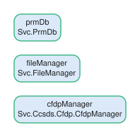

# PiSensor System Software Design Document

## Introduction

PiSensor is an F Prime deployment for a Raspberry Pi 5. It streams BMP280,
MPU6050 and NMEA GPS telemetry, and on command captures a Pi Camera picture
and stores it with location, attitude and temperature as one data product,
downlinked by CFDP. The link is an RFM69 packet radio; the ground system is
fprime-yamcs.

Colour key, used in every table and diagram: 🟩 F Prime (inherited from
`nasa/fprime`), 🟦 library (inherited from an F Prime library or ground
package), 🟨 bespoke (built by this project).

## Requirements

| ID | Requirement | Verification |
|---|---|---|
| REQ-PiSensor-001 | Outside a CFDP downlink, the system shall downlink BMP280 temperature telemetry at least once every 2 s. | Integration Test |
| REQ-PiSensor-002 | Outside a CFDP downlink, the system shall downlink MPU6050 acceleration and angular rate telemetry at least once every 2 s. | Integration Test |
| REQ-PiSensor-003 | Outside a CFDP downlink, the system shall downlink GPS latitude and longitude telemetry at least once every 2 s. | Integration Test |
| REQ-PiSensor-004 | A capture command shall produce one Pi Camera JPEG picture of at least 640x480 pixels. | Integration Test |
| REQ-PiSensor-005 | Each capture shall store one data product holding the picture, latitude, longitude, roll, pitch and temperature. | Integration Test |
| REQ-PiSensor-006 | Each data product shall carry its capture time and the sample time of each metric. | Integration Test |
| REQ-PiSensor-007 | The system shall store the data product within 30 s of receiving a capture command. | Integration Test |
| REQ-PiSensor-008 | On command, the system shall downlink every stored data product not yet downlinked, by CFDP class 2. | Integration Test |
| REQ-PiSensor-009 | A downlinked data product shall be byte-identical to the stored data product. | Integration Test |
| REQ-PiSensor-010 | The RFM69 packet radio shall be the only link carrying commands, telemetry, events and downlinked CFDP files. | Integration Test |
| REQ-PiSensor-011 | Commands sent from fprime-yamcs shall execute, and telemetry, events and CFDP files shall arrive decoded in fprime-yamcs. | Integration Test |
| REQ-PiSensor-012 | During a CFDP downlink, sensor telemetry shall continue at least once every 10 s. | Integration Test |
| REQ-PiSensor-013 | The system shall meet REQ-PiSensor-001 to -012 and -014 on a Raspberry Pi 5 under 64-bit Raspberry Pi OS 13 (Trixie). | Integration Test |
| REQ-PiSensor-014 | Each metric in a data product shall have a sample time within 2 s of the capture time. | Integration Test |

## Architecture

### Overview

```mermaid
flowchart LR
  classDef fprime fill:#b7e1a1,stroke:#2e7d32,color:#000
  classDef library fill:#a9cdf5,stroke:#1565c0,color:#000
  classDef bespoke fill:#ffe680,stroke:#b58900,color:#000
  subgraph Pi5[Raspberry Pi 5: PiSensor topology and configuration]
    bmp[Bmp280.Subtopology]:::library
    imu[MpuImu.Subtopology]:::library
    gps[NmeaGps.Subtopology]:::library
    cdh[CdhCore.Subtopology]:::fprime
    cam[piCamera]:::bespoke
    dp[DataProducts.Subtopology]:::fprime
    fh[FileHandlingCfdp.Subtopology]:::fprime
    com[ComCcsds.FramingSubtopology, comRetry]:::fprime
    radio[Rfm69.Subtopology]:::library
    sched[time and rate groups]:::fprime
  end
  subgraph Ground
    gs[RFM69 Feather ground station]:::library
    bridge[alpha-iii-yamcs]:::library
    yamcs[fprime-yamcs]:::library
  end
  bmp & imu & gps -- telemetry --> cdh
  cdh -- latest readings --> cam
  cam -- product container --> dp
  dp -- catalog file requests --> fh
  cdh & fh --> com --> radio
  radio <-. RFM69 .-> gs
  gs <-- USB serial --> bridge <--> yamcs
```

### Topology

Sketch source: [`sketch/PiSensorSketch.fpp`](sketch/PiSensorSketch.fpp).

Subtopology <code>Bmp280.Subtopology</code>

> 
>

Subtopology <code>CdhCore.Subtopology</code>

> 
>

Subtopology <code>ComCcsds.FramingSubtopology</code>

> 
>

Subtopology <code>DataProducts.Subtopology</code>

> 
>

Subtopology <code>FileHandlingCfdp.Subtopology</code>

> 
>

Subtopology <code>MpuImu.Subtopology</code>

> 
>

Subtopology <code>NmeaGps.Subtopology</code>

> 
>

Subtopology <code>Rfm69.Subtopology</code>

> 
>

_Solid box: component instance (green outline active, pink passive). Dashed box: imported topology. Chevron: port declared by this topology. Thick line with `/N`: N parallel connections. Dashed line: connection that reaches inside an imported topology. Connections generated by connection patterns (command, events, telemetry, text events, time, health, parameters) are not drawn._

### Elements

One row per element: what it is, where it comes from, how it runs, what it
serves and what is known to be wrong with it. Instances inside a
subtopology are those of the subtopology as shipped.

| Element | Class | Source | Function | Runs at | Boundary | Requirements (kind) | Verified by (observable) | Known defects |
|---|---|---|---|---|---|---|---|---|
| `PiSensor` topology and configuration | 🟨 bespoke | this project | Wires the elements; sets inherited configuration: TM frame and aggregate size to fit one 255-byte radio packet with packet spanning, device paths, ground YAMCS CFDP service | — | Raspberry Pi 5, 64-bit Raspberry Pi OS; ground host | 012 (system), 013 (system) | 012: largest gap between sensor telemetry packets at the ground during a catalog downlink. 013: platform and image version read on the bench | platform: unverified with the radio |
| `piCamera` | 🟨 bespoke | this project | On a capture command: acquires one JPEG, reads the latest sensor readings and their times from the telemetry store, derives roll and pitch from the acceleration reading, writes one product container | Own thread, one capture at a time | Pi Camera on CSI | 004 (component), 005, 006, 007, 014 (set) | 004: `piCamera` component tests and the picture record of the downlinked product. 005, 006, 014: metric and time records of the downlinked product against telemetry samples. 007: `cmdDisp.OpCodeDispatched` of the capture command to `dpWriter.FileWritten` | Camera not yet on the bench |
| `CdhCore.Subtopology` | 🟩 F Prime | fprime v4.4.2 | Command dispatch, events, telemetry channels and their store, health | 10 Hz dispatcher; 1 Hz telemetry, events, health | — | 001, 002, 003, 005, 006, 007, 014 (set) | Sensor channels and events at the ground; `cmdDisp.NoOpStringReceived` | Exports no port for `tlmSend.TlmGet`; this topology connects it |
| `ComCcsds.FramingSubtopology` | 🟩 F Prime | fprime v4.4.2 | Queues, space packets, TM and TC transfer frames, routing | 10 Hz queue and aggregator; 1 Hz buffers | — | 010, 011 (set) | Frames received by YAMCS; commands executed | Exports only the five `Svc.Com` ports; this topology connects `comQueue`, `aggregator`, `fprimeRouter` and `commsBufferManager` directly. No CFDP ports though the CFDP documentation shows them; CFDP data uses the file queue and file uplink ports. A packet larger than one aggregate asserts unless packet spanning is set. platform: unverified under the radio |
| `DataProducts.Subtopology` | 🟩 F Prime | fprime v4.4.2 | Product buffers, writer and catalog; the catalog downlinks products not yet sent | 1 Hz writer, manager, buffers | Pi 5 file system | 005, 007, 008 (set) | `dpWriter.FileWritten`, `dpCat.CatalogXmitCompleted` events | platform: catalog downlink unverified |
| `FileHandlingCfdp.Subtopology` | 🟩 F Prime modified | [`lestarch-autobot/fprime@4b2b6e0`](https://github.com/lestarch-autobot/fprime/commit/4b2b6e08c1) | CFDP class 2 file transfer, file manager, parameters | 1 Hz | Ground CFDP entity | 008, 009 (set) | YAMCS transfer record; `fileManager.CalculateCrcSucceeded` event against the CRC of the ground file | Does not compile as shipped (Red flags). Exports no ports; this topology connects `cfdpManager` directly. Transaction numbers restart at 1 after a restart, which YAMCS can match to an old transfer |
| `comRetry` | 🟩 F Prime | fprime v4.4.2 | Holds a frame until the radio is free and sends it again when the radio refuses it | On each frame | — | 010 (set) | Frames received by YAMCS | platform: unverified |
| `posixTime`, `linuxTimer`, `rateGroupDriver`, `rateGroup1KHz`, `rateGroup10Hz`, `rateGroup1Hz` | 🟩 F Prime | fprime v4.4.2 | Time and periodic scheduling | 1 kHz, 10 Hz and 1 Hz | Pi 5 clock and timer | 001, 002, 003, 006 (set) | Channel and product times | platform: 1 kHz group unverified |
| `Bmp280.Subtopology` | 🟦 library | fprime-sensors `e5d83d1` | Reads BMP280 temperature | 10 Hz | BMP280; bus not yet identified on the bench | 001, 005 (set) | `bmpManager.Reading` | `Bmp280.BmpManager` has no unit tests at `e5d83d1`. platform: unverified |
| `MpuImu.Subtopology` | 🟦 library | fprime-sensors `e5d83d1` | Reads MPU6050 acceleration and angular rate | 10 Hz | MPU6050 on I2C bus 1, address 0x68 | 002, 005 (set) | `imuManager.Reading` | — |
| `NmeaGps.Subtopology` | 🟦 library | fprime-sensors `e5d83d1` | Reads NMEA sentences and reports latitude and longitude | UART receive thread | GPS receiver; UART not yet identified on the bench | 003, 005 (set) | `gpsManager.Reading` | UART driver buffer ports are not connected and not exported; this topology connects them. platform: unverified |
| `Rfm69.Subtopology` | 🟦 library | fprime-sensors `e5d83d1` | Sends and receives one buffer of at most 255 bytes per radio packet | 1 kHz | RFM69 on SPI0 CE1 | 010 (set) | `rfm69Manager.PacketsTransmitted`, `PacketsReceived` | platform: unverified |
| RFM69 Feather ground station | 🟦 library | fprime-rfm69-feather-groundstation `ee3c233` | Carries each radio packet between the radio and USB serial, wrapped in an F Prime frame | — | Feather M0 RFM69HCW on the ground host USB | 010, 011 (set) | Frames received by YAMCS | No SDD; one integration test; built against other fprime and fprime-sensors revisions. Documented for space packets, not transfer frames. Not on the bench. platform: unverified |
| `alpha-iii-yamcs` | 🟦 library | wheel `alpha_iii_yamcs-0.1.0-py3-none-any.whl`, sha-256 `efeecebe5981ed36ee098d12c3d9aa3fcc9cf0a77754f8f66f468d84b39f7607`; source repository not identified, not on PyPI | Joins the USB serial stream to fprime-yamcs: removes and adds the F Prime frame around TM and TC frames | — | Ground host USB serial | 010, 011 (set) | Frames received by YAMCS; commands executed | Used with the alpha-iii LoRa ground radio only. Documentation and tests: not known until the source is identified. platform: unverified with the Feather |
| fprime-yamcs | 🟦 library | fprime-yamcs `f6f0e19` | Ground commanding, telemetry, events, CFDP entity | — | Ground host | 008, 009, 011 (set) | Decoded parameters, events, transfer records and files | No CFDP service configured as shipped; needs `fprime-yamcs-bundle` 5.13.7.0, which is not on PyPI |

All 🟩 rows are built from `lestarch-autobot/fprime@4b2b6e0`: tag v4.4.2
plus the one commit of the Red flags row. Kinds: `component`, one element decides it by its own tests; `set`, the
rows citing it decide it together in a system test; `system`, a property
of the whole deployment. Link rows carry 010 and 011
only; the traffic of the other requirements passes through them.
`platform: unverified` marks an element not yet run on the Raspberry Pi 5
in this role.

Wiring this topology adds between the elements:

| From | To | Purpose |
|---|---|---|
| `piCamera` | `CdhCore.tlmSend.TlmGet` | Read the latest BMP280, MPU6050 and GPS readings with their times |
| `piCamera` | `DataProducts.Subtopology` product request, send and response ports | Write the product container |
| `DataProducts.Subtopology.dpCatFileOut` | `FileHandlingCfdp.cfdpManager.fileIn` | Catalog sends each product by CFDP |
| `FileHandlingCfdp.cfdpManager.fileDoneOut` | `DataProducts.Subtopology.dpCatFileDone` | Catalog learns each transfer ended |
| `NmeaGps.driver` buffer ports | `NmeaGps.bufferManager` | Supply and return UART receive buffers |
| `ComCcsds.FramingSubtopology` frame ports | `comRetry`, then `Rfm69.rfm69Manager` | TM frames to the radio, sent again when the radio refuses one |
| `Rfm69.rfm69Manager` | `ComCcsds.FramingSubtopology` | TC frames from the radio |
| `CdhCore` events and telemetry, `FileHandlingCfdp.cfdpManager` | `ComCcsds.FramingSubtopology` queue and router ports | Events, telemetry, commands and CFDP data share the link |

## Red flags

| Element | Change to inherited source | Why | Route |
|---|---|---|---|
| `FileHandlingCfdp.Subtopology` | Its start-up call to `cfdpManager.configure` gains the file queue depth argument the component requires (new constant `FileHandlingCfdpConfig.CfdpConfig.fileQueueDepth`, 10) | The subtopology does not compile at v4.4.2, nor on `devel` | Fork [PR 453](https://github.com/lestarch-autobot/fprime/pull/453) against `devel`; this project pins the same commit on v4.4.2, `lestarch-autobot/fprime@4b2b6e0`. Upstream issue to file on nasa/fprime: "FileHandlingCfdp subtopology does not compile: cfdpManager.configure lacks fileQueueDepth". Re-qualification: the fork build and system tests L2-3, L2-4, L2-7 |

No other inherited source is changed. Defects noted in the Elements table
are recorded in the ledger for upstream reports.

## Tests

Derived from `test/int/plan.json` by `fth render-sdd-tests`.

<!-- fth:tests:begin -->
_Generated by `fth render-sdd-tests` from the plan — do not edit by hand; the package renderer fails when this table and the plan disagree._

| Test | Purpose | Requirements |
|---|---|---|
| L0-1 | Proves the running image is the manifest's image and runs on a Raspberry Pi 5 under 64-bit Raspberry Pi OS, reached over the RFM69. | REQ-PiSensor-013, REQ-PiSensor-010 |
| L0-2 | Proves the marker command round-trips over the RFM69 on the Raspberry Pi 5 so every later window can be bracketed. | REQ-PiSensor-013, REQ-PiSensor-010 |
| L2-1 | Proves every sensor channel arrives at the ground at least every 2 s. | REQ-PiSensor-001, REQ-PiSensor-002, REQ-PiSensor-003, REQ-PiSensor-010, REQ-PiSensor-011 |
| L2-2 | Proves the 2 s telemetry period holds while commands are dispatched. | REQ-PiSensor-001, REQ-PiSensor-002, REQ-PiSensor-003, REQ-PiSensor-010, REQ-PiSensor-011 |
| L2-3 | Proves one capture stores one product with a JPEG of at least 640x480, the metrics and their times, sampled within 2 s of the capture, delivered byte-identical by CFDP class 2. | REQ-PiSensor-004, REQ-PiSensor-005, REQ-PiSensor-006, REQ-PiSensor-007, REQ-PiSensor-008, REQ-PiSensor-009, REQ-PiSensor-011, REQ-PiSensor-014 |
| L2-4 | Proves a second capture stores a second product with its own capture time and the catalog downlinks both, byte-identical. | REQ-PiSensor-004, REQ-PiSensor-005, REQ-PiSensor-006, REQ-PiSensor-007, REQ-PiSensor-008, REQ-PiSensor-009, REQ-PiSensor-014 |
| L2-5 | Proves the metrics stored in a product are the sensor readings downlinked around its capture. | REQ-PiSensor-005, REQ-PiSensor-006, REQ-PiSensor-014, REQ-PiSensor-008 |
| L2-6 | Proves three captures in a row each store their product within 30 s. | REQ-PiSensor-004, REQ-PiSensor-007 |
| L2-7 | Proves sensor telemetry continues at least every 10 s while products are downlinked over the RFM69. | REQ-PiSensor-012, REQ-PiSensor-008, REQ-PiSensor-009, REQ-PiSensor-010, REQ-PiSensor-011 |
| L2-8 | Proves sensor telemetry continues and a command is served while two products are downlinked. | REQ-PiSensor-012, REQ-PiSensor-010 |
| L7-1 | Leaves one known product on board for the independent final-state check. | REQ-PiSensor-009, REQ-PiSensor-005 |
<!-- fth:tests:end -->
