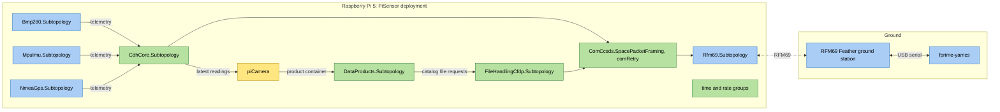
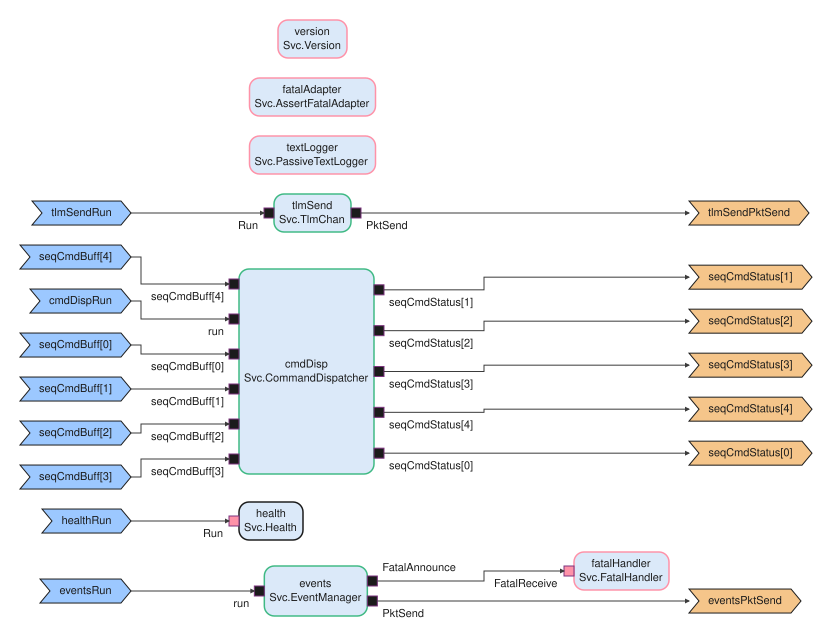
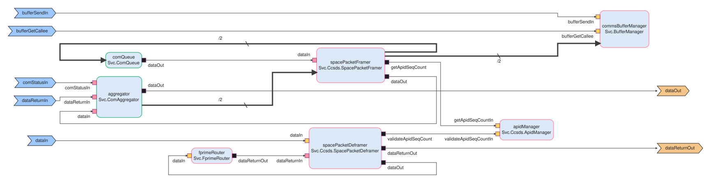

# PiSensor System Software Design Document

## Introduction

PiSensor is an F Prime deployment for a Raspberry Pi 5. It streams BMP280,
MPU6050 and NMEA GPS telemetry, and on command captures a Pi Camera picture
and stores it with location, attitude and temperature as one data product,
downlinked by CFDP. The link is an RFM69 packet radio; the ground system is
fprime-yamcs.

Colour key, used in every table and diagram: 🟩 F Prime (inherited from
`nasa/fprime`), 🟦 library (inherited from an F Prime library or ground
package), 🟨 bespoke (built by this project).

## Requirements

| ID | Requirement | Verification |
|---|---|---|
| REQ-PiSensor-001 | The system shall downlink BMP280 temperature telemetry at least once every 2 s. | System test |
| REQ-PiSensor-002 | The system shall downlink MPU6050 acceleration and angular rate telemetry at least once every 2 s. | System test |
| REQ-PiSensor-003 | The system shall downlink GPS location telemetry at least once every 2 s. | System test |
| REQ-PiSensor-004 | On a capture command, the system shall capture one Pi Camera JPEG picture of at least 640x480 pixels. | System test |
| REQ-PiSensor-005 | Each capture shall store one data product holding the picture, location, attitude and temperature. | System test |
| REQ-PiSensor-006 | Each data product shall carry its capture time and the sample time of each metric. | System test |
| REQ-PiSensor-007 | The system shall complete a capture command within 30 s of dispatch. | System test |
| REQ-PiSensor-008 | On command, the system shall downlink stored data products by CFDP class 2. | System test |
| REQ-PiSensor-009 | A downlinked data product shall be byte-identical to the stored data product. | System test |
| REQ-PiSensor-010 | Commands, telemetry, events and CFDP files shall pass over the RFM69 packet radio. | System test |
| REQ-PiSensor-011 | Commands, telemetry, events and CFDP files shall interoperate with the fprime-yamcs ground system. | System test |
| REQ-PiSensor-012 | During a CFDP downlink, sensor telemetry shall continue at least once every 10 s. | System test |
| REQ-PiSensor-013 | The system shall meet REQ-PiSensor-001 to -012 on a Raspberry Pi 5 under 64-bit Raspberry Pi OS. | System test |

Attitude in a data product is roll and pitch, derived from the MPU6050
acceleration, with the acceleration and angular rate they came from. Yaw is
not reported.

## Architecture

### Overview

### Topology

Sketch source: [`sketch/PiSensorSketch.fpp`](sketch/PiSensorSketch.fpp).

Subtopology <code>Bmp280.Subtopology</code>

> 
>

Subtopology <code>CdhCore.Subtopology</code>

> 
>

Subtopology <code>ComCcsds.SpacePacketFraming</code>

> 
>

Subtopology <code>DataProducts.Subtopology</code>

> 
>

Subtopology <code>FileHandlingCfdp.Subtopology</code>

> 
>

Subtopology <code>MpuImu.Subtopology</code>

> 
>

Subtopology <code>NmeaGps.Subtopology</code>

> 
>

Subtopology <code>Rfm69.Subtopology</code>

> 
>

_Solid box: component instance (green outline active, pink passive). Dashed box: imported topology. Chevron: port declared by this topology. Thick line with `/N`: N parallel connections. Dashed line: connection that reaches inside an imported topology. Connections generated by connection patterns (command, events, telemetry, text events, time, health, parameters) are not drawn._

### Elements

One row per element: what it is, where it comes from, how it runs, what it
serves and what is known to be wrong with it. Instances inside a
subtopology are those of the subtopology as shipped.

| Element | Class | Source | Function | Runs at | Boundary | Requirements | Verified by | Known defects |
|---|---|---|---|---|---|---|---|---|
| `CdhCore.Subtopology` | 🟩 F Prime | fprime v4.4.2 | Command dispatch, events, telemetry channels, health | 10 Hz dispatcher; 1 Hz telemetry, events, health | — | 001, 002, 003, 012 | System test | — |
| `ComCcsds.SpacePacketFraming` | 🟩 F Prime | fprime v4.4.2 | Space packet framing, deframing, queues, routing | 10 Hz queue and aggregator; 1 Hz buffers | — | 010, 011, 012 | System test | — |
| `DataProducts.Subtopology` | 🟩 F Prime | fprime v4.4.2 | Product buffers, writer and catalog; the catalog downlinks stored products | 1 Hz writer, manager, buffers | Pi 5 file system | 005, 008, 009 | System test | — |
| `FileHandlingCfdp.Subtopology` | 🟩 F Prime modified | fprime v4.4.2 plus fix | CFDP class 2 file transfer, file manager, parameters | 1 Hz | Ground CFDP entity | 008, 009, 012 | System test | Does not compile as shipped; see Red flags |
| `comRetry` | 🟩 F Prime | fprime v4.4.2 | Holds a packet until the radio is free and sends it again when the radio refuses it | On each packet | — | 010 | System test | — |
| `posixTime`, `linuxTimer`, `rateGroupDriver`, `rateGroup1KHz`, `rateGroup10Hz`, `rateGroup1Hz` | 🟩 F Prime | fprime v4.4.2 | Time and periodic scheduling | 1 kHz, 10 Hz and 1 Hz | Pi 5 clock and timer | 006, 013 | System test | — |
| `Bmp280.Subtopology` | 🟦 library | fprime-sensors `e5d83d1` | Reads BMP280 temperature | 10 Hz | BMP280 on SPI | 001, 005 | System test | No unit tests upstream |
| `MpuImu.Subtopology` | 🟦 library | fprime-sensors `e5d83d1` | Reads MPU6050 acceleration and angular rate | 10 Hz | MPU6050 on I2C bus 1, address 0x68 | 002, 005 | System test | — |
| `NmeaGps.Subtopology` | 🟦 library | fprime-sensors `e5d83d1` | Reads NMEA sentences and reports location | UART receive thread | GPS receiver on UART | 003, 005 | System test | UART driver buffer ports are not connected and not exported; this topology connects them |
| `Rfm69.Subtopology` | 🟦 library | fprime-sensors `e5d83d1` | Sends and receives one space packet per radio packet | 1 kHz | RFM69 on SPI0 CE1 | 010 | System test | — |
| RFM69 Feather ground station | 🟦 library | fprime-rfm69-feather-groundstation `ee3c233` | Carries space packets between the radio and USB serial | — | Feather M0 RFM69HCW on the ground host USB | 010, 011 | System test | — |
| fprime-yamcs | 🟦 library | fprime-yamcs `f6f0e19` | Ground commanding, telemetry, events, CFDP entity | — | Ground host | 011, 008, 009 | System test | No CFDP service configured as shipped; added by project configuration |
| `piCamera` | 🟨 bespoke | this project | On a capture command: acquires one JPEG, reads the latest sensor readings from the telemetry store, writes one product container | Own thread, one capture at a time | Pi Camera on CSI | 004, 005, 006, 007 | Component campaign; system test | — |

Wiring this topology adds between the elements:

| From | To | Purpose |
|---|---|---|
| `piCamera` | `CdhCore.tlmSend.TlmGet` | Read the latest BMP280, MPU6050 and GPS readings with their times |
| `piCamera` | `DataProducts.Subtopology` product request, send and response ports | Write the product container |
| `DataProducts.Subtopology.dpCatFileOut` | `FileHandlingCfdp.cfdpManager.fileIn` | Catalog sends each product by CFDP |
| `FileHandlingCfdp.cfdpManager.fileDoneOut` | `DataProducts.Subtopology.dpCatFileDone` | Catalog learns each transfer ended |
| `NmeaGps.driver` buffer ports | `NmeaGps.bufferManager` | Supply and return UART receive buffers |
| `ComCcsds.SpacePacketFraming` | `comRetry`, then `Rfm69.rfm69Manager` | Downlink packets to the radio |
| `Rfm69.rfm69Manager` | `ComCcsds.SpacePacketFraming` | Uplink packets from the radio |
| `CdhCore` events and telemetry, `FileHandlingCfdp.cfdpManager` | `ComCcsds.comQueue`, `ComCcsds.fprimeRouter` | Events, telemetry, commands and CFDP data share the link |

## Red flags

| Element | Change to inherited source | Why | Route |
|---|---|---|---|
| `FileHandlingCfdp.Subtopology` | Its start-up call to `cfdpManager.configure` gains the file queue depth argument the component requires | The subtopology does not compile at v4.4.2 | Fix made in the F Prime fork, not in this project; this project pins the fixed revision |

No other inherited source is changed. Defects noted in the Elements table
are recorded in the ledger for upstream reports.

## Tests

Derived from `test/int/plan.json` by `fth render-sdd-tests`.

<!-- fth:tests:begin -->
_Generated by `fth render-sdd-tests` from the plan — do not edit by hand; the package renderer fails when this table and the plan disagree._

| Test | Purpose | Requirements |
|---|---|---|
| L0-1 | Proves the running image is the manifest's image and runs on a Raspberry Pi 5 under 64-bit Raspberry Pi OS, reached over the RFM69. | REQ-PiSensor-013, REQ-PiSensor-010 |
| L0-2 | Proves the marker command round-trips over the RFM69 on the Raspberry Pi 5 so every later window can be bracketed. | REQ-PiSensor-013, REQ-PiSensor-010 |
| L2-1 | Proves every sensor channel arrives at the ground at least every 2 s. | REQ-PiSensor-001, REQ-PiSensor-002, REQ-PiSensor-003, REQ-PiSensor-010, REQ-PiSensor-011 |
| L2-2 | Proves the 2 s telemetry period holds while commands are dispatched. | REQ-PiSensor-001, REQ-PiSensor-002, REQ-PiSensor-003, REQ-PiSensor-010, REQ-PiSensor-011 |
| L2-3 | Proves one capture stores one product with a JPEG of at least 640x480, the three metrics and their times, delivered byte-identical by CFDP class 2. | REQ-PiSensor-004, REQ-PiSensor-005, REQ-PiSensor-006, REQ-PiSensor-007, REQ-PiSensor-008, REQ-PiSensor-009, REQ-PiSensor-011 |
| L2-4 | Proves a second capture stores a second product with its own capture time and the catalog downlinks both, byte-identical. | REQ-PiSensor-004, REQ-PiSensor-005, REQ-PiSensor-006, REQ-PiSensor-007, REQ-PiSensor-008, REQ-PiSensor-009 |
| L2-5 | Proves the metrics stored in a product are the sensor readings downlinked around its capture. | REQ-PiSensor-005, REQ-PiSensor-006 |
| L2-6 | Proves three captures in a row each complete within 30 s. | REQ-PiSensor-004, REQ-PiSensor-007 |
| L2-7 | Proves sensor telemetry continues at least every 10 s while products are downlinked over the RFM69. | REQ-PiSensor-012, REQ-PiSensor-008, REQ-PiSensor-009, REQ-PiSensor-010, REQ-PiSensor-011 |
| L2-8 | Proves sensor telemetry continues and a command is served while two products are downlinked. | REQ-PiSensor-012, REQ-PiSensor-010 |
| L7-1 | Leaves one known product on board for the independent final-state check. | REQ-PiSensor-009, REQ-PiSensor-005 |
<!-- fth:tests:end -->
