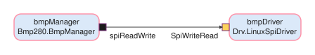
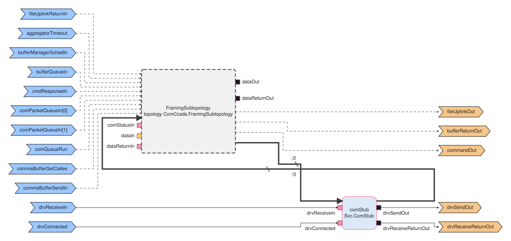
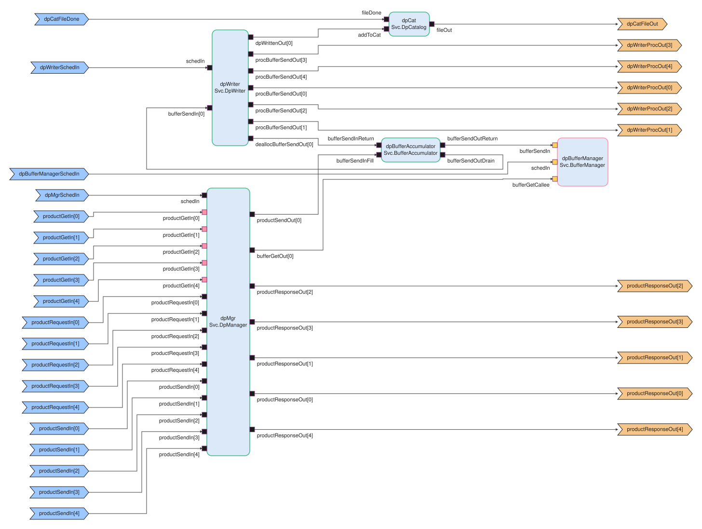
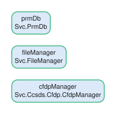
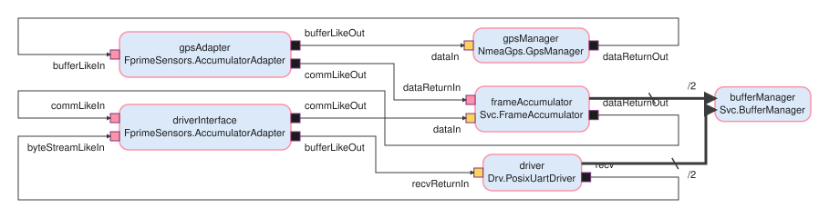

# PiSensor System Software Design Document

## Introduction

PiSensor is an F Prime deployment for a Raspberry Pi 5. The ask, verbatim:

> I would like you to develop a system that runs on a raspberry pi 5, and communicates with the following sensors:
>
> 1. BMP280
> 2. MPU6050
> 3. PI Camera
> 4. Nmea GPS
>
> The system shall have the goal of reading these sensors and combining the key sensor metrics: location, attitude, and temperature + a picture into a single data product for downlinking using CFDP.  The sensors should stream telemetry, and pictures should be captured, correlated, and made into a data product in response to a command.
>
> System communication should go through an RFM69 packet radio.
>
> My expectation is that the PI camera be rewritten using standard PI libraries that are easy to install rather than using the OpenCV camera setup from fprime-examples as that is complex and overkill.
>
> Note: your development testbed is the PI used for soak testing trials attached to your PI workstation.  Be respectful of other users.  A ground system PI w/ RFM69 will be attached to your workstation for ground testing and a camera will be attached to the soak PI after SSDD approval.  Prototype the initial system over TCP.
>
> Since this is an automatic process, please ask questions now and then proceed through SSDD review!

Attitude is roll and pitch plus raw gyro rates; yaw is not reported. The
ground system is fprime-yamcs. Bench parts on the Pi 5: an MPU6050 on I2C bus 1 (address 0x68) and an RFM69
on SPI0 CE1 answer. No BMP280 and no GPS receiver answer on any bus or port
yet; the Pi Camera and the ground Pi with its RFM69 arrive after approval.
The goal is a functional deployment with
respect to the ask, every system requirement proven in system tests on the
complete testbed.

## Requirements

| ID | Requirement | Verification |
|---|---|---|
| REQ-PiSensor-001 | Outside a CFDP downlink, the system shall downlink BMP280 temperature telemetry at least once every 2 s. | Integration Test |
| REQ-PiSensor-002 | Outside a CFDP downlink, the system shall downlink MPU6050 attitude telemetry at least once every 2 s. | Integration Test |
| REQ-PiSensor-003 | Outside a CFDP downlink, the system shall downlink GPS location telemetry at least once every 2 s. | Integration Test |
| REQ-PiSensor-004 | On a capture command, the system shall capture one Pi Camera JPEG of at least 640x480 pixels. | Integration Test |
| REQ-PiSensor-005 | Each successful capture shall produce one data product holding picture, location, attitude and temperature. | Integration Test |
| REQ-PiSensor-006 | Each data product shall carry its capture time, taken when the picture is acquired. | Integration Test |
| REQ-PiSensor-007 | Each metric marked valid shall carry a sample time within 2 s of capture time. | Integration Test |
| REQ-PiSensor-008 | A data product shall mark invalid each metric older than 2 s. | Integration Test |
| REQ-PiSensor-009 | A data product shall mark location invalid when the GPS reports no fix. | Integration Test |
| REQ-PiSensor-010 | The system shall complete a capture command within 30 s of dispatch. | Integration Test |
| REQ-PiSensor-011 | Each successful capture shall emit an `ACTIVITY_HI` event naming its data product. | Integration Test |
| REQ-PiSensor-012 | On a downlink command, the system shall send the named data product by CFDP class 2. | Integration Test |
| REQ-PiSensor-013 | A downlinked data product shall be byte-identical to the on-board data product. | Integration Test |
| REQ-PiSensor-014 | On a delete command, the system shall remove the named data product. | Integration Test |
| REQ-PiSensor-015 | In the flight configuration, commands, telemetry, events and CFDP files shall pass over the RFM69. | Integration Test |
| REQ-PiSensor-016 | In the prototype configuration, commands, telemetry, events and CFDP files shall pass over TCP. | Integration Test |
| REQ-PiSensor-017 | Commands, telemetry, events and CFDP files shall interoperate with the fprime-yamcs ground system. | Integration Test |
| REQ-PiSensor-018 | During a CFDP downlink, Table 1 sensor telemetry shall continue at least once every 10 s. | Integration Test |
| REQ-PiSensor-019 | The system shall emit a `WARNING_HI` event within 10 s of BMP280 read failure. | Integration Test |
| REQ-PiSensor-020 | The system shall emit a `WARNING_HI` event within 10 s of MPU6050 read failure. | Integration Test |
| REQ-PiSensor-021 | When GPS sentences stop, the system shall emit a `WARNING_HI` event within 10 s. | Integration Test |
| REQ-PiSensor-022 | Sensor telemetry shall report a metric invalid while its sensor is failed. | Integration Test |
| REQ-PiSensor-023 | Sensor telemetry shall resume within 10 s of a sensor's return, without a restart. | Integration Test |
| REQ-PiSensor-024 | GPS telemetry shall report fix invalid while the receiver reports no fix. | Integration Test |
| REQ-PiSensor-025 | The system shall discard NMEA sentences that fail their checksum. | System test: L5-21, L5-22 |
| REQ-PiSensor-026 | The system shall treat a BMP280 with a wrong identity register as a read failure. | Unit Test |
| REQ-PiSensor-027 | The system shall discard uplink frames that fail their integrity check. | System test: L6-1, L6-2 |
| REQ-PiSensor-028 | A capture whose camera is absent or fails shall fail its command and emit `WARNING_HI`. | Integration Test |
| REQ-PiSensor-029 | A failed or interrupted capture shall leave no data product, complete or partial. | Integration Test |
| REQ-PiSensor-030 | A capture command during a capture shall fail with `WARNING_LO` and not disturb that capture. | Integration Test |
| REQ-PiSensor-031 | A capture that cannot store its data product shall fail its command and emit `WARNING_HI`. | Integration Test |
| REQ-PiSensor-032 | A downlink or delete command naming a missing data product shall fail with `WARNING_LO`. | Integration Test |
| REQ-PiSensor-033 | A downlink command during a downlink shall fail with `WARNING_LO` and not disturb that downlink. | Integration Test |
| REQ-PiSensor-034 | A CFDP transfer that makes no progress for 60 s shall end and emit a `WARNING_HI` event. | Integration Test |
| REQ-PiSensor-035 | An incomplete CFDP transfer shall leave the data product intact for a repeated downlink command. | Integration Test |
| REQ-PiSensor-036 | Within 10 s of the end of a link outage of at least 60 s, commanding and telemetry shall resume without a restart. | Integration Test |
| REQ-PiSensor-037 | Within 10 s of the end of a ground-system outage of at least 60 s, commanding and telemetry shall resume without a restart. | Integration Test |
| REQ-PiSensor-038 | Data products stored before a link outage, ground-system outage or restart shall remain downlinkable after it. | Integration Test |
| REQ-PiSensor-039 | After a restart, the system shall resume Table 1 sensor telemetry without ground commands within 60 s. | Integration Test |
| REQ-PiSensor-040 | The camera software shall use only Raspberry Pi OS packaged camera libraries, not OpenCV. | Inspection |
| REQ-PiSensor-041 | A delete command naming a data product being downlinked shall fail with `WARNING_LO`. | Integration Test |
| REQ-PiSensor-042 | The system shall meet REQ-PiSensor-001 to -041 and -043 on a Raspberry Pi 5 under 64-bit Raspberry Pi OS 13. | Integration Test |
| REQ-PiSensor-043 | The system shall treat an MPU6050 with a wrong identity register as a read failure. | Unit Test |

Table 1: sensor telemetry.

| Sensor | Metric | Unit |
|---|---|---|
| BMP280 | temperature, validity | degrees Celsius |
| MPU6050 | roll, pitch, validity | degrees |
| MPU6050 | gyro rate about x, y, z | degrees per second |
| GPS | latitude, longitude | degrees |
| GPS | altitude | metres |
| GPS | fix validity | valid / invalid |

### Decisions for approval

The ask leaves these open. The author decided them; the human rules on each
at Approve SSDD.

| # | Question | Decision | Rows |
|---|---|---|---|
| D1 | Numeric bounds | Telemetry 2 s; stale after 2 s; fault event 10 s; capture 30 s; resume 10 s after an outage of 60 s or more; telemetry 60 s after restart; CFDP no-progress limit 60 s | 001-003, 007, 008, 010, 019-021, 023, 034, 036, 037, 039 |
| D2 | Downlink trigger | Separate command, not automatic after capture | 012 |
| D3 | CFDP class | Class 2 (acknowledged): the radio link is lossy | 012 |
| D4 | Telemetry during a file downlink | Continues, at least once every 10 s | 018 |
| D5 | Picture | JPEG, at least 640x480 | 004 |
| D6 | Downlink command during a downlink | Rejected | 033 |
| D7 | After a sensor fault | Metric flagged invalid; recovery within 10 s of return, no restart | 022, 023 |
| D8 | Bench parts | Identified on the bench and named in the Introduction | - |
| D9 | BMP280 pressure | Not required: the ask names temperature only | 001 |
| D10 | Storage | Delete command; no automatic storage bound; delete during that product's downlink rejected | 014, 041 |
| D11 | BMP280 wrong-identity test | The catalog BMP280 manager has no unit tests. The base-deployment lane writes one in this repository for the unchanged component, instead of a system test (a real BMP280 cannot return a wrong identity value) | 026 |
| D12 | Test tolerance between Pi and bench clocks | 2 s, with the clock offset measured under 0.5 s at the start of a run; used where a test compares capture time with bench time | 006 |
| D13 | Test deployment | System tests run the full deployment plus one harness component, `sysTester` (marker, platform report, on-board file hash, directory listing, bench lines, and a command that overwrites two bytes of a named file in the product directory, used to plant faults). Without it no marker command or on-board hash exists. The coverage-dump component is in the development image only | - |

## Architecture

### Elements

| Element | Kind | Function | Hardware or ground boundary |
|---|---|---|---|
| `CdhCore.Subtopology` | subtopology | Command dispatch, events, telemetry channels, health, fatal handling | — |
| `ComCcsds.Subtopology` (prototype), `ComCcsds.FramingSubtopology` (flight) | subtopology | CCSDS framing, deframing, queues, routing; member `tcDeframer` checks frame integrity | fprime-yamcs ground system |
| `PiFileHandling` | subtopology | CFDP class 2 file transfer, file manager, parameters; reads product files | Ground CFDP entity |
| `DataProducts.Subtopology` | subtopology | Data product buffers and writer; writes product files | Pi 5 file system (SD card) |
| `Bmp280.Subtopology` | subtopology | Reads BMP280 temperature; checks its identity register | BMP280 on SPI |
| `MpuImu.Subtopology` | subtopology | Reads MPU6050 acceleration and gyro rates | MPU6050 on I2C bus 1, address 0x68 |
| `PiGps` | subtopology | Reads NMEA sentences and reports location; passes each sentence through `sensorMonitor`; member `NmeaGps.frameAccumulator`, as configured with `NmeaDetector`, checks checksums | GPS receiver on a UART |
| `Rfm69.Subtopology` | subtopology | Sends and receives frames by packet radio (flight configuration) | RFM69 on SPI0 CE1 and its reset GPIO |
| `groundRadio` | ground element | Passes frames between the ground RFM69 and fprime-yamcs (flight configuration) | Ground Pi with RFM69 |
| `tcpLink` | component | Sends and receives frames over TCP (prototype configuration) | TCP socket to the ground host |
| `sysTester` | component (test harness) | Marker command and event, start report, uptime channel for system tests; serves no requirement (decision D13). Built into the base deployment and the system-test image | — |
| `sensorMonitor` | component | Publishes Table 1 telemetry with validity; reports sensor loss; serves samples; reads the MPU6050 identity register through the IMU bus driver; reads the fix field and arrival time of each GPS sentence | — |
| `piCamera` | component | Acquires one JPEG and its acquisition time per request | Pi Camera on CSI |
| `productManager` | component | Runs capture, downlink and delete commands; builds the data product; lists and deletes product files through the OS file interface | — |
| `service unit` | OS configuration | Starts the deployment at boot and after it exits | Pi OS service manager |
| `posixTime` | component | Supplies time for telemetry, events, samples and capture | Pi 5 system clock |
| `linuxTimer`, `rateGroupDriver`, `rateGroup1Hz`, `rateGroup10Hz` | components | Drive the periodic work of all elements | Pi 5 system timer |

Two link configurations, never run together:

| Configuration | Link elements |
|---|---|
| Prototype | `ComCcsds.Subtopology` (its `comStub` over a byte stream) and `tcpLink` |
| Flight | `ComCcsds.FramingSubtopology`, `Rfm69.Subtopology` (in place of `comStub` and `tcpLink`) and `groundRadio` |

Six elements are bespoke. The constraint for each:

- `sensorMonitor`: no standard element computes roll and pitch or marks a
  metric invalid. The sensor elements report a failed bus read, but not a
  sensor that stops answering without a bus error, and not a silent GPS;
  one loss report by reading age covers all three sensors. The catalog
  MPU6050 manager reads no identity register and the catalog GPS manager
  reports no fix status, so `sensorMonitor` reads both.
- `piCamera`: the ask excludes the OpenCV camera; the only catalog camera
  drives a UART sun camera.
- `productManager`: the standard send-file and remove-file commands do not
  build the product, reject a missing or busy product (030, 032, 033, 041)
  or report no progress (034). The catalog member of `Dp` is not used: it
  sends all stored products, not one named product.
- `PiGps`: `NmeaGps.Subtopology` wires `frameAccumulator` to `gpsAdapter`
  inside itself, so the sentence cannot be read from outside; `PiGps` is the
  same members with that one connection opened. It also connects the UART
  driver's buffer ports, which the catalog subtopology leaves open.
- `PiFileHandling`: `FileHandlingCfdp.Subtopology` does not compile at the
  pinned ref (its `cfdpManager` instance calls `configure` without the file
  queue depth), so the project instantiates the same three components
  (`cfdpManager`, `fileManager`, `prmDb`), unmodified. `ComCcsds` has no
  CFDP ports at the pin; CFDP data uses its file queue and file uplink port.
- `groundRadio`: no catalog has a ground-side RFM69 element. It is a second
  small deployment on the ground Pi that reuses `Rfm69.Subtopology` and a
  standard byte-stream driver towards fprime-yamcs; allocation decides its
  parts.

### Topology

Sketch source: [`sketch/PiSensorSketch.fpp`](sketch/PiSensorSketch.fpp).
The sketch shows the link elements of both configurations; the flight
wiring is fixed in the base-deployment lane.

Subtopology <code>Bmp280.Subtopology</code>

> 
>

Subtopology <code>CdhCore.Subtopology</code>

> 
>

Subtopology <code>ComCcsds.Subtopology</code>

> 
>
> 

> 
Subtopology <code>ComCcsds.FramingSubtopology</code>

>
> > 
> >
> > 

> > 
Subtopology <code>ComCcsds.SpacePacketFraming</code>

> >
> > > 
> > >
> > 

> >
> > 

> > 
Subtopology <code>ComCcsds.TmTcFraming</code>

> >
> > > 
> > >
> > 

> >
> 

>

Subtopology <code>DataProducts.Subtopology</code>

> 
>

Subtopology <code>PiSensor.PiFileHandling</code>

> 
>

Subtopology <code>MpuImu.Subtopology</code>

> 
>

Subtopology <code>PiSensor.PiGps</code>

> 
>

Subtopology <code>Rfm69.Subtopology</code>

> 
>

### Instances

| Instance | Element | Rate group / queue | Notes |
|---|---|---|---|
| `CdhCore.Subtopology` | `CdhCore.Subtopology` | 1 Hz: telemetry send, health | Command, event and telemetry spine |
| `ComCcsds.Subtopology` | `ComCcsds.Subtopology` | 10 Hz: queue, aggregator timeout | Prototype; flight uses `ComCcsds.FramingSubtopology`. File traffic queued behind telemetry and events |
| `PiFileHandling` | `PiSensor.PiFileHandling` | 1 Hz: CFDP timers, file manager | One CFDP channel. The three member components of `FileHandlingCfdp.Subtopology`, instantiated by this project |
| `DataProducts.Subtopology` | `DataProducts.Subtopology` | 1 Hz: writer, buffers | Product files on the Pi 5 file system |
| `Bmp280.Subtopology` | `Bmp280.Subtopology` | 1 Hz: read | — |
| `MpuImu.Subtopology` | `MpuImu.Subtopology` | 1 Hz: read | — |
| `PiGps` | `PiSensor.PiGps` | Driven by the UART receive thread | The members of `NmeaGps.Subtopology`, with the sentence path opened for `sensorMonitor` |
| `Rfm69.Subtopology` | `Rfm69.Subtopology` | 10 Hz: radio service | Flight configuration only |
| `tcpLink` | `tcpLink` | Own receive thread | Prototype configuration only |
| `sensorMonitor` | `sensorMonitor` | 1 Hz: passive | Reads the latest sensor readings each cycle |
| `piCamera` | `piCamera` | Queue: one capture at a time | Own thread; a capture may take seconds |
| `productManager` | `productManager` | Queue; 1 Hz: timeouts | Own thread |
| `posixTime` | `posixTime` | Passive | — |
| `linuxTimer` | `linuxTimer` | Source of the cycle | — |
| `rateGroupDriver` | `rateGroupDriver` | Divides the cycle | — |
| `rateGroup10Hz` | `rateGroup10Hz` | 10 Hz | — |
| `rateGroup1Hz` | `rateGroup1Hz` | 1 Hz | — |

## Requirement to Component Map

Short names: `Cdh` = `CdhCore.Subtopology`, `Com` = the `ComCcsds` subtopology of the
configuration under test, `link` = `tcpLink` (prototype) or `Rfm` and
`groundRadio` (flight),
`Cfdp` = `PiFileHandling`, `Dp` = `DataProducts.Subtopology`,
`Bmp` = `Bmp280.Subtopology`, `Imu` = `MpuImu.Subtopology`,
`Gps` = `PiGps`, `Rfm` = `Rfm69.Subtopology`,
`sched` = `linuxTimer`, `rateGroupDriver`, `rateGroup1Hz`, `rateGroup10Hz`.

| Requirement | Kind | Target | Observable | Level |
|---|---|---|---|---|
| REQ-PiSensor-001 | set | `Bmp`, `Cdh`, `sensorMonitor`, `Com`, `link`, `sched` | Interval between temperature channel samples at the ground | system test |
| REQ-PiSensor-002 | set | `Imu`, `Cdh`, `sensorMonitor`, `Com`, `link`, `sched` | Interval between attitude channel samples at the ground | system test |
| REQ-PiSensor-003 | set | `Gps`, `Cdh`, `sensorMonitor`, `Com`, `link`, `sched` | Interval between location channel samples at the ground | system test |
| REQ-PiSensor-004 | set | `productManager`, `piCamera`, `Dp` | JPEG markers and pixel size of the picture record of the product written after the command | system test |
| REQ-PiSensor-005 | set | `productManager`, `piCamera`, `Cdh`, `sensorMonitor`, `Dp` | Records in the data product file | system test |
| REQ-PiSensor-006 | set | `piCamera`, `posixTime`, `productManager` | Capture time record against bench time of the capture | system test |
| REQ-PiSensor-007 | set | `Bmp`, `Imu`, `Gps`, `Cdh`, `sensorMonitor`, `piCamera`, `productManager` | Sample time and capture time records of the data product | system test |
| REQ-PiSensor-008 | set | `Bmp`, `Imu`, `Gps`, `Cdh`, `sensorMonitor`, `piCamera`, `productManager` | Validity records after a sensor is stopped more than 2 s before capture | system test |
| REQ-PiSensor-009 | set | `Gps`, `sensorMonitor`, `productManager` | Location validity record of a product captured with no fix | system test |
| REQ-PiSensor-010 | set | `productManager`, `piCamera`, `Dp` | Time from command dispatch to command response | system test |
| REQ-PiSensor-011 | component | `productManager` | `ACTIVITY_HI` event and its product name argument | component test |
| REQ-PiSensor-012 | set | `productManager`, `Cfdp`, `Com`, `link` | Class 2 transaction and file at the ground | system test |
| REQ-PiSensor-013 | set | `Cfdp`, `Com`, `link` | Hash of the ground file against the on-board file | system test |
| REQ-PiSensor-014 | component | `productManager` | Product file absent after the command response | component test |
| REQ-PiSensor-015 | set | `Rfm`, `groundRadio`, `Com`, `sched` | Command response, channel, event and file at the ground; no TCP socket open on the Pi | system test |
| REQ-PiSensor-016 | set | `tcpLink`, `Com` | Command response, channel, event and file at the ground over TCP | system test |
| REQ-PiSensor-017 | system | system | fprime-yamcs records of a command, a channel, an event and a file | system test |
| REQ-PiSensor-018 | system | system | Interval between Table 1 channel samples at the ground during a downlink | system test |
| REQ-PiSensor-019 | set | `Bmp`, `Cdh`, `sensorMonitor` | `WARNING_HI` event time after the BMP280 fails | system test |
| REQ-PiSensor-020 | set | `Imu`, `Cdh`, `sensorMonitor` | `WARNING_HI` event time after the MPU6050 fails | system test |
| REQ-PiSensor-021 | set | `Gps`, `sensorMonitor` | `WARNING_HI` event time after GPS sentences stop | system test |
| REQ-PiSensor-022 | set | `Bmp`, `Imu`, `Gps`, `Cdh`, `sensorMonitor` | Validity channel of each metric while its sensor is failed | system test |
| REQ-PiSensor-023 | set | `Bmp`, `Imu`, `Gps`, `Cdh`, `sensorMonitor` | Validity channels after each sensor returns, no restart | system test |
| REQ-PiSensor-024 | set | `Gps`, `Cdh`, `sensorMonitor` | Fix validity channel while the receiver reports no fix | system test |
| REQ-PiSensor-025 | set | `Gps`, `Cdh`, `sensorMonitor` | Location channel unchanged after a bad-checksum sentence; changed after the next good one | system test |
| REQ-PiSensor-026 | component | `Bmp280.bmpManager` | Read-failure event on a wrong identity value; none on the right value | component test |
| REQ-PiSensor-027 | set | `link`, `Com`, `Cdh` | No command dispatched for a corrupted frame; the next intact command is dispatched | system test |
| REQ-PiSensor-028 | set | `piCamera`, `productManager` | Command response and `WARNING_HI` event | system test |
| REQ-PiSensor-029 | set | `productManager`, `piCamera`, `Dp` | No product file after the failed or interrupted capture | system test |
| REQ-PiSensor-030 | component | `productManager` | `WARNING_LO` event; first capture's product complete | component test |
| REQ-PiSensor-031 | set | `productManager`, `Dp` | Command response and `WARNING_HI` event with storage full | system test |
| REQ-PiSensor-032 | component | `productManager` | Command response and `WARNING_LO` event | component test |
| REQ-PiSensor-033 | component | `productManager` | `WARNING_LO` event; first downlink's file complete | component test |
| REQ-PiSensor-034 | set | `Cfdp`, `productManager` | `WARNING_HI` event time after the last CFDP progress | system test |
| REQ-PiSensor-035 | set | `Cfdp`, `productManager`, `Dp` | Product file hash unchanged; repeated downlink completes | system test |
| REQ-PiSensor-036 | set | `link`, `Com` | Time from link return to a command response and a channel sample, in each configuration | system test |
| REQ-PiSensor-037 | system | system | Time from ground-system return to a command response and a channel sample | system test |
| REQ-PiSensor-038 | set | `productManager`, `Dp`, `Cfdp` | Downlink of an earlier product completes after each event | system test |
| REQ-PiSensor-039 | system | system | Time from restart to the first Table 1 samples, no command sent | system test |
| REQ-PiSensor-040 | component | `piCamera` | Build inputs and linked libraries of the camera software | inspection |
| REQ-PiSensor-041 | component | `productManager` | `WARNING_LO` event; product file present; downlink completes | component test |
| REQ-PiSensor-042 | system | system | Board model and OS release recorded with each system test run | system test |
| REQ-PiSensor-043 | component | `sensorMonitor` | Read-failure event and attitude validity channel invalid on a wrong identity value; neither on the right value | component test |

### Faults

| Fault | Detected by | Answered by | Requirement |
|---|---|---|---|
| BMP280 read failure | `sensorMonitor` (reading age) | `sensorMonitor` (event, metric invalid) | 019, 022 |
| MPU6050 read failure | `sensorMonitor` (reading age) | `sensorMonitor` (event, metric invalid) | 020, 022 |
| GPS sentences stop | `sensorMonitor` (sentence age) | `sensorMonitor` (event, metric invalid) | 021, 022 |
| Sensor returns | `Bmp`, `Imu`, `Gps` (next good read) | `sensorMonitor` (metric valid) | 023 |
| GPS no fix | `sensorMonitor` (fix field of the sentence) | `sensorMonitor` (fix invalid); `productManager` (location invalid) | 024, 009 |
| Bad NMEA checksum | member `NmeaGps.frameAccumulator` of `PiGps` | the same (sentence discarded) | 025 |
| Wrong identity register | `Bmp280.bmpManager` (BMP280), `sensorMonitor` (MPU6050) | `Bmp280.bmpManager` (read failure); `sensorMonitor` (event, attitude invalid) | 026, 043 |
| Corrupt uplink frame | `ComCcsds.tcDeframer` | the same (frame discarded) | 027 |
| Stale metric at capture | `productManager` (sample age) | `productManager` (metric invalid) | 008 |
| Camera absent or failed | `piCamera` | `productManager` (command fails, event, no product) | 028, 029 |
| Capture interrupted by restart | `productManager` (at start) | `productManager` (partial product removed) | 029 |
| Capture during capture | `productManager` | `productManager` (command fails) | 030 |
| Storage failure | `productManager` (no written notification from `Dp` in time) | `productManager` (command fails, event) | 031 |
| Missing product named | `productManager` | `productManager` (command fails) | 032 |
| Downlink during downlink | `productManager` | `productManager` (command fails) | 033 |
| Delete during downlink | `productManager` | `productManager` (command fails) | 041 |
| CFDP no progress | `Cfdp` (timers) | `productManager` (event, product kept) | 034, 035 |
| Link outage | `tcpLink` (prototype) or `Rfm` (flight), by link status | `Com` (queues, resumes) | 036, 038 |
| Ground-system outage | `tcpLink` (prototype) or `Cfdp` (flight), by no peer | `Com`, `Cfdp` (resume) | 037, 038 |
| Restart (process exit or reboot) | `service unit` | `service unit` (starts the deployment); all elements start without commands; `productManager` finds stored products | 038, 039 |

## Inventory

Grades are those of the F Prime quality index for `v4.4.2 @ f22ce8f`, the
pinned ref. The index does not list fprime-sensors or fprime-yamcs.

The Requirements column lists the map rows that name the element or a short
name that contains it. The `system` rows (017, 018, 037, 039, 042) appear on
no element row. Evidence is the upstream state at the pin: component
checklist, `test/ut`, `test/int`. The legacy `Checklist_*.xlsx` files are
recorded but are not the component checklist of the campaign.

No inherited row has build evidence for the Raspberry Pi 5 under Pi OS 13;
each was `platform: unverified` until the base deployment built. The
prototype built for aarch64 and ran on the Pi 5 (ledger, Bench L0 and CFDP
lines, `deploy/base`); rows it instantiated and ran say `platform: ran on
the Pi 5 prototype`. Rows it did not exercise stay `platform: unverified`:
flight `ComCcsds.FramingSubtopology`, `Rfm69.Subtopology` (instantiated,
no traffic), `groundRadio` and its members.

`sysTester` (`SystemTester.SystemTester`, this repository) is test harness
under decision D13, not a mission element: it has no inventory row and
serves no requirement. The instance check of the prototype (every instance
is in the inventory) excludes exactly this one instance. If D13 is
rejected, it leaves the mission image and system tests need another marker
source.

| Element | Class | Origin | Configuration / adapter / change | SDD | Grade | Upstream evidence | Campaign id | Requirements |
|---|---|---|---|---|---|---|---|---|
| `CdhCore.Subtopology` | INHERITED | nasa/fprime@v4.4.2 | Topology wiring; platform: ran on the Pi 5 prototype | [sdd](https://github.com/nasa/fprime/blob/v4.4.2/Svc/Subtopologies/CdhCore/docs/sdd.md) | [Bronze](https://github.com/nasa/fprime/blob/coverage/v4.4.2/Svc/Subtopologies/CdhCore/index.html) | checklist no; ut no; int yes | — | 001, 002, 003, 005, 007, 008, 019, 020, 022, 023, 024, 025, 027 |
| `ComCcsds.Subtopology` (prototype) | INHERITED | nasa/fprime@v4.4.2 | `ComCcsdsConfig` override; platform: ran on the Pi 5 prototype; `Aggregator.enablePacketSpanning = true` by the project override `PiSensor/project/config/ComCcsdsConfig.fpp` | [sdd](https://github.com/nasa/fprime/blob/v4.4.2/Svc/Subtopologies/ComCcsds/docs/sdd.md) | [Bronze](https://github.com/nasa/fprime/blob/coverage/v4.4.2/Svc/Subtopologies/ComCcsds/index.html) | checklist no; ut no; int no | — | 001, 002, 003, 012, 013, 016, 027, 036 |
| `ComCcsds.FramingSubtopology` (flight) | INHERITED | nasa/fprime@v4.4.2 | `ComCfg.TmFrameFixedSize` of 255 or less, the RFM69 payload limit; same value in the ground configuration; platform: unverified; `Aggregator.enablePacketSpanning = true` by the project override `PiSensor/project/config/ComCcsdsConfig.fpp` | [sdd](https://github.com/nasa/fprime/blob/v4.4.2/Svc/Subtopologies/ComCcsds/docs/sdd.md) | [Bronze](https://github.com/nasa/fprime/blob/coverage/v4.4.2/Svc/Subtopologies/ComCcsds/index.html) | checklist no; ut no; int no | — | 001, 002, 003, 012, 013, 015, 027, 036 |
| `ComCcsds.tcDeframer` (`Svc.Ccsds.TcDeframer`) | INHERITED | nasa/fprime@v4.4.2 | Member of both `ComCcsds` variants; platform: ran on the Pi 5 prototype | [sdd](https://github.com/nasa/fprime/blob/v4.4.2/Svc/Ccsds/TcDeframer/docs/sdd.md) | [Bronze](https://github.com/nasa/fprime/blob/coverage/v4.4.2/Svc/Ccsds/TcDeframer/index.html) | checklist no; ut yes; int no | — | — (discards for 027, verified as a set: `ComCcsds` rows) |
| `PiFileHandling` | NEW-SUBTOPOLOGY | new: this repository | The three member rows below: the components of `FileHandlingCfdp.Subtopology` (nasa/fprime@v4.4.2), instantiated by this project because the catalog instance of `cfdpManager` does not compile at the pin (it calls `configure` without the file queue depth) | — | — | — | — | 012, 013, 034, 035, 038 |
| `cfdpManager` in `PiFileHandling` (`Svc.Ccsds.Cfdp.CfdpManager`) | INHERITED | nasa/fprime@v4.4.2 | CFDP parameters: class 2, 60 s inactivity; file queue depth 10; packet spanning enabled in the project override `PiSensor/project/config/ComCcsdsConfig.fpp` (`Aggregator.enablePacketSpanning = true`), so a packet larger than one frame is split across frames and no value of `OutgoingFileChunkSize`, default or commanded, asserts; no parameter file and no start-up command is relied on; platform: ran on the Pi 5 prototype | [sdd](https://github.com/nasa/fprime/blob/v4.4.2/Svc/Ccsds/CfdpManager/docs/sdd.md) | [Bronze](https://github.com/nasa/fprime/blob/coverage/v4.4.2/Svc/Ccsds/CfdpManager/index.html) | checklist no; ut yes; int no | — | — |
| `fileManager` in `PiFileHandling` (`Svc.FileManager`) | INHERITED | nasa/fprime@v4.4.2 | Source unchanged; sandbox `/`; platform: ran on the Pi 5 prototype | [sdd](https://github.com/nasa/fprime/blob/v4.4.2/Svc/FileManager/docs/sdd.md) | [Bronze](https://github.com/nasa/fprime/blob/coverage/v4.4.2/Svc/FileManager/index.html) | checklist no; ut yes; int yes | — | — |
| `prmDb` in `PiFileHandling` (`Svc.PrmDb`) | INHERITED | nasa/fprime@v4.4.2 | Source unchanged; parameter file `PrmDb.dat`, sandbox `/`; platform: ran on the Pi 5 prototype | [sdd](https://github.com/nasa/fprime/blob/v4.4.2/Svc/PrmDb/docs/sdd.md) | [Bronze](https://github.com/nasa/fprime/blob/coverage/v4.4.2/Svc/PrmDb/index.html) | checklist no; ut yes; int yes | — | — |
| `DataProducts.Subtopology` | INHERITED | nasa/fprime@v4.4.2 | Product directory in `config/`; platform: ran on the Pi 5 prototype | [sdd](https://github.com/nasa/fprime/blob/v4.4.2/Svc/Subtopologies/DataProducts/docs/sdd.md) | [Bronze](https://github.com/nasa/fprime/blob/coverage/v4.4.2/Svc/Subtopologies/DataProducts/index.html) | checklist no; ut no; int no (members `DpWriter`, `DpManager`, `DpCatalog`: int yes) | — | 004, 005, 010, 029, 031, 035, 038 |
| `Bmp280.Subtopology` | INHERITED | fprime-community/fprime-sensors@e5d83d1 | SPI device in `Bmp280Config`; platform: ran on the Pi 5 prototype, device absent | [sdd](https://github.com/fprime-community/fprime-sensors/blob/e5d83d165d5a5ceadc1ea4d0a0d6a74f0d0fbc4f/fprime-sensors/Bmp280/Components/BmpManager/docs/sdd.md) | unavailable | checklist no; ut no; int no | — | 001, 007, 008, 019, 022, 023, 026 |
| `MpuImu.Subtopology` | INHERITED | fprime-community/fprime-sensors@e5d83d1 | I2C bus 1, address 0x68; its bus driver also serves `sensorMonitor`; platform: ran on the Pi 5 prototype | [sdd](https://github.com/fprime-community/fprime-sensors/blob/e5d83d165d5a5ceadc1ea4d0a0d6a74f0d0fbc4f/fprime-sensors/MpuImu/Components/ImuManager/docs/sdd.md) | unavailable | checklist no; ut yes; int no | — | 002, 007, 008, 020, 022, 023 |
| `PiGps` | NEW-SUBTOPOLOGY | new: this repository | The six member rows below, wired as `NmeaGps.Subtopology` except that `frameAccumulator.dataOut` goes to `sensorMonitor.gpsSentenceIn` and `sensorMonitor.gpsSentenceOut` to `gpsAdapter.commLikeIn`, and that `driver.allocate` and `driver.deallocate` go to `bufferManager` (open in the catalog subtopology; the driver asserts at start without them) | — | — | — | — | 003, 007, 008, 009, 021, 022, 023, 024, 025 |
| `NmeaGps.gpsManager` in `PiGps` (`NmeaGps.GpsManager`) | INHERITED | fprime-community/fprime-sensors@e5d83d1 | Unchanged; platform: ran on the Pi 5 prototype, device absent | [sdd](https://github.com/fprime-community/fprime-sensors/blob/e5d83d165d5a5ceadc1ea4d0a0d6a74f0d0fbc4f/fprime-sensors/NmeaGps/Components/GpsManager/docs/sdd.md) | unavailable | checklist no; ut yes; int no | — | — |
| `NmeaGps.frameAccumulator` detector in `PiGps` (`NmeaGps.NmeaDetector`) | INHERITED | fprime-community/fprime-sensors@e5d83d1 | Unchanged; platform: ran on the Pi 5 prototype, device absent | [sdd](https://github.com/fprime-community/fprime-sensors/blob/e5d83d165d5a5ceadc1ea4d0a0d6a74f0d0fbc4f/fprime-sensors/NmeaGps/Components/NmeaDetector/docs/sdd.md) | unavailable | checklist no; ut yes; int no | — | — (discards for 025, verified as a set: `PiGps` row) |
| `NmeaGps.gpsAdapter`, `NmeaGps.driverInterface` in `PiGps` (`FprimeSensors.AccumulatorAdapter`) | INHERITED | fprime-community/fprime-sensors@e5d83d1 | Unchanged; platform: ran on the Pi 5 prototype, device absent | [sdd](https://github.com/fprime-community/fprime-sensors/blob/e5d83d165d5a5ceadc1ea4d0a0d6a74f0d0fbc4f/fprime-sensors/Helpers/Components/AccumulatorAdapter/docs/sdd.md) | unavailable | checklist no; ut yes; int no | — | — |
| `NmeaGps.frameAccumulator` in `PiGps` (`Svc.FrameAccumulator`) | INHERITED | nasa/fprime@v4.4.2 | Configured with `NmeaDetector`; platform: ran on the Pi 5 prototype, device absent | [sdd](https://github.com/nasa/fprime/blob/v4.4.2/Svc/FrameAccumulator/docs/sdd.md) | [Bronze](https://github.com/nasa/fprime/blob/coverage/v4.4.2/Svc/FrameAccumulator/index.html) | checklist no; ut yes; int no | — | — (frames for 025, verified as a set: `PiGps` row) |
| `NmeaGps.driver` in `PiGps` (`Drv.PosixUartDriver`) | INHERITED | nasa/fprime@v4.4.2 | GPS UART device and baud rate; platform: ran on the Pi 5 prototype, device absent | [sdd](https://github.com/nasa/fprime/blob/v4.4.2/Drv/PosixUartDriver/docs/sdd.md) | [Bronze](https://github.com/nasa/fprime/blob/coverage/v4.4.2/Drv/PosixUartDriver/index.html) | checklist no; ut no; int no | — | — |
| `NmeaGps.bufferManager` in `PiGps` (`Svc.BufferManager`) | INHERITED | nasa/fprime@v4.4.2 | Buffer sizes; platform: ran on the Pi 5 prototype, device absent | [sdd](https://github.com/nasa/fprime/blob/v4.4.2/Svc/BufferManager/docs/sdd.md) | [Bronze](https://github.com/nasa/fprime/blob/coverage/v4.4.2/Svc/BufferManager/index.html) | checklist yes (legacy spreadsheet); ut yes; int no | — | — |
| `Rfm69.Subtopology` | INHERITED | fprime-community/fprime-sensors@e5d83d1 | SPI0 CE1 and reset GPIO in `Rfm69Config`; platform: unverified | [sdd](https://github.com/fprime-community/fprime-sensors/blob/e5d83d165d5a5ceadc1ea4d0a0d6a74f0d0fbc4f/fprime-sensors/Rfm69/Components/Rfm69Manager/docs/sdd.md) | unavailable | checklist no; ut yes; int no | — | 001, 002, 003, 012, 013, 015, 027, 036 |
| `tcpLink` (`Drv.TcpClient`) | INHERITED | nasa/fprime@v4.4.2 | Ground host and port; platform: ran on the Pi 5 prototype | [sdd](https://github.com/nasa/fprime/blob/v4.4.2/Drv/TcpClient/docs/sdd.md) | [Bronze](https://github.com/nasa/fprime/blob/coverage/v4.4.2/Drv/TcpClient/index.html) | checklist no; ut yes; int no | — | 001, 002, 003, 012, 013, 016, 027, 036 |
| `posixTime` (`Svc.PosixTime`) | INHERITED | nasa/fprime@v4.4.2 | —; platform: ran on the Pi 5 prototype | [sdd](https://github.com/nasa/fprime/blob/v4.4.2/Svc/PosixTime/docs/sdd.md) | [Bronze](https://github.com/nasa/fprime/blob/coverage/v4.4.2/Svc/PosixTime/index.html) | checklist no; ut yes; int no | — | 006 |
| `linuxTimer` (`Svc.LinuxTimer`) | INHERITED | nasa/fprime@v4.4.2 | Timer period; platform: ran on the Pi 5 prototype | [sdd](https://github.com/nasa/fprime/blob/v4.4.2/Svc/LinuxTimer/docs/sdd.md) | [Bronze](https://github.com/nasa/fprime/blob/coverage/v4.4.2/Svc/LinuxTimer/index.html) | checklist no; ut yes; int no | — | 001, 002, 003, 015 |
| `rateGroupDriver` (`Svc.RateGroupDriver`) | INHERITED | nasa/fprime@v4.4.2 | Divisors for 10 Hz and 1 Hz; platform: ran on the Pi 5 prototype | [sdd](https://github.com/nasa/fprime/blob/v4.4.2/Svc/RateGroupDriver/docs/sdd.md) | [Bronze](https://github.com/nasa/fprime/blob/coverage/v4.4.2/Svc/RateGroupDriver/index.html) | checklist yes (legacy spreadsheet); ut yes; int no | — | 001, 002, 003, 015 |
| `rateGroup10Hz`, `rateGroup1Hz` (`Svc.ActiveRateGroup`) | INHERITED | nasa/fprime@v4.4.2 | —; platform: ran on the Pi 5 prototype | [sdd](https://github.com/nasa/fprime/blob/v4.4.2/Svc/ActiveRateGroup/docs/sdd.md) | [Bronze](https://github.com/nasa/fprime/blob/coverage/v4.4.2/Svc/ActiveRateGroup/index.html) | checklist yes (legacy spreadsheet); ut yes; int no | — | 001, 002, 003, 015 |
| `sensorMonitor` | NEW | new: this repository | Adapter ports: `imuIdentityOut` (`Drv.I2cWriteRead`) to the guarded `writeRead` of the `MpuImu` bus driver, reads register 0x75; `gpsSentenceIn` / `gpsSentenceOut` (`Svc.ComDataWithContext`) in the `PiGps` sentence path, reads the GGA fix field and the arrival time and passes the sentence on unchanged | [sdd](../Components/SensorMonitor/docs/sdd.md) | — | — | sensmon | 001, 002, 003, 005, 007, 008, 009, 019, 020, 021, 022, 023, 024, 025, 043 |
| `piCamera` | NEW | new: this repository | Raspberry Pi OS camera library, no OpenCV | [sdd](../Components/PiCamera/docs/sdd.md) | — | — | picam | 004, 005, 006, 007, 008, 010, 028, 029, 040 |
| `productManager` | NEW | new: this repository | Constraint from the prototype: CFDP transaction numbers start again at 1 after a restart and the ground then confuses transfers (Red flags); the `prodmgr` SDD states how a downlink after a restart stays distinct, or states the ground procedure. File names in its commands hold 40 characters at most | [sdd](../Components/ProductManager/docs/sdd.md) | — | — | prodmgr | 004, 005, 006, 007, 008, 009, 010, 011, 012, 014, 028, 029, 030, 031, 032, 033, 034, 035, 038, 041 |
| `groundRadio` | NEW-SUBTOPOLOGY | new: this repository | Second deployment on the ground Pi: a second `Rfm69.Subtopology` (row above) and the two member rows below | — | — | — | — | 001, 002, 003, 012, 013, 015, 027, 036 |
| `groundRadio` TCP driver (`Drv.TcpClient`) | INHERITED | nasa/fprime@v4.4.2 | Ground host and port of `fprime-comm-bridge`; platform: unverified | [sdd](https://github.com/nasa/fprime/blob/v4.4.2/Drv/TcpClient/docs/sdd.md) | [Bronze](https://github.com/nasa/fprime/blob/coverage/v4.4.2/Drv/TcpClient/index.html) | checklist no; ut yes; int no | — | — |
| `groundRadio` stream adapter (`Svc.ComStub`) | INHERITED | nasa/fprime@v4.4.2 | —; platform: unverified | [sdd](https://github.com/nasa/fprime/blob/v4.4.2/Svc/ComStub/docs/sdd.md) | [Bronze](https://github.com/nasa/fprime/blob/coverage/v4.4.2/Svc/ComStub/index.html) | checklist no; ut yes; int no | — | — |
| Ground system | INHERITED | fprime-community/fprime-yamcs@f6f0e19 | `fprime-comm-bridge` for TCP. CFDP by configuration only, no source change (`ground/yamcs/etc`, given to `fprime-yamcs --yamcs-config-dir`): the flight side sends each CFDP PDU in an APID 3 space packet behind the 2-byte F Prime packet descriptor; `cfdp.sql` makes stream `cfdp_in` from `tm_realtime` packets of APID 3 with the first 8 bytes removed, and puts each PDU of `cfdp_out` on `tc_realtime` behind an APID 3 header and descriptor; `org.yamcs.cfdp.CfdpService` (ground entity 100, flight entity 42, 4-byte ids) reads and writes those streams; the packaged `FprimeFilePacketService` is moved from APID 3 to the unused APID 2046. The `streamConfig` keys are written `TM`, `TC`, `sQLFile` because YAMCS 5.13.7 creates streams in key order, not file order, and the SQL file needs the other streams first. The bundle 5.13.7.0 is built from the pinned source (not on PyPI). Platform: ran on the workstation with the Pi 5 prototype; class 2 downlink of a 20 000-byte file completed at both ends; SHA-256 of the two copies equal, each taken with `sha256sum` outside the system (`docs/evidence/base-cfdp/sha256.txt`; ledger, Bench CFDP). The ground must reassemble packets spanned across TM frames (first header pointer); YAMCS 5.13.7 did so in Bench CFDP 2 | [readme](https://github.com/fprime-community/fprime-yamcs/blob/f6f0e1976abf43258666f7d8a5da92001146e583/README.md) | unavailable | checklist no; ut yes (`tests/`); int no | — | — |

The `service unit` is operating-system configuration (a unit file in this
repository), outside the inherited set.

Catalogs searched for each `NEW` row: nasa/fprime `Svc/`, `Drv/`;
fprime-sensors; fprime-devices. Nearest candidates rejected:

- `sensorMonitor`: none computes attitude or validity.
- `piCamera`: `KissCam.SunCamMgr` (fprime-devices) drives a UART sun camera.
- `productManager`: `CfdpManager.SendFile` and `Svc.FileManager` send and
  remove a file but do not build the product, reject a missing or busy
  product, or report no progress; `Svc.DpCatalog` sends all products, not
  one named product. `productManager` uses the first through its port.

`sensorMonitor` stays one component: it is the only user of the identity
value and of the fix field, so separate adapters would add two components
and two interfaces for no reuse.

Evidence gap: `Bmp280.BmpManager` has no unit tests. A system test cannot
make the stimulus of REQ-PiSensor-026 (a real BMP280 returns the right
identity value). The base-deployment lane writes a unit test for the
unchanged catalog component in this repository and records its result in
the ledger. This departs from the rule that a missing inherited test
becomes a system test; see decision D11.

### Red flags

None. No inherited source is changed. One catalog subtopology,
`FileHandlingCfdp.Subtopology`, does not compile at the pinned ref; the
project instantiates its three components, unmodified, as `PiFileHandling`.
Two catalog elements lack a function
and `sensorMonitor` supplies it through the ports named in its row: the
MPU6050 manager reads no identity register, and the GPS manager reports
neither fix status nor sentence arrival.

Risks to close in the base-deployment lane, before Approve SSDD:

- CFDP on the ground: closed for the prototype. Configuration alone was
  enough (Ground system row); no fprime-yamcs source is changed. Evidence:
  ledger line "Bench CFDP", `docs/evidence/base-cfdp/`. What the run showed
  and the design now carries:
  - The default `OutgoingFileChunkSize` (992) makes a 1011-byte packet;
    without packet spanning the deployment asserts in `Svc/ComAggregator`
    and exits. The first transfer was run with the value commanded to 480.
    The design does not rely on that: the project configuration enables
    packet spanning (`cfdpManager` row), the catalog's own setting for
    packets larger than a frame, needed in any case for 255-byte flight
    frames. Ledger line "Bench CFDP 2" records the run with the default.
  - CFDP transaction numbers start again at 1 after a restart of the
    deployment. While the ground still holds a transaction of the same
    number, YAMCS takes the new transfer for the old one and it does not
    complete; after the ground also restarted, number 1 completed. Owner:
    constraint on the `productManager` row (`prodmgr` SDD).
  - Command string arguments hold 40 characters
    (`FW_CMD_STRING_MAX_SIZE`); product file names in commands stay below.
  - The `streamConfig` key spelling in the Ground system row depends on
    YAMCS internals and is to be re-checked at any YAMCS version change.
  - Not yet run: uplink of a file, loss and retransmission, the flight
    frame size. They are system tests of the plan.
- Catalog defects F1 (`FileHandlingCfdp.Subtopology` does not compile) and
  F3 (`NmeaGps.Subtopology` driver buffers) are not filed upstream by this
  campaign, and no later nasa/fprime or fprime-sensors ref was tried:
  moving a pin after allocation would re-open every inherited row.
- `groundRadio` wiring. The RFM69 manager and `Svc.ComStub` are both
  `Svc.Com` adapters; the element joining them back to back is not yet
  shown to exist in the catalogs. If none exists, a `NEW` row with a
  campaign id is added here before Approve SSDD.

## Tests

Derived from `SystemTester/test/int/plan.json` by `fth render-sdd-tests`.

<!-- fth:tests:begin -->
_Generated by `fth render-sdd-tests` from the plan — do not edit by hand; the package renderer fails when this table and the plan disagree._

| Test | Purpose | Requirements |
|---|---|---|
| L0-1 | Proves the running image is the manifest's prototype image and runs on a Raspberry Pi 5 under Raspberry Pi OS 13, over TCP. | REQ-PiSensor-042, REQ-PiSensor-016 |
| L0-2 | Proves the marker command round-trips so every later window can be bracketed. | — |
| L0-3 | Proves the flight image is the manifest's and the marker round-trips over the RFM69. | REQ-PiSensor-042, REQ-PiSensor-015 |
| L2-1 | Proves every Table 1 channel arrives at the ground at least every 2 s. | REQ-PiSensor-001, REQ-PiSensor-002, REQ-PiSensor-003, REQ-PiSensor-016, REQ-PiSensor-017 |
| L2-2 | Proves the 2 s telemetry period holds while commands are dispatched. | REQ-PiSensor-001, REQ-PiSensor-002, REQ-PiSensor-003, REQ-PiSensor-016, REQ-PiSensor-017 |
| L2-3 | Proves one capture makes one product with a JPEG of at least 640x480 and valid, timed metrics, delivered byte-identical by CFDP class 2. | REQ-PiSensor-004, REQ-PiSensor-005, REQ-PiSensor-006, REQ-PiSensor-007, REQ-PiSensor-010, REQ-PiSensor-012, REQ-PiSensor-013, REQ-PiSensor-016, REQ-PiSensor-017 |
| L2-4 | Proves a second capture makes a new product with its own name and capture time, delivered byte-identical. | REQ-PiSensor-004, REQ-PiSensor-005, REQ-PiSensor-006, REQ-PiSensor-007, REQ-PiSensor-010, REQ-PiSensor-012, REQ-PiSensor-013, REQ-PiSensor-016, REQ-PiSensor-017 |
| L2-5 | Proves a downlink command sends the product it names and no other. | REQ-PiSensor-012, REQ-PiSensor-013 |
| L2-6 | Proves the picture and the three metric records of a product are intact in the ground copy. | REQ-PiSensor-004, REQ-PiSensor-005 |
| L2-9 | Proves commands, telemetry, events and a CFDP file pass over the RFM69, with the 2 s period outside the downlink and the 10 s period during it. | REQ-PiSensor-015, REQ-PiSensor-017, REQ-PiSensor-001, REQ-PiSensor-002, REQ-PiSensor-003, REQ-PiSensor-012, REQ-PiSensor-013, REQ-PiSensor-018 |
| L2-10 | Proves a second capture and downlink pass over the RFM69 with telemetry continuing. | REQ-PiSensor-015, REQ-PiSensor-017, REQ-PiSensor-012, REQ-PiSensor-013, REQ-PiSensor-018 |
| L3-1 | Proves Table 1 telemetry resumes within 60 s of a process restart without ground commands and a stored product is still downlinkable, unchanged. | REQ-PiSensor-038, REQ-PiSensor-039 |
| L3-2 | Proves Table 1 telemetry resumes within 60 s of a reboot without ground commands and a stored product is still downlinkable, unchanged. | REQ-PiSensor-038, REQ-PiSensor-039 |
| L3-3 | Proves a capture interrupted by a restart leaves no product, complete or partial. | REQ-PiSensor-029 |
| L3-4 | Proves a capture interrupted by a restart leaves no product, complete or partial. | REQ-PiSensor-029 |
| L5-1 | Proves a failed BMP280 raises WARNING_HI within 10 s, temperature reads invalid, and it is valid again within 10 s of the return, without a restart. | REQ-PiSensor-019, REQ-PiSensor-022, REQ-PiSensor-023 |
| L5-2 | Proves a BMP280 failed for 3 s is reported and its temperature is marked invalid in a product captured then. | REQ-PiSensor-019, REQ-PiSensor-022, REQ-PiSensor-023, REQ-PiSensor-008 |
| L5-3 | Proves a failed MPU6050 raises WARNING_HI within 10 s, attitude reads invalid, and it is valid again within 10 s of the return, without a restart. | REQ-PiSensor-020, REQ-PiSensor-022, REQ-PiSensor-023 |
| L5-4 | Proves the MPU6050 loss report and the recovery repeat on a second failure in the same run. | REQ-PiSensor-020, REQ-PiSensor-022, REQ-PiSensor-023 |
| L5-5 | Proves GPS silence raises WARNING_HI within 10 s, location reads invalid, and it is valid again within 10 s of the return, without a restart. | REQ-PiSensor-021, REQ-PiSensor-022, REQ-PiSensor-023 |
| L5-6 | Proves a long GPS silence is reported once and recovery still takes at most 10 s. | REQ-PiSensor-021, REQ-PiSensor-022, REQ-PiSensor-023 |
| L5-7 | Proves a receiver reporting no fix reads fix invalid, raises no silence event, and gives location invalid in a product. | REQ-PiSensor-024, REQ-PiSensor-009 |
| L5-8 | Proves the no-fix indication clears when the fix returns and a product captured then has a valid location. | REQ-PiSensor-024, REQ-PiSensor-009 |
| L5-9 | Proves attitude older than 2 s at capture is marked invalid in the product while the others stay valid. | REQ-PiSensor-008 |
| L5-10 | Proves a location older than 2 s at capture is marked invalid in the product while the others stay valid. | REQ-PiSensor-008 |
| L5-11 | Proves a capture with the camera unavailable fails its command with WARNING_HI and leaves no file. | REQ-PiSensor-028, REQ-PiSensor-029 |
| L5-12 | Proves a failed capture leaves no file and the next capture succeeds once the camera is back. | REQ-PiSensor-028, REQ-PiSensor-029 |
| L5-13 | Proves a capture that cannot store its product fails its command with WARNING_HI and leaves no file. | REQ-PiSensor-031, REQ-PiSensor-029 |
| L5-14 | Proves a capture with no free space fails its command with WARNING_HI and leaves no partial file. | REQ-PiSensor-031, REQ-PiSensor-029 |
| L5-15 | Proves a transfer that makes no progress for 60 s ends with WARNING_HI and the product is unchanged and downlinkable afterwards. | REQ-PiSensor-034, REQ-PiSensor-035 |
| L5-16 | Proves a transfer cut after it started ends with WARNING_HI and a repeated downlink delivers the product unchanged. | REQ-PiSensor-034, REQ-PiSensor-035 |
| L5-17 | Proves commanding and telemetry resume within 10 s of the end of a 65 s link outage, without a restart, and a product stored before it is downlinkable. | REQ-PiSensor-036, REQ-PiSensor-038 |
| L5-18 | Proves recovery within 10 s from a longer link outage, without a restart. | REQ-PiSensor-036 |
| L5-19 | Proves commanding and telemetry resume within 10 s of the ground system's return, without a restart of the flight software, and a stored product is downlinkable. | REQ-PiSensor-037, REQ-PiSensor-038 |
| L5-20 | Proves recovery within 10 s from a longer ground-system outage, without a restart of the flight software. | REQ-PiSensor-037 |
| L5-21 | Proves a sentence with a bad checksum is discarded and the next good sentence is used. | REQ-PiSensor-025 |
| L5-22 | Proves bad-checksum sentences interleaved with good ones never change the reported position. | REQ-PiSensor-025 |
| L5-23 | Proves commanding and telemetry resume within 10 s of the end of a radio outage, without a restart. | REQ-PiSensor-036 |
| L5-24 | Proves the flight software reconnects and commanding and telemetry resume within 10 s after the whole ground stack, bridge included, was down for 65 s. | REQ-PiSensor-037 |
| L6-1 | Proves an uplink frame that fails its frame check dispatches no command and an intact command still does. | REQ-PiSensor-027 |
| L6-2 | Proves five corrupted frames dispatch nothing and commanding works after them. | REQ-PiSensor-027 |
| L7-1 | Leaves one known product on board for the independent final-state check. | REQ-PiSensor-013, REQ-PiSensor-005 |
<!-- fth:tests:end -->
