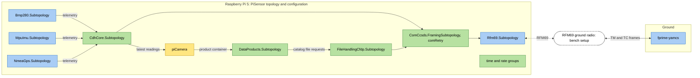
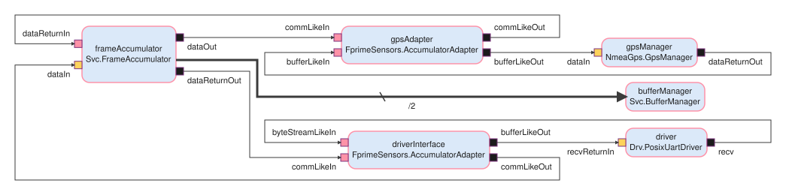

# PiSensor System Software Design Document

## Introduction

PiSensor is an F Prime deployment for a Raspberry Pi 5. It streams BMP280,
MPU6050 and NMEA GPS telemetry, and on command captures a Pi Camera picture
and stores it with location, attitude and temperature as one data product,
downlinked by CFDP. The link is an RFM69 packet radio; the ground system is
fprime-yamcs.

Colour key, used in the Overview diagram and every table: 🟩 F Prime (inherited from
`nasa/fprime`), 🟦 library (inherited from an F Prime library or ground
package), 🟨 new (built by this project).

## Requirements

| ID | Requirement | Verification |
|---|---|---|
| REQ-PiSensor-001 | Outside a CFDP downlink, the system shall downlink BMP280 temperature telemetry at least once every 2 s. | Integration Test |
| REQ-PiSensor-002 | Outside a CFDP downlink, the system shall downlink MPU6050 acceleration and angular rate telemetry at least once every 2 s. | Integration Test |
| REQ-PiSensor-003 | Outside a CFDP downlink and with a GPS fix, the system shall downlink NMEA GPS latitude and longitude telemetry at least once every 2 s. | Integration Test |
| REQ-PiSensor-004 | A capture command shall produce one Pi Camera JPEG picture of at least 640x480 pixels. | Integration Test |
| REQ-PiSensor-005 | Each capture shall store one data product holding the picture, latitude, longitude, roll, pitch and temperature. While the MPU6050 gives no reading within the bound of REQ-PiSensor-014, the product shall hold roll and pitch as placeholders marked not valid. | Integration Test |
| REQ-PiSensor-006 | Each data product shall carry its capture time and the sample time of each metric. | Integration Test |
| REQ-PiSensor-007 | The system shall store the data product within 30 s of receiving a capture command. | Integration Test |
| REQ-PiSensor-008 | On command, the system shall downlink every stored data product not yet downlinked, by CFDP class 2. | Integration Test |
| REQ-PiSensor-009 | A downlinked data product shall be byte-identical to the stored data product. | Integration Test |
| REQ-PiSensor-010 | Commands, telemetry, events and CFDP files shall pass between the Raspberry Pi 5 and the ground only through the RFM69 packet radio. | Integration Test |
| REQ-PiSensor-011 | Commands sent from fprime-yamcs shall execute, and telemetry, events and CFDP files shall arrive decoded in fprime-yamcs. | Integration Test |
| REQ-PiSensor-012 | During a CFDP downlink and with a GPS fix, the system shall downlink each telemetry item of REQ-PiSensor-001 to -003 at least once every 10 s. | Integration Test |
| REQ-PiSensor-013 | The system shall meet REQ-PiSensor-001 to -012 and -014 on a Raspberry Pi 5 under 64-bit Raspberry Pi OS 13 (Trixie). | Integration Test |
| REQ-PiSensor-014 | While REQ-PiSensor-001 to -003 are met, each metric in a data product that is marked valid shall have a sample time within 2 s of the capture time. | Integration Test |

## Architecture

### Overview

### Topology

These images are generated from the sketch and use the tool's own colours
(green outline: active component, pink: passive), not the colour key.

Sketch source: [`sketch/PiSensorSketch.fpp`](sketch/PiSensorSketch.fpp).

Subtopology <code>Bmp280.Subtopology</code>

> 
>

Subtopology <code>CdhCore.Subtopology</code>

> 
>

Subtopology <code>ComCcsds.FramingSubtopology</code>

> 
>
> 

> 
Subtopology <code>ComCcsds.SpacePacketFraming</code> (inside <code>ComCcsds.FramingSubtopology</code>)

>
> > 
> >
> 

>
> 

> 
Subtopology <code>ComCcsds.TmTcFraming</code> (inside <code>ComCcsds.FramingSubtopology</code>)

>
> > 
> >
> 

>

Subtopology <code>DataProducts.Subtopology</code>

> 
>

Subtopology <code>FileHandlingCfdp.Subtopology</code>

> 
>

Subtopology <code>MpuImu.Subtopology</code>

> 
>

Subtopology <code>NmeaGps.Subtopology</code>

> 
>

Subtopology <code>Rfm69.Subtopology</code>

> 
>

_Solid box: component instance (green outline active, pink passive). Dashed box: imported topology. Chevron: port declared by this topology. Thick line with `/N`: N parallel connections. Dashed line: connection that reaches inside an imported topology. Connections generated by connection patterns (command, events, telemetry, text events, time, health, parameters) are not drawn._

### Elements

One row per element: what it is, where it comes from, how it runs, what it
serves and what is known to be wrong with it. Instances inside a
subtopology are those of the subtopology as shipped, except
`CdhCore.tlmSend`, which the project override of `CdhCoreTlmConfig.fpp`
makes a `Svc.TlmPacketizer`. The sizing of everything sent over the radio
is in [`link-budget.md`](link-budget.md).

| Element | Class | Source | Function | Runs at | Boundary | Requirements (kind) | Verified by (observable) | Known defects | SDD |
|---|---|---|---|---|---|---|---|---|---|
| `PiSensor` topology and configuration | 🟨 new (topology) | this project | Wires the elements; sets inherited configuration (`PiSensor/project/config`): TM frame and aggregate size to fit one 255-byte radio packet with packet spanning, the telemetry packets and their rates (`PiSensor/Top/PiSensorPackets.fppi`, `TlmPacketizerCfg.fpp`), queue priorities telemetry 0, events 1, file 2 (0 served first), CFDP PDU size 148 bytes, product directory `dp`, four rate group ports, device paths, ground YAMCS CFDP service. Deployment input: the parameter file `PrmDb.dat`, built from `PiSensor/project/config/PrmDb.json` and placed in the working directory of the process (CFDP: one PDU per second, ACK timer 10 s) | — | Raspberry Pi 5, 64-bit Raspberry Pi OS | 012 (system), 013 (system) | 012: largest gap between sensor telemetry packets at the ground during a catalog downlink. 013: `CdhCore.version` events for the image; `/proc/device-tree/model` and `/etc/os-release` read over ssh for the platform | platform: run on the Raspberry Pi 5 bench, 2026-11-19 with the radio | — |
| `piCamera` | 🟨 new | this project | On a capture command: acquires one JPEG, reads the latest sensor readings and their times from the telemetry store, derives roll and pitch from the acceleration reading, writes one product container | Own thread, one capture at a time | Pi Camera on CSI | 004 (component), 005, 006, 007, 014 (set) | 004: `piCamera` component tests and the picture record of the downlinked product. 005, 006, 014: metric and time records of the downlinked product, decoded on the ground with the F Prime data product decoder and the deployment dictionary, against telemetry samples. 007: `cmdDisp.OpCodeDispatched` of the capture command to `dpWriter.FileWritten` | `imx708` (Camera Module 3) captured on the bench, 2026-11-19 | [SDD](../Components/PiCamera/docs/sdd.md) |
| `CdhCore.Subtopology` | 🟩 F Prime | fprime `devel@83221ba` | Command dispatch, events, telemetry packets (`Svc.TlmPacketizer` through the project override of `CdhCoreTlmConfig.fpp`) and the channel store, health | 10 Hz dispatcher; 1 Hz telemetry, events, health | — | 001, 002, 003, 005, 006, 007, 008, 011, 014 (set) | Sensor channels and events at the ground; `cmdDisp.NoOpStringReceived` | platform: run on the Raspberry Pi 5 bench, 2026-11-19 at `83221ba` (ran on the Pi at v4.4.2) | — |
| `ComCcsds.FramingSubtopology` | 🟩 F Prime | fprime `devel@83221ba` | Queues (telemetry before events before file data), space packets, TM and TC transfer frames, routing | 10 Hz queue; a full frame is sent at once, a partial frame once per second (`rateGroup1HzFlush`); 1 Hz buffers | — | 010, 011 (set) | Over a window, TM frames received by YAMCS do not exceed the `rfm69Manager.PacketsTransmitted` increase and commands executed do not exceed the `PacketsReceived` increase; commands executed | A packet larger than one aggregate asserts unless packet spanning is set. platform: run on the Raspberry Pi 5 bench, 2026-11-19 at `83221ba` and under the radio | — |
| `DataProducts.Subtopology` | 🟩 F Prime | fprime `devel@83221ba` | Product buffers, writer and catalog; the catalog downlinks products not yet sent | 1 Hz writer, manager, buffers | Pi 5 file system, directory `dp` under the working directory | 005, 007, 008 (set) | `dpWriter.FileWritten`, `dpCat.CatalogXmitCompleted` events | platform: run on the Raspberry Pi 5 bench, 2026-11-19 at `83221ba` | — |
| `FileHandlingCfdp.Subtopology` | 🟩 F Prime | fprime `devel@83221ba` | CFDP class 2 file transfer in PDUs of at most 148 bytes (128 file bytes), one PDU per second; file manager; parameters, loaded from `PrmDb.dat` at start | 1 Hz | Ground CFDP entity | 008, 009 (set) | YAMCS transfer record; `fileManager.CalculateCrcSucceeded` event against the CRC of the ground file | Transaction numbers restart at 1 after a restart, which YAMCS can match to an old transfer. platform: run on the Raspberry Pi 5 bench, 2026-11-19 at `83221ba` (ran on the Pi at v4.4.2) | — |
| `comRetry` | 🟩 F Prime | fprime `devel@83221ba` | Holds a frame until the radio is free and sends it again when the radio refuses it | On each frame | — | 010 (set) | Over a window, TM frames received by YAMCS do not exceed the `rfm69Manager.PacketsTransmitted` increase and commands executed do not exceed the `PacketsReceived` increase | platform: run on the Raspberry Pi 5 bench, 2026-11-19 at `83221ba` | — |
| `posixTime`, `linuxTimer`, `rateGroupDriver`, `rateGroup1KHz`, `rateGroup10Hz`, `rateGroup1Hz`, `rateGroup1HzFlush` | 🟩 F Prime | fprime `devel@83221ba` | Time and periodic scheduling | 1 kHz; 10 Hz; 1 Hz, 50 ms after the 10 Hz cycle; 1 Hz, 300 ms after it (`rateGroup1HzFlush`) | Pi 5 clock and timer | 001, 002, 003, 006, 014 (set) | Channel and product times | platform: run on the Raspberry Pi 5 bench, 2026-11-19 at `83221ba` | — |
| `Bmp280.Subtopology` | 🟦 library | fprime-sensors `e5d83d1` | Reads BMP280 temperature | 10 Hz | BMP280 on SPI; SPI bus 0, chip select 0 on the bench | 001, 005, 014 (set) | `bmpManager.Reading` | `Bmp280.BmpManager` has no unit tests at `e5d83d1`. platform: run on the Raspberry Pi 5 bench, 2026-11-19 | — |
| `MpuImu.Subtopology` | 🟦 library | fprime-sensors `e5d83d1` | Reads MPU6050 acceleration and angular rate | 10 Hz | MPU6050 on I2C bus 1, address 0x68 | 002, 005, 014 (set) | `imuManager.Reading` | platform: run on the Raspberry Pi 5 bench, 2026-11-19 at `83221ba` (ran on the Pi at v4.4.2) | — |
| `NmeaGps.Subtopology` | 🟦 library | fprime-sensors `e5d83d1` | Reads NMEA sentences and reports latitude and longitude | UART receive thread | GPS receiver sending one position per second; USB receiver at `/dev/ttyACM0` on the bench | 003, 005, 014 (set) | `gpsManager.Reading` | platform: run on the Raspberry Pi 5 bench, 2026-11-19 | — |
| `Rfm69.Subtopology` | 🟦 library | fprime-sensors `e5d83d1` | Sends and receives one buffer of at most 255 bytes per radio packet | 1 kHz | RFM69 on SPI0 CE1 | 010 (set) | Over a window, TM frames received by YAMCS do not exceed the `rfm69Manager.PacketsTransmitted` increase and commands executed do not exceed the `PacketsReceived` increase | platform: run on the Raspberry Pi 5 bench, 2026-11-19 | — |
| fprime-yamcs | 🟦 library | fprime-yamcs `f6f0e19` | Ground commanding, telemetry, events, CFDP entity | — | Ground host | 008, 009, 011 (set) | Decoded parameters, events, transfer records and files | No CFDP service configured as shipped; needs `fprime-yamcs-bundle` 5.13.7.0, which is not on PyPI |

All 🟩 rows are built from [`nasa/fprime@83221ba`](https://github.com/nasa/fprime/commit/83221ba82a) (`devel`, v4.4.0-98),
unmodified. Kinds: `component`, one element decides it by its own tests; `set`, the
rows citing it decide it together in a system test; `system`, a property
of the whole deployment. Link rows carry 010 and 011
only; the traffic of the other requirements passes through them.
`platform: run on the Raspberry Pi 5 bench, 2026-11-19` marks an element not yet run on the Raspberry Pi 5
in this role.

Wiring this topology adds between the elements. A row that names an
instance inside a subtopology is wiring this topology owns: the
subtopology exports no port for it.

| From | To | Purpose |
|---|---|---|
| `piCamera` | `CdhCore.tlmSend.TlmGet` | Read the latest BMP280, MPU6050 and GPS readings with their times |
| `piCamera` | `DataProducts.Subtopology` product get and send ports | Get the container buffer, synchronously; send the filled container |
| `DataProducts.Subtopology.dpCatFileOut` | `FileHandlingCfdp.cfdpManager.fileIn` | Catalog sends each product by CFDP |
| `FileHandlingCfdp.cfdpManager.fileDoneOut` | `DataProducts.Subtopology.dpCatFileDone` | Catalog learns each transfer ended |
| `NmeaGps.driver` buffer ports | `NmeaGps.bufferManager` | Supply and return UART receive buffers |
| `ComCcsds.FramingSubtopology` frame ports | `comRetry`, then `Rfm69.rfm69Manager` | TM frames to the radio, sent again when the radio refuses one |
| `Rfm69.rfm69Manager` | `ComCcsds.FramingSubtopology` | TC frames from the radio |
| `CdhCore` events and telemetry packets, `FileHandlingCfdp.cfdpManager` | `ComCcsds.FramingSubtopology` queue and router ports | Events, telemetry, commands and CFDP data share the link; the queue serves telemetry first, then events, then file data |
| `rateGroup1HzFlush` | `ComCcsds.aggregator.timeout` | Sends the frame holding the telemetry packets of each second, 250 ms after they are made |
| `Rfm69.rfm69Manager`, `FileHandlingCfdp.cfdpManager` buffer ports | `ComCcsds.commsBufferManager` | Radio receive and CFDP PDU buffers from the comms pool |

## Red flags

None. No inherited source is changed. Defects noted in the Elements table
are recorded in the ledger for upstream reports.

## Tests

Derived from `test/int/stimulus/plan.json` by `fth render-sdd-tests`.

<!-- fth:tests:begin -->
_Generated by `fth render-sdd-tests` from the plan — do not edit by hand; the package renderer fails when this table and the plan disagree._

| Test | Purpose | Requirements |
|---|---|---|
| L0-1 | Proves the image is the manifest's, on a Pi 5, reached only by RFM69. | REQ-PiSensor-013, REQ-PiSensor-010 |
| L0-2 | Proves the marker command round-trips, so later windows can be bracketed. | REQ-PiSensor-013 |
| L2-1 | Proves every sensor channel arrives at the ground at least every 2 s. | REQ-PiSensor-001, REQ-PiSensor-002, REQ-PiSensor-003, REQ-PiSensor-011 |
| L2-2 | Proves the 2 s telemetry period holds while commands are dispatched. | REQ-PiSensor-001, REQ-PiSensor-002, REQ-PiSensor-003, REQ-PiSensor-011 |
| L2-3 | Proves one capture stores one complete product, delivered byte-identical by CFDP class 2. | REQ-PiSensor-004, REQ-PiSensor-005, REQ-PiSensor-006, REQ-PiSensor-007, REQ-PiSensor-008, REQ-PiSensor-009, REQ-PiSensor-011, REQ-PiSensor-014 |
| L2-4 | Proves two captures store two products and the catalog downlinks both. | REQ-PiSensor-004, REQ-PiSensor-005, REQ-PiSensor-006, REQ-PiSensor-007, REQ-PiSensor-008, REQ-PiSensor-009, REQ-PiSensor-014 |
| L2-5 | Proves the metrics stored in a product are the sensor readings downlinked around its capture. | REQ-PiSensor-005, REQ-PiSensor-006, REQ-PiSensor-014, REQ-PiSensor-008 |
| L2-6 | Proves three captures in a row each store their product within 30 s. | REQ-PiSensor-004, REQ-PiSensor-007 |
| L2-7 | Proves sensor telemetry continues every 10 s during a downlink. | REQ-PiSensor-012, REQ-PiSensor-008, REQ-PiSensor-009, REQ-PiSensor-010, REQ-PiSensor-011 |
| L2-8 | Proves telemetry continues and a command is served during a downlink. | REQ-PiSensor-012, REQ-PiSensor-010 |
| L7-1 | Leaves one known product on board for the independent final-state check. | REQ-PiSensor-009, REQ-PiSensor-005, REQ-PiSensor-008 |
<!-- fth:tests:end -->
